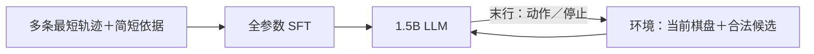

# 积木 1.5B 无地图动作 SFT 基线方案

首轮用 **Qwen2.5-1.5B-Instruct 做全参数 SFT**，检验任务微调能否提升积木求解表现。

- **模型输入：**规则、目标棋盘、当前棋盘、已执行动作、全部合法候选；不提供认知地图。
- **模型输出：**每轮先写一句动作依据，再选一个动作，环境执行后给出新状态；到达目标时说明已达标并停止。
- **监督来源：**同题采样多条经求解器认证的合法最短轨迹，替代候选编号增强；每条轨迹拆成“简短依据＋动作”的多轮标签。
- **数据规模：**每 epoch 使用 50,000 条完整多轮样本，沿用 3 epoch；不把一个决策轮计作一条数据。

## 1. 实验怎样运行



**一次选一个动作，整题通过多轮交互完成。** 环境负责执行、更新棋盘和列出合法候选；模型根据新状态选择下一步。这里的“动作序列”指各轮输出连成的序列。

求解器只在离线制作标签、认证最短解和评测时使用。运行中的模型不调用求解器，也不会收到最短距离、推荐动作或后继可达性。

| 对照条件 | 训练方式 | 每轮信息 |
|---|---|---|
| 无地图动作 SFT（本方案） | 全参数微调 1.5B | 棋盘、目标、历史、全部合法候选 |
| 未微调同基座 | 不训练 | 与 SFT 相同，使用相同输出格式 |
| 现有地图接口系统 | 冻结 LLM／地图，训练接口 | 上述信息＋认知地图 |

地图接口沿用原答案格式，对照时提取实际动作和终止结果。

SFT 与未微调同基座的差异用于衡量任务微调收益。与地图接口的比较属于系统比较：训练范围和监督也不同，不能把全部收益单独归因于地图。

## 2. 模型实际收到什么、输出什么

### 2.1 输入和输出约定

沿用[现有积木题面与环境更新格式](../experiments/flamingo_map_reader/src/blocks_prompt.py)：

1. **首轮：**任务规则、八种形状、初始棋盘、目标棋盘、输出格式，以及当前环境状态。
2. **后续轮：**完整 10×10 当前棋盘、实际执行历史、全部合法候选；保留前面各轮的对话。
3. **assistant：**固定两行：第一行 `Reason: ...`，写一句依据；第二行 `<action>ID</action>` 或 `<done/>`。两行都作为训练标签。

**依据写在动作前面，**让自回归生成动作时能利用已生成的说明。每句写清所选动作移除的具体格子、是否保留目标格，以及剩余棋盘能否继续完成。这里“离目标更近”指剩余最短移除次数减少 1；单纯少了几个格子不能证明选择正确。

短句由真实状态转移和精确求解结果生成，采用下文示例中的三种固定句式：仍需继续、此次到达、已经到达。具体格子按行列顺序填写，两格或三格用 ` and ` 连接。是否提升解题表现由任务指标判断，解释流畅本身不构成证据。

环境只解析末行唯一的动作／停止标记，不依据说明选择、补全或修复动作。说明缺失或事实错误单列记录；动作结果仍按真实执行评测。

每轮全部合法候选按 `(shape_id,row,col)` 排序后从 1 编号，不额外打乱或复制编号版本。编号只在当前轮有效；它对应真实的 `remove(shape_id,row,col)` 动作。合法候选只表示几何上能执行，仍可能进入死局，因此必须全部呈现，不能用求解器预先过滤。输入不包含地图向量、K/V、距离、排名或最优标记。

**停止条件是当前棋盘精确等于目标。** 初始已达目标的题输出一句达标说明和 `<done/>`；即使目标非空且还有合法移除动作，也应停止。

### 2.2 完整三轮示例

这是一个用于说明格式的两步小题，不代表正式训练题的难度或长度。初始棋盘的第一行有连续四格，右下角一格必须保留。选择两次水平二格移除，最后停止。

下面每个 `user` 文本框都表示一条完整输入消息；`assistant` 文本框是该轮的监督答案。英文题面沿用现有实验。

#### 第 1 轮：读取题目，选择第一次移除

**user 输入**

```text
Find a valid sequence of removals from the initial board to the goal board, as short as you can.
Reaching the goal is the first priority; among valid solutions, prefer fewer moves.

Rules: The board is a 10x10 binary grid. 1 means occupied and 0 means empty.
An action remove(shape_id,row,col) removes one listed shape at its zero-based top-left anchor.
Every occupied shape cell must overlap a currently occupied board cell and lie inside the board.
Only those cells are removed. Empty shape cells impose no constraint.
Use only the listed orientations. Shapes may be reused; there is no gravity or inventory limit.
Reach the goal board exactly, including any occupied cells that must remain.
Shapes (/ separates rows): 0=11/10; 1=10/11; 2=11/01; 3=01/11; 4=1/1; 5=11; 6=1/1/1; 7=111

Initial board:
1111000000
0000000000
0000000000
0000000000
0000000000
0000000000
0000000000
0000000000
0000000000
0000000001

Goal board:
0000000000
0000000000
0000000000
0000000000
0000000000
0000000000
0000000000
0000000000
0000000000
0000000001

Response format:
Output exactly two lines: a short reason, then one control tag.
If the current board exactly matches the goal, explain this in one sentence beginning with "Reason:", then output <done/> on the second line.
Otherwise, choose one legal candidate from the current update. On the first line, beginning with "Reason:", state which cells it removes, whether goal cells are preserved, and how it advances a valid completion. On the second line, output <action>ID</action>.
Use one of these reason sentences. Replace CELLS with the removed occupied cells as (row,col), ordered by row then column and joined by " and ".
If the removal leaves a board that still needs solving: Reason: Clearing CELLS is legal, preserves all goal cells, and leaves a solvable board with one fewer removal needed.
If the removal reaches the goal: Reason: Clearing CELLS is legal and leaves exactly the goal board.
If already at the goal: Reason: The current board exactly matches the goal; no further removal is needed.
Do not output candidate rankings or a multi-step plan.

[Environment update]
Current board:
1111000000
0000000000
0000000000
0000000000
0000000000
0000000000
0000000000
0000000000
0000000000
0000000001
Actual executed actions: (none)
Legal next moves:
1: remove(5,0,0)
2: remove(5,0,1)
3: remove(5,0,2)
4: remove(7,0,0)
5: remove(7,0,1)
Candidate numbers may change between turns; use only the numbers above.
[/Environment update]
```

**assistant 监督答案**

```text
Reason: Clearing (0,0) and (0,1) is legal, preserves all goal cells, and leaves a solvable board with one fewer removal needed.
<action>1</action>
```

环境执行 `remove(5,0,0)`，移除 `(0,0)`、`(0,1)`，再发送更新后的棋盘。

示例说明：首轮候选 1 和 3 都能在两步内完成；候选 2、4、5 虽然合法，却会留下无法继续移除的孤立格。上文展示采样轨迹之一，首轮选候选 1；也可首轮选候选 3，见第 3.2 节。上述候选比较用于读者理解，不写入模型输入或监督答案。

#### 第 2 轮：根据新棋盘选择第二次移除

**user 输入**（前面的题目和对话仍保留在上下文中）

```text
[Environment update]
Current board:
0011000000
0000000000
0000000000
0000000000
0000000000
0000000000
0000000000
0000000000
0000000000
0000000001
Actual executed actions: remove(5,0,0)
Legal next moves:
1: remove(5,0,2)
Candidate numbers may change between turns; use only the numbers above.
[/Environment update]
```

**assistant 监督答案**

```text
Reason: Clearing (0,2) and (0,3) is legal and leaves exactly the goal board.
<action>1</action>
```

这次编号 1 对应 `remove(5,0,2)`，移除 `(0,2)`、`(0,3)`。两轮编号相同，实际动作不同。

#### 第 3 轮：确认到达目标并停止

**user 输入**

```text
[Environment update]
Current board:
0000000000
0000000000
0000000000
0000000000
0000000000
0000000000
0000000000
0000000000
0000000000
0000000001
Actual executed actions: remove(5,0,0) -> remove(5,0,2)
Legal next moves:
(none)
Candidate numbers may change between turns; use only the numbers above.
[/Environment update]
```

**assistant 监督答案**

```text
Reason: The current board exactly matches the goal; no further removal is needed.
<done/>
```

本题的完整训练样本包含上述三轮对话。各轮依据、动作／停止标记及 assistant 结束 token 都计算损失；题面、棋盘、候选和 padding 不计算损失。

## 3. 监督数据怎样制作

### 3.1 使用哪些题

复用[当前积木合同](../experiments/flamingo_map_reader/configs/blocks_kv_restart.json)对应的物理题和固定划分，重新制作动作标签。

| 来源 | 本轮处理 |
|---|---|
| 8,000 普通训练题 | 每题采样多条合法最短轨迹，共 49,000 条 |
| 1,000 初始已达目标题 | 每题一轮达标说明＋`<done/>` |
| 1,000 固定失败历史 | 不加入本轮最短解监督 |
| 普通 validation／test | 保持原划分；普通 test 为 510 题，保留原初始棋盘新任务／新初始棋盘分组 |
| 已达标 100 题 | 源合同属于 validation，单列停止评测 |

实施前核对实际清单和正式源路径，不能用历史 preview 替代。原题经过地图贪心成功筛选，这一选题偏差需披露；本轮只换标签，不重新选题。

### 3.2 怎样采样多条合法最短轨迹

**随机选择的是最优动作分支，输入仍显示全部合法候选。** 精确求解器用于认证最短性，采样用于选择不同最短解及执行顺序：

1. **计算最短距离。**确认目标格均属于初始占据格，对“当前减目标”调用[精确覆盖求解器](../experiments/gcml_counterexamples/src/blocks.py)，得到最少剩余移除次数，记为 `d(当前棋盘)`；到达目标时距离为 0。
2. **逐步随机选动作。**离线枚举合法动作，仅将保留全部目标格、且满足 `d(动作后棋盘) = d(当前棋盘) - 1` 的动作加入采样池。每步从池中等概率选一个，执行后继续，直到目标。这保证每条采样轨迹合法且最短；不宣称所有完整轨迹等概率。
3. **去重并补足配额。**按有序物理动作序列 `(shape_id,row,col)` 去重。不同移除组合或同一组合的不同执行顺序都算不同轨迹，改编号不算。每题最多尝试其配额的 20 倍；预算内不同轨迹不足时，从已验证轨迹中有放回补足，并记录重复数，不能宣称已穷尽全部解。
4. **回放并生成标签。**逐条独立验证合法性、目标保留、终局和最短动作数；重新生成每轮全部合法候选与编号，填写依据和动作，追加达标说明与停止轮。用[精确距离裁判](../experiments/blocks_distance_map/src/oracle.py)核对距离逐步减 1。说明不写具体距离数值，求解结果不加入 user 输入。

同题共享精确距离缓存，避免每条轨迹重新求解。求解超时记 unknown，在全量制作前解决；不把超时当无解，不用次优路线填配额。当前求解器只返回一条见证，实施时需增加上述最优分支采样，不能只反复调用同一确定性入口。

第 2 节的小题可以采到这两条最短轨迹：

| 轨迹 | 物理动作序列 | 各轮控制标签 |
|---|---|---|
| A：先左后右 | `remove(5,0,0)` → `remove(5,0,2)` | `<action>1</action>` → `<action>1</action>` → `<done/>` |
| B：先右后左 | `remove(5,0,2)` → `remove(5,0,0)` | `<action>3</action>` → `<action>1</action>` → `<done/>` |

两条轨迹的中间棋盘、移除格说明和首轮标签都不同。每条都生成完整对话；同一输入可对应多个同样正确的动作，评测不要求复现某条标签。

### 3.3 每个 epoch 的 50,000 条怎样组成

| 样本 | 配额 | 合计 |
|---|---|---|
| 普通题的基础轨迹 | 8,000 题各 6 条 | 48,000 |
| 普通题的额外轨迹 | 固定采样种子从上述 8,000 题中等概率选 1,000 题，各加 1 条 | 1,000 |
| 零步题 | 1,000 题各 1 条 | 1,000 |
| **总计** | **7,000 道普通题各 6 条、1,000 道各 7 条，零步题各 1 条** | **50,000** |

**一条数据是一条完整多轮轨迹，包含最终停止轮。** 50,000 是训练清单条数，包含必要的补位重复，不能写成 50,000 条互不相同的轨迹或 50,000 道物理题。全量制作后报告各题不同轨迹数和补位重复数。

离线固定这份 50,000 条训练清单，3 个 epoch 各遍历一遍、打乱顺序，共 150,000 条样本呈现；首轮不在 epoch 之间重采。额外配额、轨迹采样和训练顺序使用固定并记录的种子。数量以当前 8,000／1,000 源清单为前提，若核对不符，先修订配额再运行。

### 3.4 数据隔离与保存

- **划分隔离：**同题所有轨迹留在同一 split。检查全部新轨迹的非终止 `(状态,目标)` 是否与留出输入重合，固定测试题并更新实际曝光分组；共有终局不等于整题泄漏，零步完全同题重合单列。
- **留出集：**validation／test 不做训练式多条扩充；每题固定一条参考最短轨迹用于单步评测，整题交互仍从原初始状态出发。
- **保存内容：**题目来源、配额、物理轨迹、状态、候选编号映射、最短认证、不同轨迹数、补位标记和种子。生成数据与缓存放 Git 外。

## 4. 怎样训练

### 4.1 已定训练起点

从原始 Qwen2.5-1.5B-Instruct 做全参数微调，不使用地图接口或 LoRA，不跨题 packing。用户确认使用 4090 的 1–4 号卡，每卡一条完整轨迹，global batch=4，无梯度累积。

学习率、调度、精度与训练预算以 [SFT 合同](../experiments/llm_task_sft/configs/blocks_reason_bs4.json) 为准。先用最长样本检查显存；每 epoch 保存完整模型并同步到评测平台做 validation，训练继续下一轮。当前平台连接见 [开发机手册](../DEVELOPMENT_MACHINES.md)，训练入口与输出说明见 [实验 README](../experiments/llm_task_sft/README.md)。

**每个物理题保持相同训练权重：**先平均一条轨迹内的监督 token 损失，再平均同题采样轨迹，最后平均物理题。这样，轨迹更多的普通题不会挤低零步题权重。

当前 N = 9,000、M = 50,000，题 i 的清单条数 n_i 为普通题 6／7 或零步题 1，含补位重复。对轨迹平均损失乘固定权重 `M/(N*n_i)`，再做 batch 平均；不按 batch 内权重和再次归一化。每 epoch 遍历全部 50,000 条，不丢弃最后不足 batch 的样本。

### 4.2 长度和交互预算

| 上限 | 如何确定 |
|---|---|
| 训练序列长度 S | 用真实 tokenizer／chat template 统计完整多轮训练样本，以最大长度确定 |
| 每轮生成长度 G | 统计完整两行响应（依据＋动作／停止）的实际 token 长度，包含结束 token；用 validation 检查触顶后固定 |
| 执行动作数 | 最多 32 个动作，另允许到达后的停止轮 |

S 不能裁掉后续动作或停止标签；推理时累计上下文＋G 也须在原生上下文内。若超限，实施前处理并记录，不能静默截断或删题。未微调与 SFT 使用相同 G，不用 test 调预算。

### 4.3 现有实现怎样复用

- **可复用：**环境规则、候选编号、多轮消息拼接，以及将 user token 设为 -100 的思路。
- **需要改：**普通 causal LM 入口、全参数更新、完整模型保存与重载、两行响应的控制标记解析和执行评分；移除地图加载与 token-map 分配。

旧 `MapReader` 冻结基座，旧 trainer 只保存 `adapter.pt`，旧评分依赖排序和自然语言总结。因此，正式实施时需要调整训练和评测入口，不能只改提示词。

## 5. 怎样评测

### 5.1 两种评测方式

**整题交互（rollout）：**从固定初始棋盘出发，执行模型自己选的动作，回报真实棋盘，直到停止、失败或用完 32 个动作。保留模型自身回答，衡量实际解题能力。

**固定状态单步评测（reference）：**给模型固定最短参考轨迹中的历史和当前棋盘，让它选择一次动作。下一轮接入正确参考动作及对应说明，避免本轮错误改变后续输入；当前答案不能提前放进输入。

两种方式都每轮只做一次贪心生成，不重采、不修复动作、不提供求解器建议。

### 5.2 主要指标

| 指标 | 计分方式 |
|---|---|
| 轨迹到达率（主指标） | 32 动作内曾精确到达目标的普通题数 ÷ 全部普通题数 |
| 到达且正确停止率 | 到达后正确输出 `<done/>` 的普通题数 ÷ 全部普通题数 |
| 单步可达率 | 固定状态评测中，合法选择且后继仍可解的轮数 ÷ 作答前可解的非终止轮数 |
| 辅助指标 | 单步最优率、非法／控制格式错误、提前停止、生成触顶及 token 数；零步停止正确率、说明格式和事实错误单列 |

单步最优指动作令剩余最短距离减少 1。多个动作可能同样最优，按真实状态和精确距离评分，不要求与某条采样轨迹的标签编号一致。

单步可达与合法不同：几何合法仍可能破坏可解性。提前停止、编号越界和控制格式错误在原本可解的决策轮计失败。整题交互中的单步可达率另列，并记录已死局轮数。

说明评测按固定句式提取移除格和“仍可解／已达标”主张，再用实际动作与精确裁判核验。未匹配句式记说明格式错误，不猜测自由文本含义；不以“模型说合法、说更近”判成功。说明错误不替代实际动作指标。

失败处理明确如下：

- 未到目标且无合法候选：结束并记失败。
- 非法动作或控制标记缺失、重复、格式错误：不执行，结束并保留失败计数；有效控制标记对应的动作可执行，说明问题单列。
- 到达目标：再给一个停止轮；即使未正确停止，也分别记录“已到达”和“停止失败”。

### 5.3 选模和对照

每 epoch 末评固定 validation，并评与地图线相同的 510 道普通 test 题，每轮均保存 reference 和 rollout。按 validation 的普通轨迹到达率选 checkpoint；平分时看到达且正确停止率，再平分选较早 checkpoint。选模不使用 test，最终报告复用选定轮次已完成的 test。

训练和留出集都使用第 2.1 节的固定候选编号规则。与地图接口比较时，题目、候选编号和动作预算一致；固定状态评测还须使用相同状态及历史，必要时重评接口，不能直接拿不同编号或参考轨迹的旧均值作对照。本基线不评价排序、地图最优率或 NDCG。

## 6. 实施顺序与完成条件

1. **核对源数据。**固定题目清单、split、来源、候选编号及 50,000 条配额。
2. **制作 32 题试样。**固定 32 道训练题，验证最优分支采样、轨迹去重和补位、状态回放、编号映射、短句依据与停止标签；记录不同轨迹数、unknown 和求解成本。
3. **实现训练和评测入口。**确认 mask、轨迹权重、参数更新和完整模型重载正确；小量题能过拟合，评分不依赖排序文本。
4. **制作全量标签，测长度和资源。**形成固定 50,000 条清单，确定 S、G、显存、吞吐及 batch／累积设置；明确处理未解决题和曝光冲突。
5. **提交正式配置后运行。**训练 3 epoch，每 epoch 50,000 条；validation 选模，固定 test 保存原始回答与逐步执行结果。

配置和实现已位于 `experiments/llm_task_sft/`；正式参数以配置为权威，运行进展只维护 [项目状态页](PROJECT_STATUS_AND_TODO.md)。

7B、寻路、强教师生成长解释和完整 CoT SFT 留待后续讨论。
