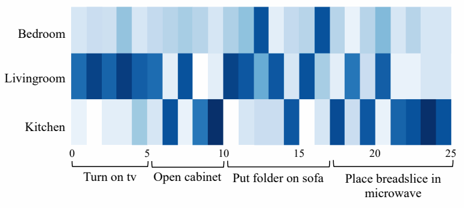

# WorMI 精读分享：把多个领域模型接入冻结 LLM

**World Model Implanting for Test-time Adaptation of Embodied Agents**
Minjong Yoo、Jinwoo Jang、Sihyung Yoon、Honguk Woo · ICML 2025
[正式论文](https://proceedings.mlr.press/v267/yoo25a.html) · [arXiv 全文](https://arxiv.org/html/2509.03956v1) · [作者代码](https://github.com/mjyoo2/WorMI)

**核心结论：**WorMI 先用已见领域的轨迹分别训练小型 LLM，再按当前环境选出几个模型，通过两级 cross-attention 把它们的隐藏表示接入冻结的推理 LLM。在两个家庭任务 benchmark 的留出任务／场景上，这种组合优于论文所比较的基线。对我们最直接的参考是表示接口的设计；它尚不能回答显式状态地图为何、何时能改善规划。

正文沿论文的“动机 → 检索 → 融合 → 训练 → 实验 → 分析”展开。末尾附讨论备忘，集中补充实现差异和容易追问的细节。以下数值来自原论文，未运行复现实验。

## 1. 动机：如何复用已有模型的领域知识？

一个家庭 agent 可能会执行“把苹果放进冰箱”，换了房间布局、物体位置或任务组合后却失败。作者关注的是：**能否保留通用 LLM 的推理能力，在部署时接入合适的领域知识，而不用为每个新环境重训整套模型？**

*图 1｜按右下角理解 WorMI：可替换的是外部模型，compound attention 负责把它们接入 LLM。图源：Yoo 等，原论文 Fig. 1。*

论文先比较两条已有路径：把相关示例放进 prompt，灵活但增加检索和上下文开销；把一个领域模型固定接进策略，可以利用专门知识，但适配范围受这个模型限制。WorMI 希望兼有二者：**从模型库中检索，再在隐藏表示层面组合。**这是作者的动机，并不意味着所有示例检索或模型集成方法都必然存在这些缺陷。

与之最接近的结构先例是 CALM：用 cross-attention 连接两个模型。WorMI 在这条思路上加入多 WM 检索、两级融合和组合模块的元学习。因此，贡献应理解为一套面向领域适配的组合机制，而非首次提出跨模型 attention。[原文 §1–2](https://arxiv.org/html/2509.03956v1#S1)

<!-- pagebreak -->

## 2. 总体框架：先训练知识来源，再学习如何调用

*图 2｜左侧决定调用哪些 WM；右侧决定如何利用它们。推理 LLM 的原始参数保持冻结。图源：原论文 Fig. 2。*

### WM 从哪里来，究竟学什么？

这里的 **world model（WM）是以 Llama-3.2-1B 为底座微调的领域模型**，不是显式状态图，也不是视频生成器。每个模型 Mⱼ 对应一份领域轨迹 Dⱼ，样本包含任务指令 I、当前状态 sₜ、动作 aₜ 和后继状态 sₜ₊₁。论文定义三种训练任务：

| 训练任务 | 输入 → 目标 | 学到的知识 |
|---|---|---|
| Dynamics，转移动力学 | 当前状态、动作 → 后继状态 | 做了之后会怎样 |
| Affordance，动作可行性 | 当前状态 → 可行动作 | 现在可以做什么 |
| Behavior cloning，行为克隆 | 指令、当前状态 → 示范动作 | 为了目标应做什么 |

所以它既学习状态转移，也学习动作选择。仅凭最终任务成绩，无法把收益全部归因于“更准确的世界模型”。推理模型则是冻结的 **Llama-3.2-3B**；后续学习的是连接它和 WM 的组合模块 Cθ。[原文 §3.1–3.2、表 A.6](https://arxiv.org/html/2509.03956v1#S3.SS2)

**数据来自对应 benchmark 的已见领域轨迹。**作者报告 VirtualHome 共 1,023 条 episode、ALFWorld 共 3,554 条 episode；这些是收集数据的总量，不能说成每个 WM 的训练量。正文没有完整列出正式六个 WM 各自对应哪些域、用了多少条轨迹。公开 README 的四类房间是配置示例，也不是正式六模型名单。

### 一次动作决策怎样发生？

当前观测 → 检索相关 WM → WM 和推理 LLM 处理输入 → 提取指定层的隐藏表示 → 两级 attention 融合并注入 → LLM 输出动作 → 环境执行并返回新观测。论文 Algorithm 1 在每个环境步重新检索；WM 的内容通过表示接口进入策略，不需要先生成一段“预测报告”再贴回 prompt。[原文 Algorithm 1](https://arxiv.org/html/2509.03956v1#A3.SS2)

<!-- pagebreak -->

## 3. Prototype 检索：为每个 WM 保存一份数据摘要

**Prototype 是一小组代表性状态嵌入，用来概括一个 WM 训练数据里出现过的环境内容。**它不是 WM 的权重、不是一个可执行模型，也不是“该领域的平均轨迹”。

论文的过程有四步：

1. 把训练轨迹中的状态拆成 object-wise states，即围绕物体及其状态／关系的信息，再编码成向量集合 Eⱼ。
2. 用 **k-center** 选择 k 个代表点：尽量让任意原始向量到最近代表点的距离都不太大。这样保存多样性，避免大量重复物体占据表示。
3. 对当前观测构造同类摘要 p，计算它与各 WM 摘要 pⱼ 的 **Wasserstein 距离**，即把两组向量视作分布，衡量匹配它们需要多大搬运代价。
4. 选择距离最小的 K 个 WM，进入后面的融合模块。

**三个数字不要混：N = 6 是模型库大小，K = 3 是本次调用的模型数，k = 15 是每个 prototype 集合中的代表点数。**正文曾把 15 写成大写 K；表 A.6 将三者分开列出，报告采用该表的记号。[原文 §3.2、表 A.6](https://arxiv.org/html/2509.03956v1#S3.SS2)

例如，当前观测中出现苹果、冰箱及其位置关系，检索器寻找的是训练状态分布与之接近的 WM。**相近的数据摘要只说明“可能相关”，并不保证模型预测正确。**检索分数也不是后面 attention 的权重：检索先筛模型，attention 再按当前隐藏表示分配信息权重。

### 为什么不用全部训练状态直接匹配？

VirtualHome 的一个嵌入集合规模为 10,200，压成 15 个点约为原来的 0.15%。附录 A.11 比较完整嵌入检索与 prototype 检索：SR 为 66.54%／66.12%，报告的推理时间为 811／385 ms。它支持“压缩检索代价、基本保住成绩”的作用。[原文表 A.11](https://arxiv.org/html/2509.03956v1#A4.SS5)

论文还给出距离上界：prototype 距离不超过原集合距离加 2ρ，其中 ρ 是代表点的覆盖半径。这个结果说明近似距离可受覆盖误差约束，**没有证明 Top-K 排名一定不变，更没有保证选出的 WM 对目标任务最优。**理解主方法不必先推完该证明。

**实现补充。**当前公开代码的 `ModelStore` 使用 KMeans，而论文写的是 k-center；两者的优化目标不同。报告按论文解释方法，复现时应先确认正式实验到底采用哪一版。[作者代码](https://github.com/mjyoo2/WorMI/blob/96a2375ad7e96e75073f478bd37462f931dc39bc/wormi/model_store.py#L33)

<!-- pagebreak -->

## 4. Compound attention：先在模型间融合，再给 LLM 读取

*图 3｜从下往上读：投影 → world-level attention → reasoning-level attention → 残差注入。右侧的推理表示为两级 attention 都提供 Query；左侧 Sum 为第二级提供 Key。图源：原论文 Fig. 3。*

记 H 为推理 LLM 的某层输出，Xⱼ 为第 j 个 WM 在连接层的输出，Zⱼ = Lθ(Xⱼ) 为维度对齐后的 WM 表示。Query 决定查找什么，Key 用于匹配，Value 是匹配后取回的内容。

| 阶段 | Query 来自哪里 | Key 来自哪里 | Value 来自哪里 |
|---|---|---|---|
| World-level | 推理表示 H | 各个 Zⱼ 经投影 | 各个 Zⱼ |
| Reasoning-level | 推理表示 H | 各个 Zⱼ 的逐位置求和，再投影 | 第一级融合结果 U，再投影 |

第一级得到融合表示 U；第二级让 LLM 按自身的查询读取 U，得到 Cθ。最终执行 **H′ = H + Cθ**，继续后面的计算。这里的 implant 指把外部信息加进隐藏表示，不是把 WM 参数拷进 LLM。[原文式 (5)–(8)](https://arxiv.org/html/2509.03956v1#S3.SS3)

<!-- pagebreak -->

### 用“苹果／桌子”走完两次 attention

假设输入是“把苹果放到桌子上”，末尾等待生成 `Action:`。为了看清位置，暂把词当成 token；下列权重是假设值。三个 WM 都读同一段输入，每个位置各有一份隐藏表示，里面包含该位置已读到的上下文信息。

**第一步，固定位置，在三个 WM 之间融合。**主模型“苹果”位置的表示发起查询，只与三个 WM 的“苹果”位置匹配；“桌子”位置另算一组权重：

| 位置 | WM1 | WM2 | WM3 | 这个位置留下什么 |
|---|---:|---:|---:|---|
| 苹果 | 0.8 | 0.1 | 0.1 | 0.8×Z₁,苹果 + 0.1×Z₂,苹果 + 0.1×Z₃,苹果 |
| 桌子 | 0.3 | 0.1 | 0.6 | 0.3×Z₁,桌子 + 0.1×Z₂,桌子 + 0.6×Z₃,桌子 |

每行权重加起来是 1，所有位置都如此处理。原来是三条等长序列，处理后得到**一条仍保留所有位置的融合序列 U**：“苹果”主要采用 WM1 的信息，“桌子”主要采用 WM3 的信息。主模型参与决定权重，WM 并不是自行投票。

**第二步，固定主模型的查询，在序列位置之间读取。**现在主模型已经读完指令，准备输出动作。它用末尾 `Action:` 的隐藏表示作 Query，从各位置的信息中选择当前需要的内容。若为简化只看“苹果”和“桌子”，新权重可以是 0.7 和 0.3。

这里保留论文的一个关键细节：**匹配用的 Key 是各 WM 在同一位置的表示之和 S，取回的 Value 才是第一步得到的加权融合表示 U。**因此先比较 Query 与“苹果的 S”“桌子的 S”，再按 0.7／0.3 取回投影后的“苹果的 U”“桌子的 U”。经过输出变换，将得到的信息加回主模型表示，继续生成动作。

两组权重回答不同问题：第一步在“苹果”位置选择 **哪个 WM 的信息**；第二步为当前动作选择 **哪些位置的信息**。第一步的融合本身也是 cross-attention，因为 Query 来自主模型，Key／Value 来自 WM；第二步再做一次跨模型 attention，只是选择的轴变了。

### 对应到张量和代码

论文公式省略了张量维度，作者代码可以补足这一点。设输入有 T 个 token，检索得到 K 个 WM。它们处理同一套 token 输入；投影后，每个 Zⱼ 都是 T × d，H 也是 T × d。

**第一级沿“模型”维度融合。**在 token 位置 t，拿 Hₜ 作查询，对 K 个向量 Z₁,ₜ … Zₖ,ₜ 计算权重 αₜ,ⱼ，再得到 Uₜ = Σⱼ αₜ,ⱼ Zⱼ,ₜ。对所有位置执行后，U 仍是 T × d。也就是说，第一步在问“这个位置采用哪个领域模型的信息”。

**第二级沿“token”维度读取。**令 Sₜ = Σⱼ Zⱼ,ₜ，使用 H 的投影作 Q、S 的投影作 K、U 的投影作 V。标准 attention 用 softmax(QKᵀ / √dₖ)V 取得信息，再加回 H。此处 K 和 V 来自不同处理过程，但仍按同一 token 位置对应。[作者实现 `WorldWiseAttentionImplantHook`](https://github.com/mjyoo2/WorMI/blob/96a2375ad7e96e75073f478bd37462f931dc39bc/wormi/modules/hooks.py#L367)

代码先 `stack` 出 B × K × T × d，再把 world-level attention 的 Query 改排为 (B×T) × 1 × d，Key／Value 改排为 (B×T) × K × d；这里 B 是批量大小。这样每个位置只能在 K 个 WM 之间加权，融合后恢复为 B × T × d，送入第二级。它没有在第一级把 K×T 个 token 摊成一个长知识库。代码还包含 RMSNorm 和输出投影，正文公式只表达主结构。

<!-- pagebreak -->

### 接在哪些层，为什么是这些层？

| 连接点 | WM：Llama-3.2-1B | 推理模型：Llama-3.2-3B |
|---|---:|---:|
| 第一处 | 索引 7 | 索引 13 |
| 第二处 | 索引 15 | 索引 27 |

表 A.6 给出上述配置，公开代码按列表顺序配对，使用从 0 开始的层索引。Meta 官方配置中，1B／3B 分别有 16／28 层，因此第二处**确实连接最后一个 Transformer block**，不能解释成“刻意避开末层”。两处约对应一半深度和末层，但作者没有报告层选择搜索或层位置消融。[表 A.6](https://arxiv.org/html/2509.03956v1#A3.SS2) · [配对代码](https://github.com/mjyoo2/WorMI/blob/96a2375ad7e96e75073f478bd37462f931dc39bc/wormi/model.py#L328) · [Meta 模型配置](https://github.com/meta-llama/llama-models/blob/main/models/sku_list.py#L325)

## 5. 怎么训练，以及 test-time 到底更新什么？

先分别训练 WM，再冻结 WM 和推理 LLM，训练 Cθ。作者用 **Reptile 风格元学习**：每次取一组 WM 及对应数据，让 Cθ 在该组合上按示范动作的交叉熵更新若干步，再把多个组合的参数变化平均回全局参数。目的是让接口适应不同模型组合。表 A.6 报告 WM 训练 2,000 步、元更新 8 次、内循环 30 步。[原文 §3.4](https://arxiv.org/html/2509.03956v1#S3.SS4)

| 阶段 | 目标域示范 | 更新哪些参数 |
|---|---|---|
| Zero-shot 测试 | 不提供 | 不更新；根据当前观测检索、组合已有 WM |
| Few-shot 测试 | 1／5／10 个示范 | 更新 Cθ；WM 和推理 LLM 仍冻结 |

所以 **test-time 是遇到目标任务并执行的阶段，不等于必然进行梯度训练**。当前观测是执行任务所需的输入，不是用于训练的目标域示范。Few-shot 在这里则确实包含组合模块的参数更新。

<!-- pagebreak -->

## 6. 实验设置：unseen 是怎样划出来的？

| Benchmark | 任务划分 | 场景划分 | 主要输入 |
|---|---|---|---|
| VirtualHome | 78 个任务：16 seen／62 unseen | 20 个场景：6 seen／14 unseen | 环境图三元组的文字表示 |
| ALFWorld | 6 类任务：4 seen／2 unseen | 4 类场景：3 seen／1 unseen | 文字观测及动作历史 |

**Unseen 指没有进入该训练划分的任务或场景。**VirtualHome 的 78 个任务属于 TurnOn、Open、PutOn、PlaceIn 四大类；“62 个未见任务”不等于“62 种未见动作技能”。ALFWorld 则有任务类型层面的留出。二者都在各自 benchmark 内评测，没有做 VirtualHome 训练后直接迁移到 ALFWorld 的实验。[原文 §4、附录 B](https://arxiv.org/html/2509.03956v1#S4)

指标必须分清：**VirtualHome 的 SR 是整项任务成功率；ALFWorld 的 SR 按本文定义是子目标完成比例。**PS（Pending Steps）是论文报告的平均完成步数，越低越好；失败 episode 如何计入均值没有充分交代，因此不能把它直接解释成成功轨迹上的纯规划效率。主要结果为 5 个随机种子的均值及 95% 置信区间。

基线包括直接生成动作的 ZSP、微调 1B 模型的 LLM-FT、检索示例放进上下文的 LLM-Planner，以及结合动作可行性和代价的 SayCanPay。推理骨干尽量统一为 3B，但**整个系统的模型数量、训练步数和计算预算并不相同**：例如基线表 A.5 为 200 个梯度步，WM 表 A.6 为 2,000 步；SayCanPay 的 Can 分支还使用环境提供的可行性信息。[原文附录 C.1](https://arxiv.org/html/2509.03956v1#A3.SS1)

### 6.1 Zero-shot：留出任务和场景上有明显收益

下表摘录表 1 最难的 **Unseen Tasks & Unseen Scenes** 一列，± 为原表的 95% 置信区间。

| 方法 | VirtualHome SR | PS | ALFWorld SR | PS |
|---|---:|---:|---:|---:|
| ZSP | 8.19 ± 0.33% | 29.36 | 2.13 ± 0.09% | 49.68 |
| LLM-FT | 42.82 ± 0.76% | 20.79 | 29.40 ± 1.65% | 46.84 |
| LLM-Planner | 21.45 ± 0.42% | 27.73 | 12.31 ± 0.80% | 46.33 |
| SayCanPay | 45.71 ± 0.59% | 19.04 | 39.66 ± 1.43% | 23.86 |
| **WorMI** | **66.12 ± 0.80%** | **15.17** | **51.67 ± 2.23%** | **20.18** |

相对 SayCanPay，SR 分别提高 **20.41 和 12.01 个百分点**。在“已见任务＋已见场景／已见任务＋未见场景”两列，WorMI 的 SR 分别为 VirtualHome 85.78%／80.26%，ALFWorld 62.51%／52.67%。改善并非仅出现在一个留出条件。[原文表 1](https://arxiv.org/html/2509.03956v1#S3.T1)

<!-- pagebreak -->

### 6.2 Few-shot：少量示范主要用于调整接口

| Benchmark | 方法 | 1-shot SR | 5-shot SR | 10-shot SR |
|---|---|---:|---:|---:|
| VirtualHome | SayCanPay | 46.75% | 49.80% | 56.24% |
| VirtualHome | **WorMI** | **74.90%** | **78.04%** | **79.61%** |
| ALFWorld | SayCanPay | 40.94% | 36.70% | 39.54% |
| ALFWorld | **WorMI** | **51.50%** | **58.69%** | **64.46%** |

WorMI 在各 shot 条件均领先这些基线；三种条件的平均差为 26.58／19.16 个百分点。但 ALFWorld 的 1-shot 为 51.50%，与 zero-shot 的 51.67% 接近，不能说“加一个示范就一定提升”。[原文表 2；此处省略置信区间](https://arxiv.org/html/2509.03956v1#S4.T2)

## 7. 结果分析：哪些组成部分真的有帮助？

### 7.1 先分清：接几个、怎么挑、怎么融合

以下均为 VirtualHome 未见任务＋未见场景。**WorMI-R 是随机选 3 个，不是随机选 1 个。**数量实验在表 5，表 6 是复杂指令实验。

| 对照 | 接入数 | 改变了什么 | SR |
|---|---:|---|---:|
| 单个最相关 WM | 1 | 只使用一个知识来源 | 42.75% |
| 全部使用，WorMI-E | 6 | 取消筛选，同时增加数量 | 48.63% |
| 随机选择，WorMI-R | **3** | 数量不变，改为随机检索 | 62.04% |
| CONCAT | 未另列 | 改为拼接融合 | 47.79% |
| ADD | 未另列 | 改为求和融合 | 56.47% |
| **完整 WorMI** | **3** | 原型检索＋两级融合 | **66.12%** |

“一个模型明显不如三个”和“随机挑三个只差一点”回答的是不同问题，彼此不冲突。原型检索相对随机检索增加 **4.08 点**，这才是固定数量下较直接的检索对照；与全部六个相比则同时改变了选择与数量，不能全算作检索算法的净贡献。

完整融合相对 ADD 增加 **9.65 点**，支持融合方式有用。但 CONCAT／ADD 未单列完整配置及参数预算，也没有单独去掉元学习或某一级 attention 的对照，两级各自是否必要仍未拆清。另有算术笔误：ADD 的 PS 是 17.43，完整方法是 15.17，应相差 **2.26 步**，正文写成了 1.79。[表 3](https://arxiv.org/html/2509.03956v1#S4.T3) · [单 WM 对照，表 A.12](https://arxiv.org/html/2509.03956v1#A4.SS6)

<!-- pagebreak -->

### 7.2 Attention 图：知识来源会随任务变化

*图 4｜行是不同房间来源的 WM，列沿任务执行展开。开电视、开柜子、放文件和把面包放入微波炉时，模型权重发生变化。图源：原论文 Fig. 4。*

这与“按当前需要调用领域知识”的解释一致。但注意力权重本身不是知识正确性或因果贡献的证明；消融结果提供了更直接的性能依据。

### 7.3 一个更具体的组合案例

*图 A.6｜重点看右侧 (c)：同一任务的不同时刻可以依赖不同 WM。图源：原论文 Fig. A.6。*

目标任务是 **Place plum in cabinet**。C1 的训练数据有“把物品放进柜子”，C3 有“把李子放进冰箱”，C2 相关性较弱。取李子阶段，C3 的权重较高；放入柜子阶段，C1 的权重升高。这是论文实际给出的案例，说明已学知识的部分组合可以帮助新任务。[原文附录 D.1](https://arxiv.org/html/2509.03956v1#A4.SS1)

但不能由这个案例断言所有 unseen 测试都只是已见因素重组：论文没有穷举留出任务的全部组成因素及训练覆盖。

<!-- pagebreak -->

### 7.4 多个 WM 有用，但并非越多越好

| 同时接入的 WM 数 | 1 | 2 | 3 | 4 | 6 |
|---|---:|---:|---:|---:|---:|
| SR | 42.75% | 62.94% | **66.12%** | 61.96% | 48.23% |

表 5 的峰值在 3 个。附录 A.12 还表明，最相关的单个 WM 在已见任务／场景上已有 82.72%，完整 WorMI 为 85.78%；到未见任务／场景时，差距扩大为 42.75% 对 66.12%。这支持“新域可能需要多个知识来源”，但没有排除更多参数或模型集成带来的贡献。[表 5](https://arxiv.org/html/2509.03956v1#S4.T5) · [表 A.12](https://arxiv.org/html/2509.03956v1#A4.SS6)

**为什么六个会更差？我的机制推测是：第二级 Key 直接把各 WM 表示求和，即使第一级降低了某个 WM 在 Value 中的权重，它仍可能改变 Key，影响后续匹配。**此外也可能有接入数量变化带来的接口适配问题。论文没有将这些因素分开验证，所以目前能确定的是“六个更差”的现象，不能确定唯一原因。

模型库扩到 **N = 12** 后，原型检索的 SR 为 66.51%，随机检索降为 51.17%。这说明库里干扰来源增多时，筛选更有价值；目前规模仍不足以验证数百、数千模型的扩展能力。正文表 3 与表 5 的“全部 6 个模型”分别报 48.63% 和 48.23%，存在小幅不一致，方向相同。[表 A.10](https://arxiv.org/html/2509.03956v1#A4.SS4)

### 7.5 更难任务、模型大小和多模态

更换推理模型为 1B／3B／11B 后，WorMI 的 SR 为 49.65%／66.12%／71.18%，各规模均领先对应基线。它能受益于更强的主模型，也没有消除对主模型能力的依赖。[原文表 4](https://arxiv.org/html/2509.03956v1#S4.T4)

长程指令下，WorMI 的整项任务 SR 为 **19.61%**，子目标完成率 GC 为 49.35%；多指令条件为 **20.26%** 和 60.62%。结果优于基线，但仍有约八成整项任务未成功。附录的多模态版本 SR 为 57.65%，低于文本主设置 66.12%，只是初步扩展结果。[表 6](https://arxiv.org/html/2509.03956v1#S4.T6) · [表 A.7](https://arxiv.org/html/2509.03956v1#A4.SS2)

<!-- pagebreak -->

### 7.6 插入、移除与计算成本

*图 5｜(a) 刻意加入与目标域相关的 WM，成绩随之改善；(b) 移除相关 WM，成绩下降。图源：原论文 Fig. 5。*

图 5(a) 与表 5“六个一起用反而变差”不矛盾：这里**特意加入与目标域相关的模型**，而表 5 研究接入数量。实验支持模块可增删、相关知识有用；移除模块导致掉分并不等同于严格的 machine unlearning，即不能据此证明某项知识已从整个系统消除。[原文 §4.2](https://arxiv.org/html/2509.03956v1#S4.SS2)

资源方面，附录 A.8 使用 **11B 推理模型＋1B WM**，不能混作主表 3B 设置的耗时：

| 方法 | 报告的推理时间 | 显存 |
|---|---:|---:|
| ZSP／LLM-FT | 298 ms | 21,877 MiB |
| LLM-Planner | 401 ms | 21,877 MiB |
| SayCanPay | 609 ms | 46,230 MiB |
| WorMI，N = 6、K = 3 | 385 ms | 33,445 MiB |

WorMI 在这个测量中快于两个复杂基线，但比直接 LLM 推理更慢、显存更多。“少量可训练参数”与“低总推理成本”是两件事。作者也将多 WM 的开销列为限制。[原文附录 D.3](https://arxiv.org/html/2509.03956v1#A4.SS3)

<!-- pagebreak -->

## 8. 如何评价，以及对我们 cross-att 路线的参考

**我的判断：值得借鉴表示融合接口，也值得用作相关工作；对泛化和机制的结论应保持在现有证据范围内。**

原文证据支持：同一 benchmark 内，已见领域训练出的多个小型 LLM，可以通过检索和已训练的接口帮助留出任务／场景。称为 **zero-shot 目标域泛化**是合理的，因为不使用目标域训练示范；但它不是完全未经训练的系统，也没有证明跨 simulator 或开放世界的普遍适应能力。

六个 WM 的具体领域分配未充分公开，不应推定“六个 seen scenes 就必然一场景一个 WM”，更不能把 ALFWorld 的六种任务全部各训一个，因为其中两类本来是 unseen。这里需要的是正式划分和配置，而不是凭数量补出实验故事。

另一个边界是**机制归因**：WM 同时学转移、可行动作和行为克隆，结果主要报告 SR／PS；又缺少同预算、同总参数的数据合并专家等对照。因此论文证明了这套系统有效，还没有独立证明收益来自状态估计、转移预测或规划中的哪一环。

### 与我们路线的共同点和差异

| 问题 | WorMI | 我们当前显式地图接口 |
|---|---|---|
| 外部信息来源 | 领域轨迹微调的 1B LLM 隐藏表示 | 冻结地图的当前、目标与候选后继向量 |
| 主模型 | 冻结 Llama-3.2-3B | 冻结 Qwen2.5-1.5B-Instruct |
| 主要训练对象 | 投影及两级 attention 组合模块 | 投影、角色／编号、门控 cross-attention |
| 读取方式 | 先逐 token 融合多个 WM，再跨 token 读取 | 用角色与编号寻址，读取地图状态向量 |
| 要检验的能力 | 留出任务／场景的动作执行表现 | 距离读取、比较、动作、终止及完整闭环 |

两条路线都让冻结 LLM 持续读取外部表示。关键差异在于：**WorMI 提供的是领域 LLM 的隐式知识，我们希望提供具有明确状态和动作后果含义的地图信息。**它的成功为“训练接口”提供参考，但不是我们地图机制已经成立的证据。[项目研究定义](RESEARCH_BRIEF.md) · [当前接口设计](../experiments/flamingo_map_reader/DESIGN.md)

对当前项目最直接的建议是：先验证一个地图接口是否能在新任务和编号变化下被稳定读取，并改善闭环动作；不要因为 WorMI 使用多专家和元学习，就同步扩大我们的结构。若要借鉴它的设计，最有价值的问题是：**额外的融合层带来的收益，能否在信息量、参数和训练预算匹配后仍然保留？**

分享收束可以用这句话：**WorMI 展示了如何把多个领域专家的隐藏表示接入冻结 LLM；我们进一步关心，这个接口能否读取明确、可检验的状态结构，并把它转化为可靠的行动。**

<!-- pagebreak -->

## 附：讨论备忘与实现核对

**Q：WM 是 LLM，为什么还叫 world model？**
论文按训练功能命名：预测状态转移和可行动作，因此属于 LLM-based WM。但它也训练行为克隆；不是纯粹的动力学模块。

**Q：它真的进行未来 rollout 或树搜索吗？**
主方法和 Algorithm 1 没有把显式多步 rollout／搜索列为决策步骤。动作来自融合后的策略；“训练过转移预测”不等于“测试时显式模拟并比较未来路径”。

**Q：prototype 相似，为什么 WM 就有用？**
这是可检验的相关性假设。表 A.9 保持 prototype 不变、把部分 WM 换成未训练模型；替换比例从 0% 到 33%／50% 时，SR 从 66.12% 降至 58.58%／38.03%。检索器不能仅凭旧摘要识别模型能力变化。[表 A.9](https://arxiv.org/html/2509.03956v1#A4.SS4)

**Q：第二级的 Key 为什么求和，Value 却用加权结果？**
设计上，Key 提供汇总后的匹配表征，Value 携带已筛选的内容。两者逐位置对应，维度合法；但论文没有单独证明这种搭配是最优的。

**Q：层号为什么恰好是 7→13、15→27？**
配置和代码可核实这两处连接；作者没有交代选择过程。约半深度＋末层是配置的事实描述，不能把层次语义猜测写成作者已验证的理由。表 A.6 的 WM 训练段还出现一行 [13,27]，与后面明确的 WM [7,15] 不一致；后者得到公开示例配置支持。

**Q：训练后换新的 WM，可以完全即插即用吗？**
元学习和增删实验提供了初步支持；公开实现仍要求兼容的输入、表示维度和连接位置。不能由它推到任意架构、任意 tokenizer 的模型都可直接互换。

**Q：和 MoE 有何关系？**
可类比为“检索专家＋表示融合”，但专家是独立的领域 LLM；路由依据环境状态摘要，融合位置在跨模型隐藏层。它不是通常在一个模型内部按 token 路由 FFN 专家的结构。

### 真正复现前，需要向论文之外补齐什么？

以作者仓库提交 **96a2375** 的静态代码为依据，目前有三类需要核实的细节：

- **正式实验合同：**六个 WM 的域与轨迹清单、训练／测试划分，以及目标域 few-shot 样本的抽取方式。README 示例不能代替正式配置。
- **论文与实现差异：**论文的 k-center／线性投影，对应公开代码的 KMeans／带 GELU 的门控 MLP。代码默认 attention head 数为 1，也不能直接当成正式实验确认值。[检索代码](https://github.com/mjyoo2/WorMI/blob/96a2375ad7e96e75073f478bd37462f931dc39bc/wormi/model_store.py#L33) · [投影代码](https://github.com/mjyoo2/WorMI/blob/96a2375ad7e96e75073f478bd37462f931dc39bc/wormi/modules/layers.py#L16)
- **训练时的因果遮罩：**公开 hook 的第二级跨 token attention 调用没有传入 causal／padding mask；若用 teacher forcing 处理整段回答，需要核查是否会读取未来位置。这里只确认静态代码中的风险，不能据此认定论文实验已经泄漏。[相关调用](https://github.com/mjyoo2/WorMI/blob/96a2375ad7e96e75073f478bd37462f931dc39bc/wormi/modules/hooks.py#L182)

**材料说明。**本报告经 AI 辅助整理，结合指定对话的问题、arXiv v1 正文及附录，并核对作者公开代码；数据均为论文报告值。图 1–5、图 A.6 从原 PDF 裁出，保留图内内容，沿用作者的 [CC BY 4.0](https://creativecommons.org/licenses/by/4.0/) 许可。裁去原英文图注，另配中文阅读提示。原论文未明确的信息在文中保留为未决问题。
