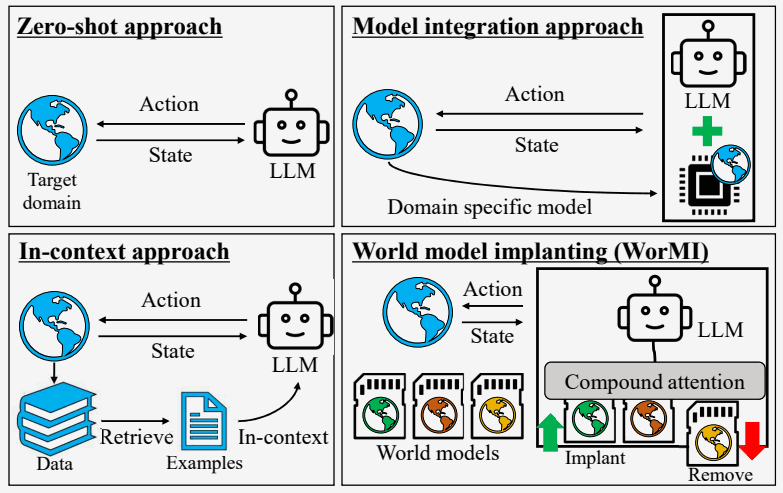
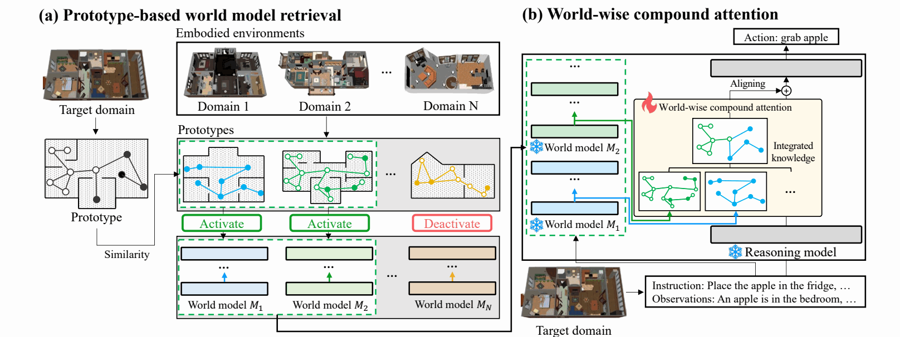
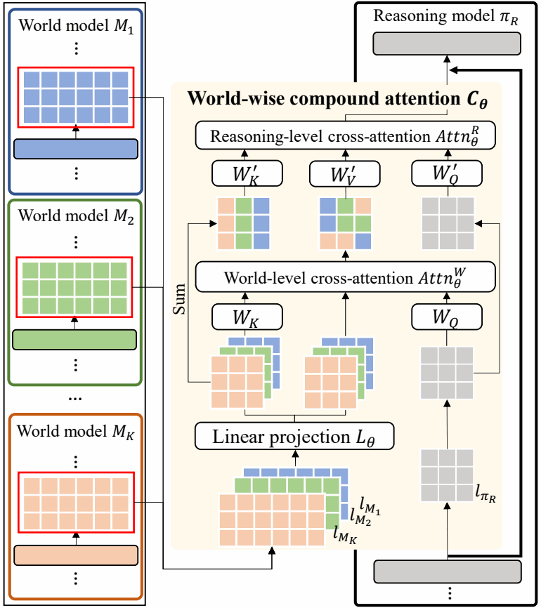
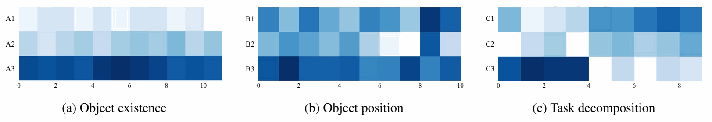
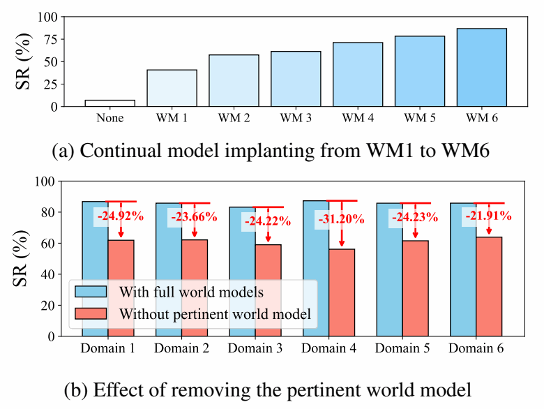

# WorMI 精读分享：让冻结 LLM 调用领域知识

**World Model Implanting for Test-time Adaptation of Embodied Agents**

Minjong Yoo 等 · ICML 2025 · [论文](https://arxiv.org/html/2509.03956v1) · [作者代码](https://github.com/mjyoo2/WorMI)

WorMI 的思路是：**先把不同领域的经验学进多个小模型，遇到新任务时选出相关模型，再把它们的表示融合进一个冻结的推理 LLM。**读这篇论文，关键是沿着“知识从哪里来、怎样被调用、是否真的帮助了行动”这条线往下看。

## 1. 为什么需要可替换的领域知识？

家庭 agent 既需要理解任务，也需要知道物体在哪里、哪些动作可行、行动会改变什么。通用 LLM 有语言和推理能力，但换了场景或任务组合后，原有知识未必足以支持可靠行动。

作者希望把这两部分分开：**通用推理由主模型承担，领域经验由外部模型提供。**新任务到来时，调整调用的知识来源，减少重新训练整个系统的需要。

*图 1｜左下是把示例放进 prompt，右上是接入固定领域模型；右下的 WorMI 则允许检索和替换外部模型。*

论文由此提出两个相连的问题：**面对当前环境，该调用哪些模型？选出之后，它们的知识怎样进入 LLM？**前者由 prototype 检索解决，后者由两级 cross-attention 解决。它延续了 CALM 的跨模型连接思路，进一步处理多个领域模型的选择和组合。[原文 §1–2](https://arxiv.org/html/2509.03956v1#S1)

<!-- pagebreak -->

## 2. 知识从哪里来，又怎样选出来？

*图 2｜从左到右读：当前观测与各领域的摘要匹配，选出相关 WM，再把这些模型的隐藏表示接入推理 LLM。*

**先用领域轨迹训练 WM。**每个 WM 都由 **Llama-3.2-1B** 微调而来，使用对应 benchmark 中某个已见领域的数据。轨迹中的一条转移记录包含：任务指令 I、当前状态 sₜ、示范动作 aₜ、执行后的状态 sₜ₊₁。VirtualHome 把状态图写成物体关系三元组；ALFWorld 使用文字观测和交互历史。论文定义了三类监督任务：

| WM 学什么 | 输入 | 监督目标 |
|---|---|---|
| 状态转移 Dynamics | 当前状态＋动作 | 后继状态 |
| 动作可行性 Affordance | 当前状态 | 可执行的动作 |
| 行为克隆 BC | 任务指令＋当前状态 | 轨迹中的示范动作 |

三类任务训练的是领域 LLM 本身，让其隐藏表示包含环境与行为经验。公开代码把动作、后继观测组织成文本回答，用语言模型的监督微调训练；论文未完整交代三类样本的配比和可行动作标签的构造方式。[原文 §3.2](https://arxiv.org/html/2509.03956v1#S3.SS2) · [数据转换代码](https://github.com/mjyoo2/WorMI/blob/96a2375ad7e96e75073f478bd37462f931dc39bc/wormi/datasets/virtualhome.py#L20)

**再为每个模型建立检索摘要。**作者从这些轨迹中提取物体及其状态、关系的向量，用 k-center 选出一小组有代表性的向量。这组向量就是 **prototype**：它概括该 WM 接触过什么样的环境，而不必在检索时遍历全部训练数据。

执行任务时，对当前观测构造同类摘要，用 Wasserstein 距离衡量两组向量分布的接近程度，再选出最相关的 WM。主设置的模型库有 **6 个 WM，每次选 3 个**；每份 prototype 包含 15 个代表点。这里的“选模型数”和“代表点数”是两个不同参数。

到这一步，系统只是选好了知识来源。**Prototype 决定谁参与，接下来的 attention 决定参与者的哪些信息有用。**前者依据训练数据与当前观测的相似性，后者依据推理模型此刻的隐藏表示。[原文 §3.2](https://arxiv.org/html/2509.03956v1#S3.SS2)

<!-- pagebreak -->

## 3. 先融合 WM，再让主模型读取

**主模型是冻结的 Llama-3.2-3B，旁边接入若干冻结的 1B WM。**它们读取同一套 token：任务指令、观测以及所需历史。WM 提供指定层的隐藏表示，而主模型负责最终输出动作。接口先把 WM 表示投影到主模型的维度，再完成图 3 中的两级 attention。

*图 3｜从下往上读：投影 → 跨 WM 融合 → 主模型读取 → 残差注入。右侧主模型表示为两级 attention 都提供 Query。*

**第一步：每个位置分别决定怎样融合 WM。**主模型在“苹果”位置的表示，只查询各 WM 的“苹果”位置，得到跨模型的权重并加权求和；其他位置同样处理。因此，K 条长度为 L 的序列变成一条长度仍为 L 的融合序列 U。这里本身也是 cross-attention，查询来自主模型。

**第二步：主模型再从融合序列里读取内容。**这一次，查询可以匹配不同 token 位置。下表列出两级 attention 的 Q/K/V 来源：

| 阶段 | Query：查什么 | Key：与谁匹配 | Value：取回什么 |
|---|---|---|---|
| 跨 WM 融合 | 主模型当前位置 | 各 WM 的同一位置 | 各 WM 的同一位置 |
| 跨位置读取 | 主模型当前位置 | 各 WM 逐位置求和得到的序列 | 第一步的融合序列 U |

两步的区别在 **softmax 的维度**：第一步在 K 个 WM 之间分配权重，第二步在 L 个序列位置之间分配权重。第二步的 **Key 是未加权的 WM 求和，Value 才是 U**。取回的内容经输出变换后，残差加到主模型隐藏表示上，继续生成动作。[原文式 (5)–(8)](https://arxiv.org/html/2509.03956v1#S3.SS3)

实现中，WM 表示堆叠并投影后为 `[B,K,L,d]`，再把每个位置展开为独立查询：Q 为 `[B×L,1,d]`，K/V 为 `[B×L,K,d]`。融合后恢复 `[B,L,d]`，送入第二级 attention。B 是批大小，d 是对齐后的隐藏维度；这里省略多头维度。[实现](https://github.com/mjyoo2/WorMI/blob/96a2375ad7e96e75073f478bd37462f931dc39bc/wormi/modules/hooks.py#L401)

<!-- pagebreak -->

## 4. 两级接口用什么监督，怎样一起训练？

**“先融合、再读取”是前向计算顺序；训练时，两级 attention 由同一个动作损失联合优化。**这里要与前面的 WM 预训练分开：WM 已学好并冻结，推理 LLM 也冻结；可训练的是输入投影、两级 attention 及输出变换等接口参数 θ。

这些参数分布在两处接口，分别连接 **WM 第 7→主模型第 13 层、WM 第 15→主模型第 27 层**（索引从 0 开始）。代码用 hook 取出、修改层输出，并在第二级输出后加 RMSNorm 和 MLP；论文图中的输入线性投影，在代码里也实现为 MLP。[表 A.6](https://arxiv.org/html/2509.03956v1#A3.SS2) · [接口代码](https://github.com/mjyoo2/WorMI/blob/96a2375ad7e96e75073f478bd37462f931dc39bc/wormi/modules/hooks.py#L171)

接口使用所选 WM 对应领域的轨迹数据。每个样本给出**任务指令、当前观测／必要历史 → 示范动作**。例如，“把苹果放进冰箱＋手持苹果、冰箱已打开”对应动作 `putin fridge`；这只是数据格式的简化示意。主模型经过两级接口后预测动作，论文式 (9) 最小化示范动作的负对数概率：

**L(θ) = −Σ log πθ（示范动作｜任务指令、观测／历史）**

对文本动作，这就是逐 token 的交叉熵：在给定前面正确 token 的条件下，提高下一个示范 token 的概率。**没有“正确 WM 权重”或“标准融合向量”的额外标签。**动作预测的误差经过冻结主模型后续的计算，反传到两级 attention，让它们共同学会取用有助于动作预测的信息。冻结参数不妨碍梯度经过这些计算传回接口。[原文 §3.4、式 (9)](https://arxiv.org/html/2509.03956v1#S3.SS4)

代码对应的是 `SFTTrainer` 加回答部分的语言模型监督；接口训练入口把样本设置为以动作回答结束。WM 分支在 `no_grad` 下提取表示，主模型输出的 loss 用来更新接口。因此，**WM 的后继状态预测是预训练任务，组合接口的核心监督则是最终动作。**[训练入口](https://github.com/mjyoo2/WorMI/blob/96a2375ad7e96e75073f478bd37462f931dc39bc/wormi/scripts/train.py#L63) · [监督配置](https://github.com/mjyoo2/WorMI/blob/96a2375ad7e96e75073f478bd37462f931dc39bc/wormi/trainer.py#L223)

为了让同一个接口适用于不同 WM 组合，作者再把上述动作监督放进 **Reptile 风格的元学习**：为每组 WM 复制一份共享接口，用这些 WM 对应数据集的并集训练若干步，再把共享参数朝各组训练后参数的平均值移动。下一轮仍从共享参数出发。**变化的是模型组合和训练样本，监督目标仍是示范动作。**论文内循环每组训练 30 步；外循环负责汇总各组更新。[Algorithm 1](https://arxiv.org/html/2509.03956v1#A3.SS2)

由此就能区分论文中的两种 test-time adaptation：

- **Zero-shot：**不提供目标域训练示范，也不更新参数；根据当前观测检索并组合已有 WM。
- **Few-shot：**提供少量目标域示范，只更新组合接口；WM 和主模型仍保持冻结。

所以，**test-time 指模型遇到目标任务并执行的阶段，不等于必然在测试时训练。**Zero-shot 的适应来自动态组合，few-shot 则进一步调整组合方式。

实验在 VirtualHome 和 ALFWorld 两个家庭任务环境中分别进行。作者留出部分任务和场景，检查模型能否把已见领域的经验用于这些 **unseen** 条件。因此，zero-shot 指的是**不使用目标域示范的基准内部泛化**，并不是系统从未接受过领域训练，也不是跨两个 benchmark 的直接迁移。[原文 §4](https://arxiv.org/html/2509.03956v1#S4)

<!-- pagebreak -->

## 5. 实验先回答：这套组合是否有效？

总体上，WorMI 在已见和留出条件下，都优于论文比较的直接 LLM、微调 LLM、示例检索和 SayCanPay 等基线。以 VirtualHome 的未见任务与未见场景为例，成功率从 SayCanPay 的约 **46%** 提高到约 **66%**；少量目标域示范下，WorMI 也保持领先。[表 1–2](https://arxiv.org/html/2509.03956v1#S3.T1)

VirtualHome 的 SR 是整项任务成功率，ALFWorld 的 SR 按本文定义是子目标完成比例；PS 是平均完成步数。这些结果说明表现有改善，下面进一步看知识是否被用上。

### 知识能否随任务需要而切换？

*图 A.6｜右侧 (c) 最直观：执行“把李子放进柜子”时，取李子阶段更多依赖学过李子任务的 WM，放入柜子阶段更多依赖学过柜子任务的 WM。*

这个案例呈现了作者希望获得的行为：**不同模型提供部分知识，接口随当前需要改变权重。**它与组合知识的解释一致；是否带来性能收益，则要看消融。[附录 D.1](https://arxiv.org/html/2509.03956v1#A4.SS1)

消融分别检查模型数量、选择方式和融合方式：单个 WM 明显不如多个，但把六个全部接入也会下降；固定接入三个时，prototype 检索优于随机选择；选定模型后，完整融合方案优于直接拼接或相加。这里随机对照同样选的是**三个**，因此“单个差很多”和“随机选择只差一点”并不冲突。[表 3、表 5](https://arxiv.org/html/2509.03956v1#S4.T3)

### 有用的知识能否通过增删模型来改变？

*图 5｜上图刻意加入与目标域相关的 WM，成绩改善；下图移除相关 WM，成绩下降。*

这里强调的是**加入相关知识**，与无差别接入六个模型的数量实验条件不同。两组结果共同说明：多个来源可以互补，但接口不会自动消除所有干扰。为什么全部接入会变差，论文没有进一步分离原因。

<!-- pagebreak -->

## 6. 这篇论文证明了什么，对我们有什么用？

**最有价值的结果，是冻结主模型后，仍然可以通过学习表示接口，把多个领域模型的经验组合成更有效的动作策略。**检索让系统选择知识来源，两级 attention 让这些知识参与主模型的内部计算。这是比“它也用了 cross-attention”更具体的参考。

同时，论文还有两个需要保留的边界。第一，WM 同时学习状态转移、动作可行性和行为克隆，而实验主要报告任务表现；因此还不能确定收益具体来自状态估计、转移预测还是动作模仿。第二，消融支持完整方案优于几个替代方案，但没有把两级 attention 与元学习的独立贡献完全拆开。

方法的实际能力也有边界：长程和多指令任务的整项成功率仍约为两成，多 WM 推理增加了计算开销。它展示了受控环境中的有效组合，还没有解决普遍的长程规划与开放世界适应问题。[表 6](https://arxiv.org/html/2509.03956v1#S4.T6) · [资源分析](https://arxiv.org/html/2509.03956v1#A4.SS3)

对我们的 cross-att 路线，共同点很明确：**让冻结 LLM 在内部计算中读取外部表示，主要训练连接接口。**区别在于，WorMI 提供的是领域 LLM 的隐式知识；我们希望提供当前状态、目标和候选动作后果等具有明确含义的地图向量。[项目研究定义](RESEARCH_BRIEF.md)

因此，值得借鉴的是“外部知识如何被主模型选择和使用”，而不是直接照搬多 WM 和元学习。我们的关键问题仍是：**LLM 能否可靠读取地图里的状态关系，并把这些信息用于动作选择和完整闭环？**WorMI 为接口设计提供了依据，这一机制问题还需要我们自己的实验回答。

*复现提示：六个正式 WM 与训练域的完整对应关系尚未充分公开；公开代码与论文在聚类、投影等细节上也有差异，正式复现时需要核对。*

本报告经 AI 辅助整理，依据 arXiv v1 正文、附录及作者公开代码，未运行复现实验。图 1、2、3、5、A.6 均出自 Yoo 等原论文，保留图内内容，仅裁去英文图注并补充中文说明，沿用 [CC BY 4.0](https://creativecommons.org/licenses/by/4.0/) 许可。
