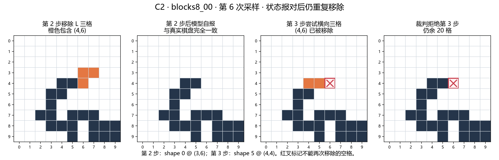
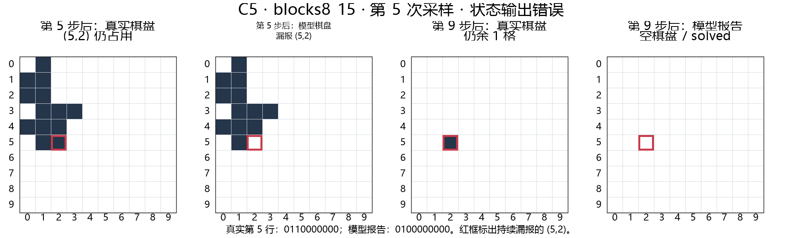
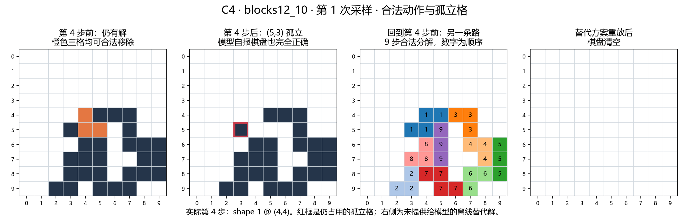

# 早期任务讨论与案例批注

本页保留原研究批注与独有案例记录。模型成绩集中见[实验全景](../EXPERIMENT_OVERVIEW.md)，任务定义见[研究简述](../RESEARCH_BRIEF.md)。

## 1. 研究动机

> 仅靠语言推理，目前基于语言智能的 LLM 可能不能正确、稳定地维护任务状态。在推理过程中，它可能遗忘自己已经走到哪里，因而影响后续预测、规划和泛化。我们希望模型**在行动前形成并持续更新对当前世界的状态认识，据此想象，推理可能的结果来进行决策**，在行动后用真实反馈校准认识，并据此推演动作后果。

因此需要用具有可建模状态的任务来检验这一判断，本报告就是对前期反例任务选取的简单总结汇报

## 2. 任务选择

任务选择只保留三个条件：规则清楚、状态和动作可核验、动作会改变后续可行性。

| 任务          | 定位  | 判断                                            |
| ----------- | --- | --------------------------------------------- |
| 普通寻路、DAG    | 参考  | 节点和边直接给出，适合检查图结构读取、动作合法性和路径输出。缺点在于状态直接取决于所在节点 |
| 翻硬币         | X   | 状态直接取决于动作数量                                   |
| 五子棋，国际象棋等棋类 | X   | 1.当前模型训练数据中有大量相关情况，影响判断，2.属于react，大部分不符合我们需求  |
| 二维积木轮廓分解    | √   | 每次移除都会改变剩余几何结构和后续可行解，且都能判定可行性                 |

*已经尝试过和模型下五子棋，从思维过程中可以看出其能力非常强*
![[8f005aab41f7fc70914feca537ce234a.jpg|340]]
同时，像是围棋、国际象棋等，都可看做ReAct，我们要做的话方法会和简单加多模态拉不开差距
## 5. CASE STUDY
### 5.1 积木：报告正确仍重复移除空格

`blocks8_00` 第 6 次采样中，第 2 步已移除 `(4,6)`，模型随后报告的棋盘也将该格标为空。第 3 步仍选择横向三格 `(4,4)、(4,5)、(4,6)`，非法动作。

### 5.2 积木：状态输出漏掉仍占用的格子

第 5 次采样中，前 4 步的状态报告正确。第 5 步执行 `shape 3 @ (4,5)` 后，真实棋盘的第 5 行（`row=5`）仍为 `0110000000`，其中 `(5,2)` 仍然占用；模型却将这一行报告为 `0100000000`。第 6 至第 9 步持续漏报该格，9 个动作虽然全部合法，真实棋盘最后仍剩 `(5,2)`，模型却输出 `solved`。

| | 第 5 行（`row=5`） |
| --- | --- |
| 真实棋盘 | `0110000000` |
| 模型报告 | `0100000000` |

这个案例直接展示了状态输出错误如何传递到后续状态和终止判断。

### 5.3 积木：初始空格重叠

 第 3 步横向双格覆盖了初始就为空的 (2,5)，非法操作

![[Pasted image 20260908003849.png|700]]
### 5.4 积木：合法动作把可解状态变成死局

第 4 步移除 `(4,4)、(5,4)、(5,5)`。三格当时均被占用，动作和 `board_after` 都正确；但它使 `(5,3)` 变为孤立单格，后续再也没有形状可以覆盖。动作前的棋盘仍有完整解，改用另一种移除即可清空。

### 5.5 积木：空计划，输出unsolved

这种情况是闭源模型思考了但是的确没做出来，输出`{"actions":[],"final_status":"unsolved"}`，思维链加密不可见，但也说明对于此类问题，模型能力有限
 ![[Pasted image 20260908004613.png]]
### 5.6 单向图寻路：走不存在的路
![[Pasted image 20260908004719.png]]

### 5.7 开关+最短路
![[Pasted image 20260908021734.png]]
### 5.8 其他错误罗列

- 终止判断错误
    Luna `blocks12_generated064` 第 1 次采样：13 个动作全部合法，也没有进入死局，但还剩 `(7,1)、(7,2)` 两格，模型却输出 `solved`。再执行一个合法动作即可清空。
    这是独立于状态报告的“完成条件判断错误”。
- 状态报告错误，但动作序列仍然成功
    Sol 中有 3 个样本出现这种情况：动作全部合法并清空棋盘，但中间 `board_after` 有错误。例如 `blocks12_01` 第 7 次采样连续几步漏报 `(4,0)`，最后仍然完成。
