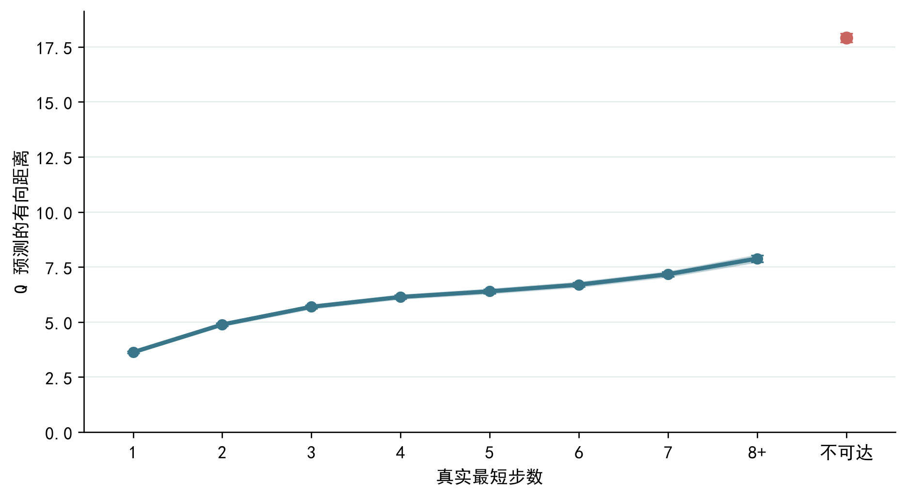
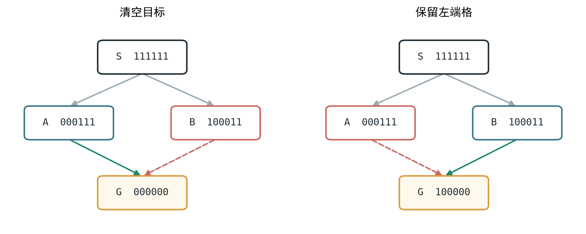
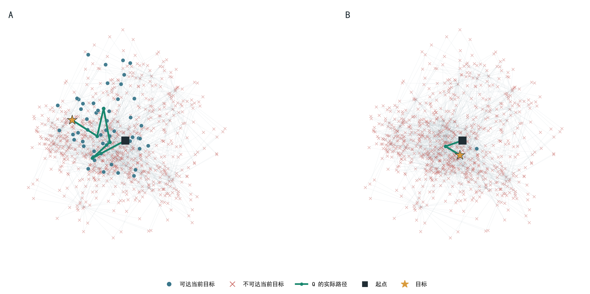
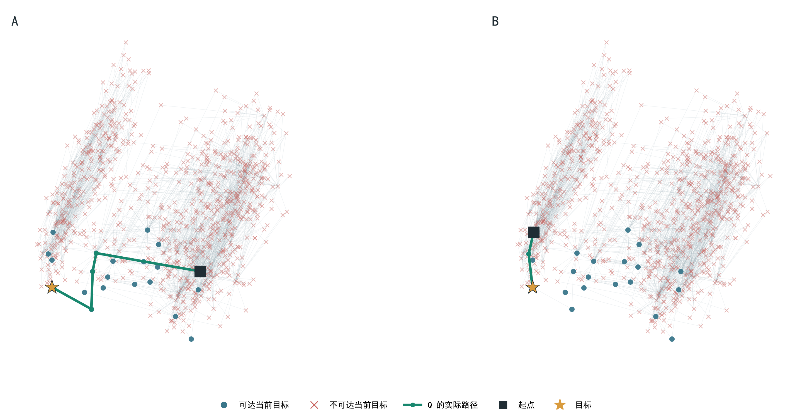

# 积木 Q-map：树关系补全后的跨棋盘结果

## 总结果

**整体结论：在 1,000 张训练棋盘**的求解树上采样起点、目标和分支，用精确最短步数与可达性监督同一个 Q。在未参与训练和选权重的 **200 张新棋盘**上，Q 对合法后继贪心排序，完成 **3,928/4,355 道任务（90.2%）**

| 指标          |       正确／总数 |         比例 |
| ----------- | ----------: | --------: |
| 总到达         | 3,928/4,355 | **90.2%** |
| **第一步后仍可达** | 4,167/4,355 | **95.7%** |
| 第一步在最短路上    | 3,812/4,355 | **87.5%** |
第一步仍可达指执行动作后所在状态，还在可行解的子集。

### 按真实最短步数分组

| 指标        |       正确／总数 |        到达率 |
| --------- | ----------: | ---------: |
| 1 步       |     600/600 | **100.0%** |
| **2–4 步** | 1,656/1,800 |  **92.0%** |
| **5–6 步** | 1,024/1,200 |  **85.3%** |
| **7–8 步** |     648/755 |  **85.8%** |

不同轨迹长度的任务场景下，一步题全部到达；2–4 步为 92.0%，5–8 步约为 85%，说明长程任务仍不够稳定（要求每一步都不能出错，其实差不多就是一步可行的概率，0.96的n次方）

### 换目标

| 目标类型 | 完整到达／总数 | ACC |
| --- | ---: | ---: |
| 清空目标 | 1,515/1,530 | **99.0%** |
| 普通非空目标 | 1,213/1,354 | **89.6%** |
| 含孤立格的非空目标 | 1,200/1,471 | **81.6%** |

清空目标到达 99.0%，但普通非空目标为 89.6%，含孤立格的目标只有 81.6%。
对于不同目标，清空完成最好，含孤立格的非空目标由于需要保留特定结构，仍有难度。

## 模型学到的距离关系

*图 1：同一 15,000 步权重；点是封存新棋盘上各真实距离组的平均预测距离，误差条为按棋盘重采样的 95% 区间。*

### 错误统计

在固定 1,000 道非空目标任务里，140 道失败中

- 有 **76** 道在某一步移除了目标必须保留的格子，
- **61** 道因局部余量不能再正确覆盖目标，
- 另有 **3** 道在判卷时成为全局不可达。
- 首个错误发生在第 1 步的有 **82** 道。

### 监督机制

*图 2：同一父状态的两个合法后继 A、B，换目标后可达性互换；这是机制示意，不是测试样本。*

把每张棋盘看成一棵“不断合法移除”的求解树：节点是剩余棋盘，边是一次移除。我们从 **1,000 张训练棋盘**采路径，再展开沿途的兄弟分支；目标既有空棋盘，也有普通及含孤立格的非空棋盘。

| 取什么数据 | 可达／较近 | 不可达／较远 |
| --- | --- | --- |
| 路径与多个目标 | 路径上的祖先到后代；按最短步数标注 | 目标格已被移除，或目标格仍在但余块无法按规则移完 |
| 同父分叉、互换目标 | A 分支到 A 的后代目标，B 分支到 B 的后代目标 | A、B 互换目标后，经求解器证实走不到的关系 |
| 补全清空和长程 | 枚举同一父状态的合法后继，找出通向空盘或远处非空目标的最短选择 | 无法到达目标的后继，以及虽可到达但要绕路的后继 |

训练不只看一条标准解：同一父状态的多个合法后继都会进入比较。某个后继是否有用，取决于它能否到达**当前目标**。

图 2 中 `S→A` 和 `S→B` 都是合法的一步转移；下面比较 A、B 到不同目标的关系：

| 目标 | A 到目标 | B 到目标 | Q 应排出的顺序 |
| --- | ---: | ---: | --- |
| 清空 | 1 步 | 不可达 | A 比 B 近 |
| 保留左端格 | 不可达 | 1 步 | B 比 A 近 |

换目标后，A、B 的好坏正好反过来。因此训练的是“当前棋盘到指定目标”的关系，不给某个节点贴永久的好坏标签。

- **正样本**：从当前棋盘确实能到指定目标，包括一步到达、沿路径走多步后到达，以及同父分叉中仍通向目标的后继。目标可以是空棋盘，也可以是指定的非空棋盘；每对都标注最少还需几步。
- **负样本**：从当前棋盘已经到不了指定目标。一种是目标要保留的格子已被移除；另一种是目标格还在，但其余格子无法按允许的形状全部移除。

**还能到达但需要绕路**不标为不可达，只在与最短路后继比较时算较差选择。同一个后继换了目标，正负也可能反转（图 2）。

*图 3：封存棋盘上的同一起点与同一批状态；左右只切换目标。圆点／叉号根据当前目标是否真实可达着色，绿色为该目标下 Q 实际选出的路径。二维位置来自同一组 128 维 Q 的投影，换目标后位置不变，着色和路径改变。线段长度不能当作模型的有向距离。*

*图 4：封存棋盘上目标相同、起点不同的两个例子。两边的真实可达状态集合相同，Q 选出的路径随起点变化；这说明图只用于展示状态与轨迹关系，不能把单个成功案例替代分层到达率。*

---

本页取代此前的过程记录；早期单棋盘 A／B 实验与逐级推进的完整过程见[归档](archive/qmap_progression.md)，本页图与统计的机器可读来源见 [tree_qmap_figure_data.json](tree_qmap_figure_data.json)。

## 与 LLM 读取实验的关系

本页 3,928/4,355（90.2%）使用补充清空和长程关系后的 `tree_continue_986cb4d/checkpoints/step_015000.pt`。较早 cross-attention 实验曾使用 `tree_1000_132f5a1/best.pt`；最近同数据多基线及 10k B2 已采用续训新图，不能沿用早期说明称它们仍使用旧图。028 当前 `data/map_sft_sources/qmap.pt` 的内嵌来源为 `986cb4d`、续训 15,000 步；10k 训练缓存与该 Q 重算的地图检查见[专项诊断](../../map_sft_baselines/results/b2_10k_diagnosis.md)。源目录的旧 `source_manifest.json.q_checkpoint` 仍保留早期地图路径，不能仅凭这一历史字段判断当前权重。

在 LLM 的同一批 510 道测试题上，已完成纯地图、同规则和同预算的 CPU 贪心对照：旧图到达 345/510（67.6%），续训图到达 397/510（77.8%）；第一步后仍可达分别为 465/510（91.2%）与 473/510（92.7%）。续训图救回 105 题，也退步 53 题，不能把总提升理解为每题都改善。正式合同见[配置](../../flamingo_map_reader/configs/blocks_map_baseline_comparison.json)，详细计数见[现有摘要](../../flamingo_map_reader/results/blocks_results_summary.json)的 `map_greedy_comparison`。

本页题集包含 1–8 步任务，LLM 普通测试为 6–9 步，90.2% 与 77.8% 的分母不同。第一步可达率也不是后续每一步的条件正确率，不能直接用其幂次推出完整路径到达率。续训补充关系与 510 题的重合尚未审计；最近新图条件的 LLM 结果见[同数据多基线报告](../../map_sft_baselines/results/report.md)，新一轮强模型匹配评测仍待执行。

## 十二块原八形状的广覆盖续训

用户授权在平台35016从当前选用的986cb4d地图继续，原Huber＋原权重soft-rank与监督类型不变；数据覆盖求解状态、完整分叉、后续与跨分支的远近关系。用户明确选择的覆盖口径为：完整表示训练初盘的全部求解图和精确关系，实际训练尽可能广采样，单独报告曝光率，不要求把巨量关系逐条全部送入梯度。

[规模核对](blocks12_scope_summary.json)表明，一个随机12块初盘即有10,174,464个可达状态、103,519,717,687,296个有序起终点对；另有更大的例子。仅从50个不重叠横向双格槽中选12个，就有121,399,651,100种合法初盘，因此不把有限训练根集合冒称为所有可能初盘。原始小探针对过大的分量停止计数，未知不算不可达；正式数据不允许截断后冒充完整。

[数据合同](../configs/blocks12_graph_data.json)采用连通分量求解图的完整笛卡尔积：所有形状均连通，移除不会跨越初盘的不同连通分量；完整分量BFS与合法边可表示全局所有合法状态和转移。对任意源与目标，若目标不是源的子集则不可达；否则移除差集的最少覆盖数，恰好等于从完整分量到其差集补集的BFS距离，因此任意状态对都有精确标签，不需物化平方大小的表。原始DistanceOracle逐对核对与全部合法后继闭合检查通过。计数按初盘局部域报告，跨初盘重复状态不冒充不同全局状态。

[固定12块基线合同](../configs/blocks12_baseline.json)先以现用Qmap检查清空与中间目标，后续使用同题比较。12次构造不是12步动作上限；合法移除路径的有限上界按占用格数计算。新数据与产物使用独立持久目录，旧权重和其他诊断保持原样。

固定200个新初盘上，父权重清空为31/200（15.5%），中间目标214/400（53.5%）；清空失败中161次局部覆盖被破坏、8次全局不可达。完整来源见[基线摘要](blocks12_baseline_summary.json)，这是续训前的同题基准。

训练数据选择1,000个不同初盘，并排除上述200个评测初盘；不是单棋盘扩增。664个原始合法摆放动作全部可用，每种至少出现在32个训练初盘。首次显式BFS存表在分量85超过2,000万状态后失败，未生成完整数据标记，也未开始训练。改用[dd的ROBDD](https://github.com/tulip-control/dd)压缩保存完整BFS层和状态集合；动作仍逐个精确枚举，任意状态对仍按相同差集覆盖关系查询。小图全部状态、全部状态对和全部合法后继与显式BFS一致；存储预算不足仍报错，不截断成所谓完整图。可用覆盖和实际训练曝光分别报告。
