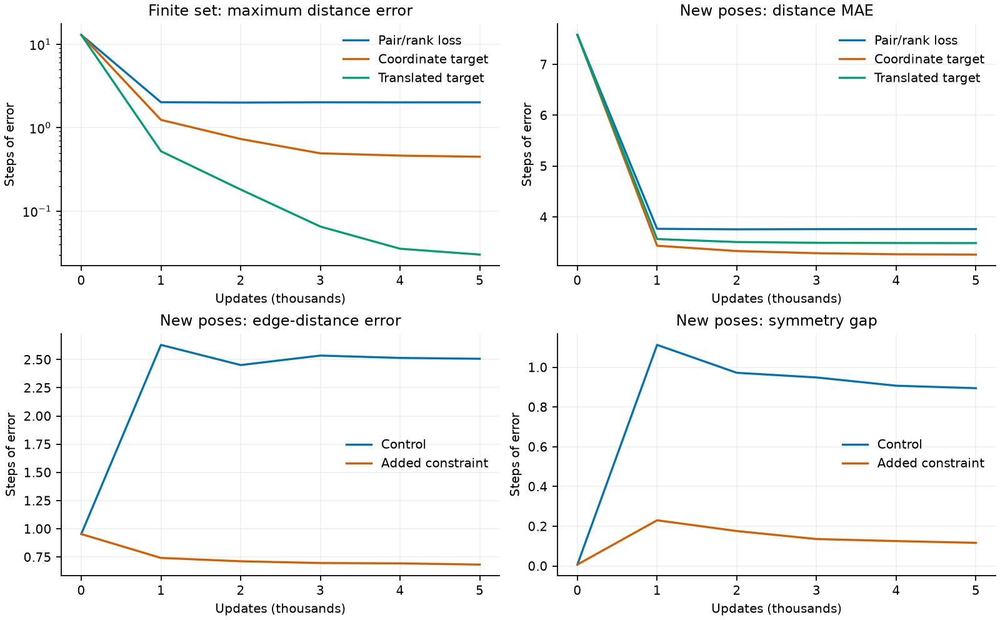

# 魔方 Qmap：哪些学会了，哪些没有

**六动作纯 Q 仍不能可靠完成长程任务。**目前保留“状态→共享编码器 Q→固定距离→选最近后继”的结构，让距离与动作关系监督网络自行形成空间；不把人工坐标作为正式训练方案。环境提供合法后继，尚未独立训练动作条件转移模型。

当前证据分三层：全魔方固定度量对照检查实际到达；92 个状态的小检查定位监督与优化问题；直接坐标标签仅作为编码器拟合能力的诊断。小集合拟合成功不能当作全局地图成功，小集合之外表现差也不能单独证明距离监督路线不可行。历史失败产物已归档，本轮运行位置见各节。

完整路线检查提供了有限范围的正结果：同一 71 状态模板上，三个初始化的共享编码器均仅靠关系监督选对全部 23 组动作、走通全部 4 条起点路线，距离 MAE 为 0.013–0.021；留出覆盖路线每组仍为 0/32。

随后在 4090 上比较多个集合：联合训练在三个初始化上均保住旧图、走通全部 32 条训练路线；顺序训练明显遗忘。共享物理状态改善了部分未训练的跨集合距离，但新物理状态上的真实贪心到达仍只有 1～2/32，尚未形成可靠全局地图。

## 基线：loss 降了什么

同一个目标无关编码器，使用距离 Huber 与完整软排序交叉熵。以下是固定训练监测集和验证集，最佳模型按验证总损失选择；两项损失权重均为 1。

| 固定集合／指标 | 初始化 | 最佳模型 | 末步模型 |
|---|---:|---:|---:|
| 训练 Huber | 6.3310 | 1.4720 | 1.4695 |
| 训练排序 CE | 1.7884 | 1.8352 | 1.8344 |
| 训练总 loss | 8.1194 | 3.3072 | 3.3039 |
| 验证 Huber | 6.9632 | 1.9368 | 1.9372 |
| 验证排序 CE | 1.7887 | 1.8333 | 1.8343 |
| 验证总 loss | 8.7519 | 3.7701 | 3.7715 |


末段 loss 已进入平台，训练排序 CE 甚至高于初始化。只能说这套训练没有把排序学好，不能说已经达到全局最优，也不能把总 loss 下降解释为求解能力改善。MAE 只是“预测步数与真步数相差多少”的平均绝对误差，不是训练损失。

## 单步与完整到达

独立决策样本中，选中环境最短路动作的比例为 **666/1000（66.6%）**，均匀随机选合法动作约为 39.0%。剩余距离 1、2 时为 100%；距离 5～10 时约为 30%～55%。最大距离处所有动作都能前进，因此深层一步正确率高也可能没有区分能力。

固定距离分层的 512 题中，完成 **131/512**；381 个失败全部是二状态往返。该队列中初始距离 ≥7 的题全部失败，不能外推为所有长程起点都失败：另一个预留组合队列中有少数距离 7、10 的题到达。所有模型的求解预算相同，合法动作由环境提供，未用搜索或禁逆动作辅助。

一个实际错误，固定同一目标：

| 状态 | 到目标真步数 | Q 预测距离 |
|---|---:|---:|
| A | 4 | 3.271 |
| B | 3 | 3.584 |
| C | 2 | 4.014 |

A→B 是正确动作；到 B 后，Q 却认为返回 A 比走向 C 更好。往返来自**错误的目标距离地形**。长路径增加遇到错误的机会，而遇错后经常不能恢复；不能只归为每步独立随机误差的累计。

## 已归档的修复尝试

三个续训条件从同一 Q 和 Adam 出发，使用相同在线采样流、预算和验证选模规则。测试仅报告验证选定模型，不按测试成绩改选。

| 条件 | 单步最优率，1000 题 | 主队列到达，512 题 | 旧参考队列，512 题 | 预留新组合，512 题 |
|---|---:|---:|---:|---:|
| 继续原绝对距离＋软排序 | 66.5% | 131 | 152 | 144 |
| 距离项换成动作前后的距离差 | 67.5% | 138 | 145 | 149 |
| 原两项损失再加进展边距 | 66.8% | 132 | 148 | 146 |

预留队列沿用受保护测试端点，重新组合未评测状态对；没有参与训练或选模，不是新的物理状态池。各队列之间任务不同，不能跨列比较绝对数字。结果没有显示稳定的长程改善，三个条件在主队列的 ≥7 步任务上均未到达。

距离差监督改善了其自身 loss，但会压缩整体距离。另一个冻结检查仅缩放所有预测距离，就能降低排序 CE，动作选择完全不变。因此 CE 改善也必须与最优动作率、完整到达一起判断。续训重启了同一固定种子的采样流，不代表获得了全新不重复数据。

## 针对覆盖与重复训练的直接检验

冻结模型的一批训练图中，排序监督覆盖全部候选，但仅约 16% 的候选—目标关系同时进入该批的绝对距离 Huber。这是抽样曝光差异，不是说剩余关系没有排序标签。

据此运行两组各一万次更新：原采样对照；补全图内全部节点—目标距离，并持续重放未纠正训练图的干预。模型、两项损失、初始 Q／Adam、验证选模和题目相同。两组均在 CPU 正常完成；开发机 SSH 超时，未确认启动远端训练。

| 条件 | 验证选定模型到达 | 末步模型到达 | 固定训练监测集一步最优率：初始→末步 |
|---|---:|---:|---:|
| 原采样 | 145/512 | 143/512 | 64.7%→64.3% |
| 完整距离标签＋错题重放 | 145/512 | 133/512 | 64.7%→61.4% |

本轮两组共用重新固定的分层题，与上表题目不同，不能跨表比较数字；仍是已使用保护状态池中的诊断。两组最佳点均为首次更新，未取得持续改善。

最终困难训练池的单步最优率，相对初始模型从 49.2% 到 71.9%；过程中记录 979 次整图全部父节点选对的复查。这说明定向重复训练确实能修正部分案例，但没有保持其他关系：固定训练监测集和末步留出到达均退化。困难池由训练过程筛选，不能当作独立测试。此次失败分支及完整产物已归档，当前代码恢复纯 Q 基线。

## 递归子结构为何没有自动变成全局地图

局部动作关系与面向目标的方向是两件事。知道相邻、逆动作和闭环，不能决定面对远目标时走哪条分支。当前魔方只在剩一、两步时稳定选对，中程选择本身仍弱；单目标小样本拟合也没有证明跨目标的组合能力。

还存在一个可验证的表示限制。取同一面连续四次 U 转动的环 A→B→C→D→A，边长都为 1、两条对角线都为 2。精确 oracle 给出一个合法实例，其四点到目标的距离为 **12、11、12、11**。

任何 L1 距离都必须满足五点不等式：

```text
h(A)+h(C)+D(A,C)+D(B,D)
    ≤ h(B)+h(D)+D(A,B)+D(B,C)+D(C,D)+D(D,A)
```

h 是到同一目标的距离。真实标签左侧为 28，右侧为 26，违反该条件。四点环自身可以精确嵌入 L1，但加上这个远目标就不行；当前缩放 L1 在任何维数都不能同时精确拟合这些关系。具体状态、完整距离矩阵及全部 32 个二值切分的验证保留在 [测试](../tests/test_quarter_turn.py)。

**该反例只否定全局零距离误差，不证明正确贪心排序不可能，也不足以单独解释目前全部误差。**数据曝光、模型容量和优化问题仍可能并存。它说明继续要求所有局部与全局距离精确满足相同 L1 几何，存在无法靠加数据消除的冲突。

固定距离对照将读出分别换为最大绝对差 L∞ 与 L2，共享编码器和两项损失保持不变。“到各锚点的距离”作为向量时，L∞ 可以精确重建本次五点距离；这是构造性可行性检查，不是训练结果。五点可行性不保证 128 维能够精确表示全部魔方状态。

## 固定度量对照与表示诊断

正式度量对照源码为 `90f6733`，合同为 [metric_comparison.json](../configs/metric_comparison.json)。远端使用原基线的同一份冻结数据与 oracle，从相同随机权重开始 L1 与 L∞，L∞ 未达验证条件后顺序运行 L2，三组均已完成。输出集中在平台 `/zhanghanyue/experiment/grounded_llm_puzzle_qmaps/runs/metric_comparison_90f6733/`；队列日志在同工作区 `logs/metric_comparison_90f6733.log`。距离尺度沿用原 L1，L∞ 与 L2 使用原始范数；是整个固定读出规则的对照，不能单独归因于范数形状。

| 固定度量 | 最佳步数 | 测试距离 MAE | 测试单步最优率 | 测试到达：最佳／末步 | 最佳模型起始距离 ≥7 的到达 |
|---|---:|---:|---:|---:|---:|
| 匹配 L1 | 160,000 | 2.4047 | 66.6% | 131/512、134/512 | 0/291 |
| L∞ | 185,000 | 2.6750 | 62.9% | 119/512、121/512 | 1/291 |
| L2 | 170,000 | 2.5690 | 67.0% | 133/512、134/512 | 0/291 |

上述同题对照没有显示直接换 L∞ 的收益。L2 比 L1 最佳点多完成两题，末步相同，仍未解决长程到达；单 seed 不足以判断微小差异的稳定性。L∞ 的少量远程到达不能抵消整体下降，也不能据此选用 L∞。

本地共享测试 15 项、魔方测试 10 项通过。远端两步 smoke 完整走通三种距离、验证触发 L2 与汇总出口；初次 smoke 在训练评测结束后因缺少 matplotlib 画图失败，已将画图改为可选，重验通过。没有把两步 smoke 当作性能结果。

另以 `7c256cc` 的 [anchor_diagnostic.json](../configs/anchor_diagnostic.json) 做一次固定锚点诊断：从训练允许的状态中随机选择锚点，不含保护端点，不按评测成绩调整；每个坐标直接使用真实 oracle 距离。该条件在推理时读取 oracle，**不是训练出的地图，也不是所有同维表示的能力上界**。

| 精确锚点 L∞ 诊断 | 验证 | 测试 |
|---|---:|---:|
| 平均距离误差 | 3.3564 | 3.3714 |
| 单步最优率 | 60.3% | 61.3% |
| 完整到达 | 134/512 | 139/512 |

测试起始距离 ≥7 的任务全部未到达，373 个失败均发生循环。坐标本身没有网络拟合误差，但少量固定锚点仍不能保证长程方向正确；这不排除学习到更好的坐标。原始输出位于本地 `runs/cube2_qmap/metric_diagnostics_7c256cc/anchors.json`。

结构与实现调研见 [structure_notes.md](structure_notes.md)，其中详细区分 DeepCubeAI 的离散世界模型、目标条件代价读出和搜索；没有把其架构混入当前度量对照。

## 按用户指定假设逐项检查

仍保留目标无关 Q、固定距离和环境枚举后继，不增加目标条件读出、转移头、搜索或禁逆动作。主要合同见 [structure_checks.json](../configs/structure_checks.json)，源码 `027cace`。所有结构检查是短程、单 seed 的诊断，不是全魔方成功结果。

### 冻结基线：局部边与全局关系同时失真

对旧 L1 基线 `8eed676` 的 1,000 组验证题检查六个动作后继：6,000 次边评价均超过 1.01，边预测距离平均约 2.125、最大约 2.425；候选到目标距离中约 43.55% 低估超过一步。真最优后继中约 39.90% 未在预测距离上前进。沿固定 oracle 最短轨迹评分，只有 28.2% 的题每一步均被模型排对；此项是评分诊断，oracle 轨迹不供纯 Q 求解使用。

这证实原模型同时存在局部伸长和长程压缩，不证明某一个损失项是唯一原因。原始审计在本地 `runs/cube2_qmap/metric_diagnostics_7c256cc/legacy_structural_audit.json`。

### 同一有限集合，多目标共同约束

固定 92 个状态，含已知四环反例、两条中程最短路径、六个目标及 103 组完整动作候选；完整距离对为 4,186 个。L∞ 的完整锚点构造对这组状态的距离误差为零，因此该集合具有明确可行解。构造不是学习成功。

训练呈现与所有留出呈现的输入状态互不重叠，且排除原实验保护端点。验证／测试只换共同左乘呈现，仍复用相同相对关系，不能称为未见关系类型泛化。完整与稀疏距离组匹配编码和更新预算，但标签曝光不同。

| 固定呈现条件 | 训练距离 MAE | 最大距离误差 | 训练单步最优率 | 留出呈现到达 |
|---|---:|---:|---:|---:|
| 稀疏距离＋完整排序 | 0.3254 | 3.1045 | 100% | 19/128 |
| 完整距离＋完整排序 | 0.2136 | 2.0132 | 100% | 18/128 |
| 只换分组 L1-max | 0.2944 | 2.6900 | 100% | 18/128 |

完整监督使有限集合中的最大差获胜坐标从 22 个增加到 57 个，但没有转化成留出到达提升。分组规则在本次检查中也没有优于普通 L∞，没有据此启动更昂贵的全空间分组训练。

### 新呈现训练：一次只加一项约束

以下各组共用相同随机初始化、在线呈现流和完整关系监督，只改变对应的一项损失。选择验证目标最小的 checkpoint；测试不参与选模。对称差是相同相对关系在多个验证呈现之间的距离差，低差也可能来自距离压缩，不能单独作为成功。

| 条件 | 验证边距离 MAE | 验证对称差 | 留出中程单步最优率 | 留出到达：最佳／末步 |
|---|---:|---:|---:|---:|
| 原两项损失 | 2.5149 | 0.9073 | 45.0% | 31/128、31/128 |
| 只加边上界 | 0.6833 | 0.5686 | 42.1% | 27/128、27/128 |
| 只加最短边进展 | 2.4341 | 0.9505 | 43.2% | 29/128、28/128 |
| 只加配对距离对称 | 3.9846 | 0.1165 | 43.2% | 24/128、24/128 |

边与对称约束分别改善了各自针对的指标，但没有改善到达；路径条件减少了最优边不前进的情况，也没有提高留出到达。本轮不足以宣称这些方法永远无效，但已经否定“把该项加上便解决问题”的判断。

### 坐标发现与编码器拟合分开检查

完整距离监督仍有较大误差，因而追加 [coordinate_probe.json](../configs/coordinate_probe.json)（源码 `90e19c2`）：同一编码器直接学习已知可行的有限集合锚点坐标，推理只运行网络和 L∞，不读取 oracle。监督来源仍是该集合的完整真距离。它只是定位训练坐标发现问题，不是重新宣称少量固定锚点足以覆盖全魔方。

再用 [coordinate_shift_probe.json](../configs/coordinate_shift_probe.json)（源码 `d242707`）仅平移等价坐标、将未使用坐标设为常量，使目标离开 sigmoid 的输出边界。平移前后构造的距离矩阵完全相同，编码器、预算和题目不变。

| 监督 | 训练距离 MAE | 最大距离误差 | 训练单步最优率 | 留出呈现到达 |
|---|---:|---:|---:|---:|
| 直接监督原锚点坐标 | 0.1315 | 0.4485 | 100% | 19/128 |
| 只平移等价坐标 | 0.0046 | 0.0302 | 100% | 17/128 |

平移条件通过预先固定的有限集合拟合标准。这表明当前编码器能够学到这一组多目标距离，距离聚合下的坐标发现和输出参数化确实会影响拟合；不能再把该小集合的失败直接归为网络容量不足。留出呈现仍未改善，尚未形成可迁移的全局距离坐标。

完整 rollout 可离开有限模板，所以训练父节点上的单步全对不等于整题全对。候选来自环境，未把求解限制到已训练节点，也没有用 oracle 修正动作。

后续只读审计进一步收窄了“没有拟合好”的含义：完整关系组的距离误差中位数约 0.0678，95% 分位约 0.9583，最大约 2.0132；103 组训练动作全部正确，最小好／坏动作预测距离间隔约 0.820。它未通过原先严格的统一最大误差阈值，但已经学到相当一部分有限距离和动作结构，不能概括成完全没有学会。

该模板只有 18 个不同父状态。执行各训练题模型选出的第一步后，93 个非终止后继中有 44 个状态—目标决策没有显式候选监督；这 44 个决策下一步均有 4～5 个候选不在 92 状态集合中。因此，原模板完整到达不能单独作为有限关系拟合成败的证据。完整最优路线检查在后文单独报告。



运行分别在平台同工作区 `runs/structure_checks_027cace/`、`runs/coordinate_probe_90e19c2/`、`runs/coordinate_shift_probe_d242707/`。本地保留同名结果目录。共享与魔方针对性测试共 30 项通过；七条件两步 smoke 已通过。

已完成 [warm_start_checks.json](../configs/warm_start_checks.json)（源码 `c757458`）：用“完整关系预训练”与“平移坐标预训练”两种小地图作为起点，以相同后续预算学习另外的状态集合，重置 Adam 并共用在线采样流。

| 预训练起点 | 后续验证总损失 | 后续验证单步最优率 | 测试到达：最佳／末步 |
|---|---:|---:|---:|
| 完整关系监督 | 3.5164 | 68.0% | 34/128、34/128 |
| 平移坐标监督 | 3.4341 | 68.0% | 33/128、33/128 |

坐标预训练没有显示下游到达优势。两组均计入预训练预算；不能与只训练一个阶段的原始组作等总预算增益比较。该结果不支持把直接坐标标签转为正式路线；仍应检查关系监督的覆盖、联结与优化效率。

### 监督是否被有效利用：梯度与同起点对照

先按原采样器与训练种子检查累计联结（源码 `d328bed`）。下表的多目标比例以作为局部节点出现的状态为分母；节点—目标关系包含排序监督，不等同于全部都受绝对距离校准。

| 原采样器累计批次 | 不同输入状态 | 见过多个目标的局部节点比例 | 同批排序关系也进入绝对距离项的平均比例 |
|---|---:|---:|---:|
| 32 | 140,005 | 1.9% | 16.1% |
| 512 | 1,677,166 | 28.4% | 16.2% |
| 2,048 | 3,288,992 | 76.3% | 16.2% |

早期联结稀疏，但会随采样迅速增加；全部批次也共享编码器。因此不能将“同一状态没有面对多个目标”作为全程失败的既定原因。这不是完整运行曝光审计，也不证明已有监督组织最优。原先补全候选距离并重放错题的历史负结果仍有效，不能把相同干预重新包装为新方案。

复查命令为 `python -m experiments.cube2_qmap.src.supervision_audit --study /PATH/TO/structure_checks_027cace --prepared-run /PATH/TO/cube2_quarter_turn_8eed676 --contract experiments/cube2_qmap/configs/supervision_use.json --out /NEW/FILE.json --source-commit d328bed97deeca9d0d8ab99ddc80abad8ca60227 --sampling-batches 32 512 2048`。本地原始结果在 `runs/cube2_qmap/supervision_audit_d328bed.json`。

源码 `a90f3fa` 的 [supervision_audit.py](../src/supervision_audit.py) 只读检查完整关系训练后的有限地图。92 个状态的 4,186 个距离对全部有标签，每个状态连接其余 91 个状态。因此，这个有限集合内没有缺失距离标签，但不能据此断言全魔方监督充分。

在该 checkpoint 上，距离项与排序项的 Q 梯度范数均约 0.0043，方向余弦约 −0.87；共享参数梯度范数均约 0.042，方向余弦约 −0.67。L∞ 距离项在 57 个坐标上有非零梯度，排序项在 37 个坐标上有非零梯度。此处“有梯度”是本次完整批次的观察，不等于其余坐标在整个训练中从未得到监督。

梯度反向是一个训练点的局部线索，不证明两种真值在数学上冲突。合同 [supervision_use.json](../configs/supervision_use.json) 从同一 checkpoint、全新 Adam 出发，只改变是否继续显式排序项；全部父节点／候选／目标间的距离标签保留。两组统一按完整训练距离 Huber 选模，测试不参与选择。输出位于平台同工作区 `runs/supervision_use_a90f3fa/`。

更严格地说，负余弦也不证明合并更新会破坏两项损失。该快照中，距离梯度、排序梯度分别与其总和的内积约为 `0.000580` 和 `0.000561`，都为正；在当前梯度的线性近似下，负总梯度仍是两项损失的共同下降方向。旧快照未保存 Adam 历史，不能还原实际更新来支持更强因果判断。新的路线检查直接记录实际 Adam 更新前后的损失与已学关系退化。

| 同起点后续监督 | 训练距离 Huber | 训练距离 MAE | 最大距离误差 | 留出状态到达 |
|---|---:|---:|---:|---:|
| 完整距离＋显式排序 | 0.0705 | 0.2067 | 1.9619 | 18/128 |
| 只保留完整距离 | 0.0672 | 0.2026 | 2.0956 | 18/128 |

两组最佳均为末步。删除排序项略微降低平均误差，但最坏误差未改善，有限拟合标准均未通过。不能将梯度反向升级为“排序项是主要失败原因”，也没有据此删除正式基线的排序项。

接着按 [dense_supervision.json](../configs/dense_supervision.json)（源码 `a1dabec`）检查同一距离标签的梯度分配。对于已知 `d(s,g)`，L∞ 上界等价于每个坐标均满足 `|Q_i(s)−Q_i(g)| ≤ d(s,g)`。原最大差损失主要更新当前获胜坐标；新增项同时惩罚所有超标坐标，仍不提供坐标角色或锚点答案。两组同起点、同标签、同后续预算，保留最大距离 Huber；显式排序项均关闭，单独隔离上界分配的效果。

| 同起点距离监督 | 训练距离 Huber | 训练距离 MAE | 最大距离误差 | 留出状态到达：最佳／末步 |
|---|---:|---:|---:|---:|
| 最大距离原损失 | 0.0672 | 0.2026 | 2.0956 | 18/128、18/128 |
| 另加逐坐标上界 | 0.0678 | 0.2042 | 2.0870 | 19/128、19/128 |

两组最佳均为末步，均未通过有限拟合标准。单题差异不足以支持收益；当前系数和短预算下，更密的上界梯度没有解决问题。不能从该负结果外推所有梯度分配方法无效。运行位于平台同工作区 `runs/dense_supervision_a1dabec/`。

### 完整最优路线：关系监督可以学会有限地图

按用户认可的审计建议完成 [route_complete.json](../configs/route_complete.json)，源码 `8d06330`，实现为 [route_complete.py](../src/route_complete.py)。它从八步起点、路径中间目标和原目标构造关系，递归加入每个最优后继直到目标，并为每个沿途父状态保留全部六个动作候选。最终集合为 71 个状态、2,485 个距离对、23 组状态—目标决策、4 条初始路线，含真正的最优分支。所有最优动作都会终止或进入另一组受监督决策。

同一个数据模板使用三个随机初始化。每次先初始化原共享编码器，再用其随机 Q 初始化自由坐标；GPU 上的最大初始差均为 `1.43e-6`，在预先修正的浮点容差内。自由坐标和编码器都只学习同一批完整距离及候选软排序，没有人工坐标标签。两组匹配更新预算、Adam 与学习率计划，固定训练目标选模；所有最佳点均为末步，留出状态不参与选择。

| 初始化种子 | 参数化 | 训练距离 MAE | 95% 分位误差 | 最大误差 | 最优动作 | 初始路线到达 |
|---|---|---:|---:|---:|---:|---:|
| 20261016 | 自由坐标 | 0.1925 | 0.6753 | 3.6022 | 23/23 | 4/4 |
| 20261016 | 共享编码器 | 0.0134 | 0.0321 | 1.7740 | 23/23 | 4/4 |
| 20261017 | 自由坐标 | 0.1895 | 0.7345 | 2.8316 | 23/23 | 4/4 |
| 20261017 | 共享编码器 | 0.0209 | 0.0516 | 1.7370 | 23/23 | 4/4 |
| 20261018 | 自由坐标 | 0.1943 | 0.7840 | 3.6966 | 23/23 | 4/4 |
| 20261018 | 共享编码器 | 0.0156 | 0.0450 | 1.8683 | 23/23 | 4/4 |

六组都通过合同中预先规定的平均／分位距离误差、动作正确与完整初始路线验收；从全部 23 组受监督决策分别出发，也全部到达。所有条件在首次记录的第 500 步检查时已全部选对动作和走通初始路线。最大误差仍较大，因此这是一张有限范围内可用的近似地图，不是所有距离的精确表示。

这提供了比直接坐标标签更贴近正式目标的正结果：**当前共享编码器确实能仅靠距离与动作关系自行形成一张可用的小地图。**本次没有出现“自由坐标成功而编码器失败”。编码器的距离拟合更好，但两种参数化的实际初始 Q 步长不同：编码器 RMS 约 `0.0065–0.0076`，自由坐标约 `0.0016`；不能据此宣称它在所有匹配优化条件下都更优。

覆盖路线评测始终考虑全部六个动作；若选错后进入不受监督决策，两组均计为失败，不屏蔽动作、不用 oracle 纠正。新模板与旧 92 状态模板的关系集合和任务难度不同，因此新旧数字不能单独证明“补全路线是性能改善的唯一原因”。它证明了此次闭合任务能够被纯关系训练解决。

**推广仍未成功。**编码器分别在训练排除的共同左乘状态集合上评测：

| 种子 | 留出验证路线 | 留出测试路线 | 测试距离 MAE | 测试单步最优率 |
|---|---:|---:|---:|---:|
| 20261016 | 0/16 | 0/32 | 2.3914 | 74/184 |
| 20261017 | 1/16 | 0/32 | 2.4397 | 74/184 |
| 20261018 | 0/16 | 0/32 | 2.3902 | 77/184 |

这些留出集合仍复用同一关系模板，不是未见关系类型；三个种子也复用同一队列，不能把它们合成独立的新题数。自由坐标没有未见状态编码能力，不参与该评测。结果把下一步重点从“有限集合能否仅靠关系学会”推进到“如何通过多个相互重叠的集合形成可推广的共享地图”。

每组抽查 11 次实际 Adam 更新，包括第一个更新及定期检查前的更新。共享编码器有小幅目标震荡，最大抽查总损失上升约 `4.54e-4`；三组在这些抽查更新中均没有发生已正确动作退化。自由坐标的动作退化次数分别为 1、1、0。此处是更新抽查，不能声称整个训练过程从未退化，也没有证据把旧梯度反向作为主要失败原因。

完整产物位于平台 `/zhanghanyue/experiment/grounded_llm_puzzle_qmaps/runs/route_complete_8d06330/`，本地保留同名结果目录。初次 `2d76606` 运行因 GPU logit/sigmoid 往返误差超过过严阈值，在任何训练更新之前退出；核对误差后提交浮点容差修复并在新目录重跑，未覆盖失败记录。魔方针对性测试 18 项及两模型本地两步 smoke 通过。

### 4090：多个相互重叠的多目标集合

训练源码 `2f53baa`，合同 [overlapping_routes.json](../configs/overlapping_routes.json)，实现 [overlapping_routes.py](../src/overlapping_routes.py)。平台旧端口当时连接超时，未取用远端权重；将已保存的精确 oracle、保护状态和 71 状态模板迁入 4090，按已提交的旧路线合同在本机复现旧图。三个暖启动均走通旧图 4/4，MAE 分别约 0.0134、0.0219、0.0170。每个种子的三个条件从同一份暖启动权重出发，新阶段统一重置 Adam。

八个集合各含同一套完整路线结构、两个目标与全部组内距离标签。重叠条件共有 464 个物理状态、16 个目标；每个新集合与某个先前集合共享 8～21 个状态，形成连通的集合关系。无重叠对照共有 568 个状态、16 个目标，集合之间没有物理状态重叠。三条件的集合数、相对标签类型、每集合更新次数相同；输入状态的数量和物理位置不同，不能宣称全部信息量相同。

联合条件每轮交错访问全部集合，顺序条件依次完成各集合；采用相同常数学习率，避免不同阶段学习率计划成为额外变化。主比较固定为末步，最佳点仅按训练目标保存作辅助记录，没有按验证或测试选择策略。

**旧关系保持与训练集合拟合：**

| 种子 | 条件 | 旧图距离 MAE | 旧图真实到达 | 全部训练真实到达 | 训练动作最优 |
|---|---|---:|---:|---:|---:|
| 20261016 | 重叠联合 | 0.0317 | 4/4 | 32/32 | 184/184 |
| 20261016 | 重叠顺序 | 1.5255 | 0/4 | 8/32 | 127/184 |
| 20261016 | 无重叠联合 | 0.0148 | 4/4 | 32/32 | 184/184 |
| 20261017 | 重叠联合 | 0.0237 | 4/4 | 32/32 | 184/184 |
| 20261017 | 重叠顺序 | 1.5749 | 1/4 | 12/32 | 132/184 |
| 20261017 | 无重叠联合 | 0.0155 | 4/4 | 32/32 | 184/184 |
| 20261018 | 重叠联合 | 0.0358 | 4/4 | 32/32 | 184/184 |
| 20261018 | 重叠顺序 | 1.5804 | 0/4 | 12/32 | 134/184 |
| 20261018 | 无重叠联合 | 0.0186 | 4/4 | 32/32 | 184/184 |

因此，在这批固定集合内，联合训练足以保持旧关系并学会新集合；顺序训练的相同累计曝光并不能防止遗忘。无重叠联合也能保持旧图，所以不能将保持效果单独归因于物理状态重叠。实际更新抽查中，联合条件对旧图未记录到动作退化；抽查不是全程证明，累计遗忘以每阶段旧图曲线及末步结果判断。

**状态都见过、关系未训练的推广：**从两个物理队列中选择匹配距离分层和计数的 377 个跨集合距离对，以及 33 个跨目标完整候选决策。所有输入状态都属于训练状态；父节点及六个候选到新目标的关系，没有出现在任何集合的距离或排序监督中。距离对覆盖真距离 4～10，动作决策覆盖 6～10；六步动作层只有一个样本，因此单步宏平均对该样本敏感。

| 种子 | 条件 | 未训练跨图距离 MAE | 距离分层宏 MAE | 新目标单步最优 | 新目标真实到达 |
|---|---|---:|---:|---:|---:|
| 20261016 | 重叠联合 | 2.0129 | 1.8218 | 12/33 | 1/33 |
| 20261016 | 重叠顺序 | 3.1526 | 2.8073 | 9/33 | 0/33 |
| 20261016 | 无重叠联合 | 2.6181 | 2.3129 | 11/33 | 0/33 |
| 20261017 | 重叠联合 | 1.9376 | 1.7092 | 14/33 | 3/33 |
| 20261017 | 重叠顺序 | 2.9816 | 2.6753 | 14/33 | 0/33 |
| 20261017 | 无重叠联合 | 2.5681 | 2.3038 | 9/33 | 0/33 |
| 20261018 | 重叠联合 | 1.8704 | 1.6258 | 13/33 | 2/33 |
| 20261018 | 重叠顺序 | 3.1962 | 2.7936 | 12/33 | 0/33 |
| 20261018 | 无重叠联合 | 2.6264 | 2.3788 | 8/33 | 0/33 |

重叠联合的跨图距离误差低于无重叠联合，是共享状态帮助部分关系推广的线索。但两个物理队列不是同一组端点，暖启动时的难度也不同：宏 MAE 约为 3.62～3.66 与 3.91～4.04。即便按各自初始值计改善，重叠条件改善较多，本轮仍不足以将全部差异归因于某个唯一机制。最关键的负结果是：输入都见过，也远未学会所有新目标关系，因此不能把失败仅解释为未见状态的编码问题。

**共同的留出物理状态队列：**该队列排除了两种训练条件的全部输入，三个种子复用同一组任务。以下是允许任意合法中途状态、固定预算的真实贪心到达，不是离开受监督路线就停止的严格指标。

| 种子 | 暖启动旧图 | 重叠联合 | 重叠顺序 | 无重叠联合 |
|---|---:|---:|---:|---:|
| 20261016 | 1/32 | 2/32 | 0/32 | 1/32 |
| 20261017 | 1/32 | 1/32 | 3/32 | 2/32 |
| 20261018 | 1/32 | 1/32 | 0/32 | 2/32 |

重叠联合将该队列的平均距离误差从约 2.37～2.43 降到 1.56～1.60，但没有取得稳定的完整到达收益；无重叠联合也能降低平均误差。重叠联合在该队列的全部失败均为循环，未发生预算耗尽。对固定、确定性的贪心策略，回到同一状态会重复同一动作，单纯延长预算不能消除这些循环。

这些结果支持如下有限判断：持续混合旧、新集合可以解决当前集合中的遗忘；共享局部状态能改善一部分跨集合关系；组内误差较低且图之间有重叠，仍不足以保证所有跨图目标距离或未见物理状态上的方向正确。更有针对性的下一步是检验少量跨集合长程距离与完整候选关系监督，继续留出独立的跨图关系验收，而非只增加同类组内标签。该判断是后续假设，不是已证明的唯一原因。

训练使用 4090 的 1～3 号卡，完整策略评测使用空闲的 4 号卡，未使用预留的 0 号卡。项目根目录为 `/home/gongruochen/grounded_llm`，训练产物集中在 `runs/cube2_overlap_2f53baa/`；本地保留同名结果目录。无中途状态限制的评测源码为 `a020f41`，合同 [overlap_policy_eval.json](../configs/overlap_policy_eval.json)，结果在各种子的 `unrestricted_policy.json`。训练、原严格路线评测、真实贪心评测分开保存，不混用成功率。21 项魔方针对性测试、三条件本地短 smoke 和独立策略评测 smoke 通过。本轮只有一套集合及三个初始化，不把它们当作三套独立任务数据，也没有据测试重选模型。

### 有限可行性与全空间精确拟合的边界

另一个离线数学检查（源码 `5e6a6ef`）找到 129 对互不重叠的魔方状态：每对真距离为 14，不同对之间的四个交叉距离均不超过 13。[具体状态与合同](linf_dimension_witness.json)保留全部构造，可由精确环境重验。

若一个 L∞ 坐标同时承担两对的 14 步差，无论方向相同或相反，两对差值之和为 28，而对应交叉距离之和最多 26，产生矛盾。因此一个坐标最多承担其中一对，128 维无法全部精确表示。允许所有距离误差不超过 ε 时，同样有 `28−2ε ≤ 26+2ε`，所以 ε 至少为 0.5。

这只是全体距离最坏误差的下界，不是否定近似地图或正确动作排序，也不能解释当前平均误差与到达率。正式目标仍是让关系监督形成可用的近似空间，不以全空间零误差作为训练验收。

## 最小可用结论

训练允许的单目标小检查中，同一编码器拟合 206 个状态、45 个完整候选组后，单步最优率从 75.6% 到 100%，Huber 从 0.8930 到 0.0013，进展边距从 0.6156 到 0.0004，八步路径按最短路完成。该检查包含额外进展损失，属于训练集拟合，不能当作当前两项损失基线的成功或泛化结果。

这说明那批局部约束能够同时被网络满足；它没有包含全局所有距离关系。新发现的 L1 反例为全局精确拟合给出了明确限制，但实际排序失败的各项原因仍未完全区分。不能直接断言全部来自“多目标互相干扰”，也不能仅凭局部成功认定拆开训练后平均权重就能解决。

当前保留目标无关编码器与固定向量距离。直接换范数、追加局部约束、删除显式排序、分配冗余上界梯度，都未解决全局到达。原 92 状态模板未通过严格最大误差阈值，但已有正确动作结构，且 rollout 存在后续监督覆盖缺口；不能仅据此将路线归为不可学习。

完整最优路线及多集合检查表明，编码器无需人工坐标答案，可以同时学会并保留这些有限组内关系。顺序训练的遗忘已被联合训练明显缓解；未训练的跨目标关系和新物理状态仍弱。下一步优先检验跨集合长程距离与完整候选监督，保留未训练关系和新状态的验收。全空间监督的充分性仍未确定。分开训练与合并权重仍未启动；本轮顺序条件是同一个网络连续训练，没有合并多个模型。

## 证据来源

基线源码为 8eed676，匹配续训为 c4f32f5 和 55649b5；预留组合在 5492411 固定。历史运行已归档，位置见[归档说明](../../../DEVELOPMENT_MACHINES.md#7-qmap-历史归档)；本轮源代码与运行路径分别记录于对应小节。[summary.json](summary.json)只保留支持上述判断的数字。所有正式结果为单 seed，候选和 rollout 中间状态不保证未参与训练。
