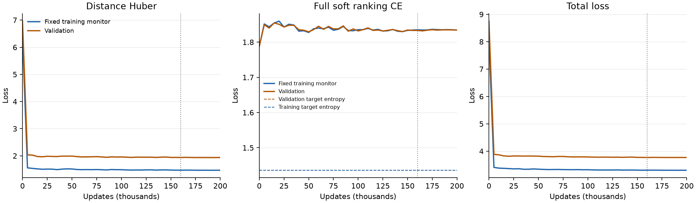

# 二阶魔方纯 Q：六动作局部图与循环修复

六动作局部图及在线共同左乘已经实现并训练完成。距离 Huber 明显下降，但完整软排序 CE 比初始化更高，长程贪心仍失败。用户随后要求针对性修复：当前比较原绝对距离监督与动作距离差监督，模型仍为纯 Q；正式合同见 [quarter_turn_progress.json](../configs/quarter_turn_progress.json)，下文先记录已完成的首轮证据。

## 六动作首轮：实现、训练与 loss

训练源码 `8eed6763204bd4c5b5fb468263b936186be13b68`，合同 [quarter_turn_local.json](../configs/quarter_turn_local.json)。从头训练，完整执行预算，用时 30.10 分钟；最佳验证总损失在第 160,000 步，末步为第 200,000 步。共享编码器、对称距离、绝对距离 Huber 和完整软排序 CE 保持原定义，没有学习转移模型。环境只保留每面的正／逆 90 度，直径为 14。

局部图有 34 个去重状态，起点和六个直接后继构成七个排序父节点，各有完整六候选；终点父节点不构造排序任务。每次抽样重新共同左乘全图与目标，所有进入损失的状态均排除 46,852 个保护端点。相对根全集共 3,674,159 类，最佳／末步最慢根层分别遍历 1.083／1.354 轮，在线图抽取 2,048／2,560 万次。图抽取数不等于不同呈现数，也不等于所有绝对上下文都已覆盖。

| 固定集合／项目 | 初始化 | 最佳 | 末步 |
|---|---:|---:|---:|
| 训练绝对 Huber | 6.3310 | 1.4720 | 1.4695 |
| 训练软排序 CE | 1.7884 | 1.8352 | 1.8344 |
| 训练总 loss | 8.1194 | 3.3072 | 3.3039 |
| 验证绝对 Huber | 6.9632 | 1.9368 | 1.9372 |
| 验证软排序 CE | 1.7887 | 1.8333 | 1.8343 |
| 验证总 loss | 8.7519 | 3.7701 | 3.7715 |

没有平滑曲线；竖线为验证选中的 checkpoint。训练／验证排序目标熵分别为 1.4357／1.4360，最佳排序 KL 约 0.3995／0.3974。总 loss 的下降主要来自距离项，不能说排序项也得到改善。最后五万步验证总损失的记录范围仅 0.00421，已经进入本配置的平台，但不证明达到全局最优。绘图入口为 `src/plot_losses.py`。

## 同题冻结比较

| 条件 | 六动作距离分层测试 | 复用旧测试起终状态 |
|---|---:|---:|
| 六动作最佳 | 131/512 | 151/512 |
| 六动作末步 | 134/512 | 150/512 |
| 旧九动作最佳 | 120/512 | 151/512 |
| 旧九动作权重，仅换六动作选择 | 122/512 | 140/512 |

同一队列的起终状态及最大步数相同；两种计步规则分别报告自己的最短步数，禁止直接用不同 metric 的误差或 CE 数值比较。新测试配对结果为两者都成功 115 题、仅六动作成功 16 题、仅九动作成功五题；旧测试两者都成功 132 题、各自独有 19 题。一个队列增加 11 题，另一个持平，不支持稳定求解提升。单 seed 且动作、数据、初始化和训练过程共同变化，不能单独归因于去掉 180 度。

六动作最佳在 1,000 条独立参考决策上的最短动作率为 66.6%，相同状态下随机选择为 39.0%。512 条自身 rollout 有 130 条全程最短，131 条到达；381 条失败均为长度二的确定性循环，未出现预算耗尽。训练监测状态的最短动作率为 68.5%、到达 141/512，也没有充分掌握长程决策。新测试起点距离七至十四的所有轨迹未到达。

## 错误累计与局部排序的直接证据

单步最优定义为 `d(next,g)=d(current,g)-1`，不是只检查动作合法；所有合法后继都仍可达目标，可达率是环境性质。一步到目标只对距离一的题有意义，本批为 72/72。距离二的完整两步到达也为 36/36。

| 真剩余距离 | 参考题数 | Q 单步最优率 | 随机动作最优率 |
|---:|---:|---:|---:|
| 1 | 72 | 100.0% | 16.7% |
| 2 | 71 | 100.0% | 19.0% |
| 3 | 71 | 87.3% | 19.0% |
| 4 | 71 | 63.4% | 19.0% |
| 5 | 71 | 45.1% | 19.2% |
| 6 | 71 | 54.9% | 19.0% |
| 7 | 71 | 29.6% | 20.4% |
| 8 | 73 | 31.5% | 23.5% |
| 9 | 72 | 38.9% | 25.0% |
| 10 | 72 | 33.3% | 29.2% |
| 11 | 71 | 62.0% | 50.2% |
| 12 | 72 | 87.5% | 86.6% |
| 13 | 71 | 100.0% | 99.8% |
| 14 | 71 | 100.0% | 100.0% |

深层第一步正确率高，很大程度是最优动作多；十四层所有六个动作都下降。这不代表能穿过七至十层的困难决策区。

固定 512 个起点，沿环境的一条最短路径独立检查 Q、每一步都继续执行环境最优动作，共 3,826 个干净参考状态，Q 的逐步最优率仍仅 65.9%。七步及以上起点没有一条参考路径的全部 Q 选择都最优。这排除了“主要只是走错后进入陌生状态”这一单一解释；在正确参考状态上也已有明显局部错误，但两种效应并非互斥。

在 Q 自身轨迹上，169/512 第一轮即偏离最短路，另有 103 条在第二步、52 条在第三步首次出错。只有一条轨迹出错后最终恢复到达。错误会破坏连续到达，但这里不是极高单步准确率下偶发误差的简单累积，更直接的问题是中间层单步排序本身较弱。首次错误后立刻返回原状态只有 28/382，不能将所有失败都描述为第一处错误立即循环；381 条失败最终全部形成两状态往返。

一个真实循环（目标 1450943）：

| 状态 | 编号 | 真距离 | Q 距离 |
|---|---:|---:|---:|
| A | 3445955 | 4 | 3.271 |
| B | 3122297 | 3 | 3.584 |
| C | 3188064 | 2 | 4.014 |

A 的 U 后继为 B，是正确前进；B 的 U' 后继是 A，但 F 后继 C 才真正更近。Q 把 A 排在 C 前面，因此 A→B→A。求解器只比较真实后继，没有“原地不动”动作；A 虽然比其全部后继的预测距离都小，仍会离开，再被吸回。环境不存在非目标局部死路，假低点来自学到的距离。向量距离对称、满足三角不等式也不蕴含沿真实动作的 Bellman 进展关系。

动作距离差监督正针对这个机制；本轮尚未证明其能修复表示或优化缺陷，不以禁逆动作、访问集合剪枝或搜索替代 Q 修复。诊断入口为 `src/decision_audit.py`，原始结果与逐候选循环例保存在 run 目录；紧凑证据见 [quarter_turn_summary.json](quarter_turn_summary.json)。

## 六动作产物与检查

- 远端：`/zhanghanyue/experiment/grounded_llm_puzzle_qmaps/runs/cube2_quarter_turn_8eed676`；训练、冻结比较及自动收尾全部正常结束，队列退出码为零。
- 本地：`D:/Grounded_llm/runs/cube2_qmap/quarter_turn`，保存两份权重、oracle、数据、完整曲线及冻结诊断；生成物不提交。
- 完整 BFS、全部六动作邻接边、逆动作、标签重算、在线整图变换、留出保护、纯 Q checkpoint 及无 oracle 推理检查通过。另独立重放 2,048 个在线图，未发现标签、动作或保护边界错误；CPU 重放到达数与远端一致。
- 评测父状态及目标受保护，评测候选和后续轨迹不保证全未见；所有相对关系类型参加训练，不能声称未见关系泛化。旧测试已参与诊断，后续修复实验必须标明这一复用边界。

## 先前九动作：分层均衡与增加预算

**追加完整预算后，距离拟合改善，求解没有稳定提升。** 同批测试父模型 147/512，本次验证选出的最佳模型 151/512；旧参考测试反而从 139/512 变为 136/512。不能将四题差值称为可靠增益。

## 本次执行与损失定义

已按用户确认的方案完成追加训练，源码 `90ec4ca61be7f55138a2c09929b015403a167073`，合同见 [balanced_epochs.json](../configs/balanced_epochs.json)。从原广深纯 Q 的最佳模型及 Adam 状态续训，复用同一份冻结数据、oracle、保护状态与评测划分，使用新的固定随机采样流。运行完成 200,000 步，用时 26.87 分钟；最佳验证模型位于追加 195,000 步。

共享编码器与目标无关，仍为积木 BoardEncoder；可逆任务使用对称化的固定距离。优化目标仍只有 `Huber(预测距离, 真距离) + CE(完整软排序目标, 预测分布)`，两项权重与温度都沿用原定义。距离对按该对真距离分层，排序组按父状态到目标的真距离分层，每组仍含全部九个合法候选。没有增加学习头、重要性权重或推理搜索。

各层批配额相差至多一，余数轮换；层内独立乱序、无放回遍历后重排。小层可在一个 batch 中跨轮，不代表一轮内重复。起始及全部验证点均参与最佳选择，末步另存；末步测试结果仅为预先约定的诊断，不因为某项测试更高而改选模型。

## 主要看实际 loss 的下降

MAE 是平均绝对距离误差，单位为动作步数，用于直观解释；直接优化的是下面两项 loss。训练侧起终点使用完全相同的 5,995 个距离对和 1,000 个排序组，避免用不同随机 batch 比较。验证集也固定不变。

| 固定集合／项目 | 续训起点 | 最佳模型 | 末步模型 |
|---|---:|---:|---:|
| 训练 Huber | 1.6971 | 1.0250 | 1.0248 |
| 训练软排序 CE | 2.2591 | 2.2241 | 2.2243 |
| 训练总 loss | 3.9562 | 3.2491 | 3.2491 |
| 验证 Huber | 1.8431 | 1.4824 | 1.4825 |
| 验证软排序 CE | 2.2786 | 2.2424 | 2.2426 |
| 验证总 loss | 4.1217 | 3.7247 | 3.7251 |

主要下降来自距离 Huber，排序项下降较弱。完整软目标的最小 CE 为目标熵，并非零：训练约 1.9402、验证约 1.9417；最佳模型对应排序 KL 约 0.2839／0.3006，仍有较明显差距。

| 追加 step | 固定训练 Huber | 验证 Huber | 验证软排序 CE | 验证总 loss |
|---:|---:|---:|---:|---:|
| 5,000 | 1.4081 | 1.5101 | 2.2395 | 3.7495 |
| 20,000 | 1.3361 | 1.5138 | 2.2583 | 3.7721 |
| 50,000 | 1.1358 | 1.5379 | 2.2768 | 3.8146 |
| 100,000 | 1.0376 | 1.4925 | 2.2433 | 3.7358 |
| 150,000 | 1.0269 | 1.4829 | 2.2426 | 3.7255 |
| 195,000 | 1.0250 | 1.4824 | 2.2424 | 3.7247 |
| 200,000 | 1.0248 | 1.4825 | 2.2426 | 3.7251 |

后五万步验证总 loss 从 3.725495 变为 3.725095；该期间记录值范围仅 0.001681。在学习率已降低且完整执行预算后，本配置确实出现平台。它比此前预算耗尽更有依据，但不构成达到全局最优、或任何共享 Q 都不可行的证明。

## 实际覆盖与同题冻结结果

末步最慢距离层遍历 9.7355 轮，最慢排序层 4.8678 轮；最佳模型分别为 9.4921 和 4.7461 轮。逐层累计抽样量相差至多一，所有训练行都已多次进入监督。

| 模型 | 当前固定测试 | 旧参考测试 |
|---|---:|---:|
| 父广深模型 | 147/512 | 139/512 |
| 本次最佳 | 151/512 | 136/512 |
| 本次末步（诊断） | 152/512 | 135/512 |
| Hamming | 64/512 | 61/512 |
| 精确 oracle | 512/512 | 512/512 |

最佳模型测试距离 MAE 为 1.9446，但一步最短动作率为 51.80%，父模型为 54.10%；训练侧分层动作率仅 54.4%。从初始距离 7–11 出发的本批任务均未到达；更长预算没有把关系拟合转化成可靠的长程决策。512 条测试轨迹中 144 条全程最短，151 条最终到达，其余 361 条确定性贪心循环。

## 解释与边界

原先的训练充分性疑问得到更有力的检验：本次已多次遍历全部行，loss 后段也进入平台，不能继续只用“原来二万步太少”解释现有失败。与此同时，采样、预算和学习率一起改变，且只有一个 seed，没有匹配的长预算原采样对照，因此不能把任何差值单独归因于分层采样。

层内反复训练并不增加不同绝对呈现。距离十一训练距离均值达到约 10.85，验证同层却只有约 5.59，提示稀少层的呈现迁移仍很弱。该层数据只有 4,709 行，末步已被重复接近两千轮排序、四千轮距离监督；应区分覆盖相对类型与覆盖绝对上下文。这个观察不等于证明所有误差都来自过拟合，固定距离与共享编码器的决策表达仍是候选解释。

固定 L1 的五点反例只否定全体最短距离的零误差拟合，不能单独解释当前 loss 或证明动作排序不可能。先前“梯度余弦转正”的探针也只说明起点附近的局部方向可改变，并未保证训练后求解改善，本轮结果明确保留这一负面边界。

## 产物与验证

- 远端完整数据与模型：`/zhanghanyue/experiment/grounded_llm_puzzle_qmaps/runs/cube2_balanced_epochs_90ec4ca`；冻结数据通过链接复用父运行，没有重新生成或放宽留出。
- 本地权重、原始曲线、冻结评测和损失端点：`D:/Grounded_llm/runs/cube2_qmap/balanced_epochs`；紧凑当前摘要及先前审计见 [summary.json](summary.json)。
- 九项核心检查通过，包含分层配额、无放回完整遍历、小批次轮换、纯 Q 参数与公式、Adam 续训和起始模型保留。正式运行保存的覆盖计数与预算一致。
- 训练与最佳／末步冻结评测均已完成。包装队列在末步评测写盘后，因 heredoc 最后一行换行错误将结束标记当成 Python 变量，原队列保留退出码 1 和失败日志；结束标记已修正，独立完成检查 `completion.json` 确认全部产物完整。训练没有重启，也没有覆盖原失败记录。

## 先前广深覆盖运行与冻结审计

以下保留父运行及其审计语境。涉及“未证明收敛”“尚未执行”的原诊断针对旧预算；本次追加预算与平台证据以本文前半部分为准。

### 决策结构与旧数据缺口

第一性原理：对同一个目标，合法后继的真实距离只能比父状态少一步、相同或多一步；决策必须保留这一单位的优势。状态图有同层边、逆动作、回路、汇合和多条最短路。端点距离相关性不能代替每一步候选排序或整条路径到达。

第二性原理证据：[覆盖审计](coverage_audit.json)表明旧增强前后都只有 64,623 种相对距离类型及 11,327 种相对决策类型，深度九决策覆盖约 0.08%。抽样深路径没有完整决策覆盖；旧模型训练侧正确率也只有约 54%，所以表示与优化同样需要检验。推导、采样依据和可复现入口见 [DATA_DESIGN.md](../DATA_DESIGN.md)。

### 实际新增覆盖

| 结构 | 实际数量 |
|---|---:|
| 非恒等相对决策类型 | 3,674,159（100%） |
| 同目标完整最短路径 | 16,384 |
| 路径上的连续决策 | 122,639 |
| 闭合局部分叉 | 8,192 |
| 分叉中的父状态决策 | 81,920 |
| 多上下文短距离关系 | 800,000 |
| 总距离关系 | 4,678,718 |
| 总九候选决策组 | 3,878,718 |

保护旧参考和新评测实际用到的 39,360 个状态，所有训练目标、父状态、候选和路径节点均排除这些状态。新划分是显式评测端点保护，区别于旧的整桶状态留出。测试的相对类型已经在其他绝对框架中训练过，因此只检验未参与训练损失的绝对状态迁移，不宣称未见相对关系类型泛化。

保持原纯 Q 编码器、对称距离、Huber 和完整软排序；采用无放回广度、真实距离均衡与上下文混合采样。最佳模型实际完成 1.3238 轮完整相对决策遍历、2.6477 轮广度距离遍历，已经超过合同要求，不是只生成数据而未训练到。

### 冻结评测：同题比较

| 条件 | 新测试到达 | 旧参考到达 |
|---|---:|---:|
| 旧纯 Q | 146/512 | 138/512 |
| 广深覆盖纯 Q | 147/512 | 139/512 |
| Hamming | 64/512 | 61/512 |
| 精确 oracle | 512/512 | 512/512 |

新测试一步最短动作率 54.10%；距离 MAE 2.2989、Spearman 0.6494。旧 Q 在同批新距离对上的 MAE 为 1.9471。扩大覆盖并未改善距离拟合；训练侧距离均衡抽样的一步正确率为 53.60%，也没有可靠拟合训练决策。

512 条新 rollout 中仅 145 条全程沿最短决策，另两条偏离后仍到达。首次错误发生在第一步的有 243 条；共 367 条出现过非最短决策，首次错误中 205 条留在同层、162 条远离目标。逐步记录见原始 `post_eval.json`。

| 真实步数 | 状态对数 | 平均 Q 距离 | MAE |
|---|---:|---:|---:|
| 1 | 571 | 3.796 | 2.796 |
| 2 | 524 | 5.598 | 3.598 |
| 3 | 522 | 6.553 | 3.553 |
| 4 | 551 | 7.123 | 3.123 |
| 5 | 529 | 7.446 | 2.446 |
| 6 | 562 | 7.659 | 1.688 |
| 7 | 552 | 7.841 | 1.039 |
| 8 | 541 | 7.928 | 0.642 |
| 9 | 566 | 7.950 | 1.097 |
| 10 | 522 | 8.021 | 1.980 |
| 11 | 560 | 7.575 | 3.425 |

### 表示限制与解释边界

当前距离是缩放 L1，五点距离必须满足五边形不等式。审计给出合法魔方状态的精确反例，左侧 16、右侧 15，因此当前形式不能精确拟合全体最短距离，增加维数也不能消除这类冲突。这个局部反例只给出至少一个误差不小于 0.1，不能解释整体 MAE，也不证明动作排序或求解不可能。汉诺塔同样有反例却表现更好，必须保持这一区分。

当前证据仅表明“本轮数据与训练预算组合没有得到可靠求解”；尚不足以区分训练时长、采样权重、编码器容量和固定距离各自的贡献。没有改变模型、距离或增加学习头，也没有通过 oracle 搜索补救 Q 的动作选择。数据和训练预算同时变化，且只有单 seed，不能作纯数据因果归因。

### 收敛与失败机制审计

**结论：没有证明充分收敛。当前证据支持固定学习率下的平台与监督冲突，不能排除增加训练和降低学习率后改善。** 以下为既有曲线审阅和冻结 checkpoint 诊断；没有更新模型参数或重新训练。诊断保存于 Git 外 `runs/cube2_qmap/breadth_depth/convergence_audit.json`，可重放脚本为同目录 `convergence_audit.py`。训练源码仍为下文记录的提交，诊断固定随机种子记入原始 JSON。

代码审阅覆盖了动作／相对状态方向、九候选标签、软排序符号、uint8 标签转浮点、梯度更新与验证选择。现有环境独立几何检查、全图 BFS 和数据闭合检查提供了规则正确性的支持，本次未发现可以直接解释失败的标签错位或损失符号错误。下面的梯度诊断是候选机制证据，不能代替训练对照。

#### 1. 停止条件没有给出收敛证据

训练实际完成全部预算，学习率从头到尾固定，未触发早停。更关键的是：只有通过最小步数与广度遍历条件之后，早停计数才开始；本次预算内只有六次符合条件的验证，少于合同规定的八次耐心。因此，本次运行即使连续不改善，也没有足够的合格验证次数触发早停。

| step | 验证总目标 | 验证最短动作率 | 广度决策遍历轮次 |
|---:|---:|---:|---:|
| 1,000 | 4.0183 | 51.6% | 0.0697 |
| 5,000 | 4.0890 | 53.8% | 0.3484 |
| 10,000 | 4.1617 | 54.1% | 0.6968 |
| 15,000 | 4.1465 | 53.3% | 1.0451 |
| 19,000 | 4.1217 | 54.0% | 1.3238 |
| 20,000 | 4.1765 | 54.1% | 1.3935 |

后期没有持续下降，但这只能说明当前设置下的平台，不能证明换更小步长也无法改善。19,000 是满足覆盖门槛之后的最优，不能称全训练过程最优；1,000 的总目标更低，但早期权重未保存，无法事后比较其 rollout。每次只记录一个随机训练 batch 的 loss，也不足以画出可比较的训练集收敛曲线。

最佳模型累计抽取的排序行数相当于数据集行数的 2.508 倍，但抽样并不均匀：明确保证的广度遍历仅 1.324 轮，路径／分叉行被重复抽样。数据被看过与数据被学会是两件事。积木已有正式配置包含更长训练及较低学习率续训，但任务规模与采样不同，不能按绝对 step 数直接判定训练充分性。

#### 2. 两项监督对当前模型产生系统性的局部梯度冲突

使用冻结最佳模型，按原训练采样规则抽取 12 个批次，分别计算 Huber 与完整软排序梯度，不执行 optimizer.step：

| 诊断 | 结果 |
|---|---:|
| 批次梯度夹角余弦平均 | −0.4818 |
| 发生负余弦的批次数 | 12/12 |
| 先平均梯度、再计算夹角余弦 | −0.9030 |
| 距离梯度范数平均 | 0.4170 |
| 排序梯度范数平均 | 0.1669 |
| 对全部预测距离共同乘比例 α，距离损失在 α=1 的导数 | −0.7243 |
| 同一尺度方向上，排序损失的导数 | +0.3031 |

负的尺度导数说明距离损失倾向拉大距离，正的排序尺度导数说明排序损失倾向缩小距离。原因的一个直接线索是：大量中远距离对仍偏小，而近距离和部分候选间隔已经过大。两项权重都为一，不意味着优化影响相等。

这证明了该 checkpoint、该采样分布附近存在冲突；不证明冲突是唯一原因，也不证明所有参数位置都冲突。这里量到的是原始梯度，Adam 的动量和预条件会改变实际更新，不能把它直接解释成每一步排序损失必然上升。[相关原始研究](https://arxiv.org/abs/2001.06782)讨论了这类多目标梯度冲突，但本次没有引入梯度手术或新损失。

进一步只改变冻结诊断中的样本分布或行权重，各抽取 12 个批次，不更新参数：

| 诊断条件 | 批次余弦平均 | 平均梯度间余弦 | 负余弦批次 |
|---|---:|---:|---:|
| 原采样与原权重（新独立抽样） | −0.4552 | −0.8925 | 12/12 |
| 原采样，两项监督使用同组完整候选 | −0.3512 | −0.8813 | 12/12 |
| 距离层均衡，两项仍独立取样 | +0.7416 | +0.9684 | 0/12 |
| 距离层均衡，同组完整候选 | +0.7827 | +0.9739 | 0/12 |
| 保留原采样，按实际深度概率校正损失权重 | +0.6634 | +0.9546 | 0/12 |

因此，同组取样本身不足以消除该处冲突；改变距离层的贡献权重是更直接的候选干预。两项监督在预测距离等于真值时原本兼容，观察到的冲突不意味着定义自相矛盾。

最小修改建议是**保留原数据、广度遍历和完整候选组，只按距离层校正损失贡献**。距离关系按该对的真距离 d 赋权；排序组按父状态到目标的真距离 d 赋权，同一组九个候选仍共同计算完整软排序。令目标层权重 `p_target(d)=1/11`，实际混合抽样概率为 `p_sample(d)`，则 `w(d)=p_target(d)/p_sample(d)`，分别应用于 Huber 行和排序组。两类采样概率不同，需分别计算；不能给排序组内的候选各自重新赋权而改变原软目标。

逐层均衡对应当前距离均衡的评测目标，并非唯一正确的任务分布。若要评价均匀随机合法状态起点，应另外报告那种分布下的结果；不能仅为让梯度余弦变正而任意选择权重。

例如距离层九的 Huber 权重约 0.301，层一约 2.000；对应排序组权重约 0.293 和 2.126。平均权重在实际采样分布下为一，因此这改变的是各层的相对贡献，而非把整个损失任意放大。所有广度类型仍被遍历，没有删去难题。直接改成完全均衡取样也可行，但在原 batch 大小下，最大层完成一轮无放回覆盖需约四万步，应重新计算覆盖预算；保留原流并校正权重更容易做匹配比较。

该诊断只证明平均梯度方向可被改变，**没有证明求解会改善**。同组候选的逐层探针仍显示八至十一层局部冲突；浅层同向梯度可能掩盖它。仅把全部距离乘一个正常数不会改变任何 argmin，因而“尺度冲突减少”也不等于学到更好的动作。验证必须同时检查中间层排序、深层距离、等价呈现稳定性与完整到达。第二组诊断保存在 `loss_alignment_probe.json`，同目录 `loss_alignment_probe.py` 可重放。

#### 3. 完整软排序的 loss 与贪心决策质量必须分开读

对固定的 1,000 条验证决策，当前交叉熵为 2.2786，均匀预测为 log(9)=2.1972，精确目标分布的熵为 1.9417。交叉熵的最小值不是零；模型与目标之间剩余的 KL 为 0.3369。公式是 `CE(target,pred)=H(target)+KL(target||pred)`，与[概率目标交叉熵定义](https://docs.pytorch.org/docs/stable/generated/torch.nn.CrossEntropyLoss.html)一致。

| 父状态真距离 | 最短动作率 | 随机选合法动作的期望正确率 | 软排序 CE |
|---:|---:|---:|---:|
| 1 | 100.0% | 11.1% | 2.9599 |
| 3 | 81.1% | 11.2% | 2.0131 |
| 6 | 21.1% | 12.3% | 2.2451 |
| 8 | 18.7% | 13.7% | 2.3025 |
| 9 | 14.4% | 21.4% | 2.3152 |
| 11 | 90.0% | 91.9% | 2.3777 |

一步题已经全部选对，但候选预测距离范围平均 6.0785，真实范围只有 2；正确候选概率过于集中也会被完整软目标惩罚。因此“CE 高于均匀预测”不能改写成“动作选择整体不如随机”。同时，十一层有大量正确动作，90% 也不说明掌握深层决策；瓶颈是经过中间层时找到少数下降动作。每层约 90 题，这些差值是探索性点估计，不作显著性判断。

将 CE 改报 KL 有助理解，但在同一固定验证集上只是减去常数，**不会改变梯度或 checkpoint 排序**。真正要同时监测的是距离、分层动作优势与完整到达。

#### 4. 采样权重与验证分布不匹配；相对覆盖没有带来严格对称性

原采样器给广度流一半权重，这使训练距离对约 59.7% 位于距离 8–10，距离 1–4 合计仅约 18.2%；验证距离近乎逐层均衡，相应比例约 26.9% 和 36.5%。排序流也约 59.9% 落在 8–10。广度防止遗漏相对类型，却同时加重了大层；不能把“加入距离均衡流”当成整体均衡。

按真实训练混合分布另抽 4,096 个训练决策，最短动作率为 39.16%，同样本随机期望为 22.58%。之前 53.6% 是按距离均衡抽样的训练指标，两者分布不同，不能直接比较或说训练退步。

完整广度对每个相对任务只配置了一种绝对呈现，MLP 没有架构上的群等变保证。对 256 个相对任务分别施加八种共同左乘：当前模型同轨道预测距离的平均标准差为 0.3297、平均极差为 1.0393；42.97% 的相对任务在不同呈现中有时选对、有时选错。真实距离及动作关系在这些变换下完全相同。极差并不等于同一候选组的排序误差，但混合正确性直接说明决策没有学成严格对称。

路径与分叉在生成时闭合，但训练器将它们摊成独立关系和独立候选组抽样；它增加了同目标局部约束的密度，并没有显式的整条轨迹一致性损失。这符合纯 Q 两损失合同，但此前不能将数据深度解释成已经学会顺序规划。

#### 5. 表示限制仍是候选，当前没有足够证据把它列为首因

在 16,000 个合法状态上，新模型约 3.15% 输出 sigmoid 进入小于 0.01 或大于 0.99 的区域；第二隐藏层仅一个单元在样本上恒零，Q 协方差的参与率维数约 36.2。没有看到整体饱和或整体常量坍缩。旧模型反而更饱和、参与率维数更低，但求解接近，这也不支持把某一个表征统计直接当成成功原因。

用原始角块 one-hot 的线性模型预测冻结 Q，在独立 4,000 个状态上可解释约 80.1% 的输出方差。这提示仍有大量可加的角块特征成分，但剩余非线性成分可能对决策重要，不能由此证明网络容量不足。固定 L1 的五点反例只否定全体距离零误差，不否定足够正确的动作排序；汉诺塔也有同类反例。

### 审计时提出的验证顺序（保留当时语境）

随后用户选定的是直接分层均衡及增加预算，现已执行；原建议中的匹配续训对照、小集拟合和新增对称呈现尚未执行。

1. **优先做匹配的续训对照。**从同一个已保存的 Q 与 Adam 状态开始，两组采用相同的较低学习率、追加更新预算和确定性抽样流：A 保留原损失权重，B 仅加入上述距离层权重校正。A 的变化检验调整优化后能否继续学，A/B 的差异检验层权重干预；该设计不单独区分训练时长与学习率的贡献。从较短阶段开始，看固定训练监测集与验证集趋势，再决定是否延长。保留起始模型，不能让覆盖门槛排除更好的起点。学习率调节本身不需要增加学习模块；可参考 [ReduceLROnPlateau](https://docs.pytorch.org/docs/stable/generated/torch.optim.lr_scheduler.ReduceLROnPlateau.html) 的验证平台降率机制。原 checkpoint 保存了 Adam，但没有保存采样器／随机数状态；可做确定性的匹配续训，不能声称逐步精确恢复原随机流。
2. **做小集可拟合检查。**仍用同一个 Q、距离、Huber 与完整软排序，选少量共享目标的完整邻域，重复训练到局部排序稳定。重点看能否正确区分下降／同层／远离，不把距离必须降至零作为门槛。若小集都学不好，优先检查优化和表示；若小集很好、大集不好，才有依据追查容量、干扰或上下文覆盖。
3. **若层权重与低学习率仍不能改善，再处理残余冲突。**必要时只调整 Huber 与排序两项现有损失的相对权重，并分层复测，而不是只让总梯度余弦好看。正标量乘某一梯度只能改变大小，不能改变两梯度夹角；所以简单把一个 loss 乘小，不能称为消除方向冲突。PCGrad 等投影方法可以作为后续独立优化对照，但不作为首选，也不声称投影能修复缺失的决策几何。额外增加更多同分布行也不改变当前层权重。
4. **针对对称缺口增加不同呈现。**同一完整候选组在线重采样共同左乘，继续排除保护状态；对路径／分叉整体使用同一变换。仍只有原两项监督，不要求把对称状态编码成同一向量，目标是它们的距离和动作排序保持一致。匹配训练量后比较等价呈现下的稳定性。
5. **最后才比较表示。**在优化、采样和小集检查都明确后，先区分共享编码器容量与固定距离的限制。若要换编码器或固定距离，应作为单独条件讨论和验证。当前没有足够依据直接新增模块，更不能用搜索补救后的成功替代纯 Q 贪心结果。

后续模型选择应预先约定验证指标；同时保留总损失、分深度最短动作率、最优／非最优候选间隔、循环率和完整到达，测试集不用于反复挑设置。六盘汉诺塔的同层循环也应采用相同诊断，但本次没有对其做新的梯度测量，不能把魔方的梯度结论外推过去。

解释纪律已按 11 类统计／因果误读检查：分层与总体、样本分布与外推、成功题筛选、初始极值与最佳点选择、探索性多指标、同期改变多个变量等风险已在上文注明。未进行显著性检验或新训练重复，因此这是冻结诊断与代码审计，不是训练因果机制的最终验证。

### 来源与验证

- 训练源码／合同：`a07b5f7fb1605aaf0fbd7935c16f3174859caf47`；[配置](../configs/breadth_depth.json)。冻结诊断源码：`83135f4777c94f68a8b51077407d63b34d539595`。
- 平台：`root@172.16.78.10:35016`；远端完整数据和权重：`/zhanghanyue/experiment/grounded_llm_puzzle_qmaps/runs/cube2_breadth_depth_a07b5f7`。
- 本地 checkpoint、曲线、完整摘要和诊断：`D:/Grounded_llm/runs/cube2_qmap/breadth_depth`；大数据保留远端。紧凑摘要见 [summary.json](summary.json)。
- 模型仅按验证目标选择，并先满足实际广度遍历要求。新测试只在冻结后用于结论；旧测试已经参与数据诊断，明确作为参考。
- 环境、完整 BFS、对称变换、评测状态隔离、整条路径／分叉闭合、覆盖采样和冻结诊断检查通过。二元切分的全部 32 种情况验证了五边形不等式符号；两任务训练保存／读取 smoke 通过。
