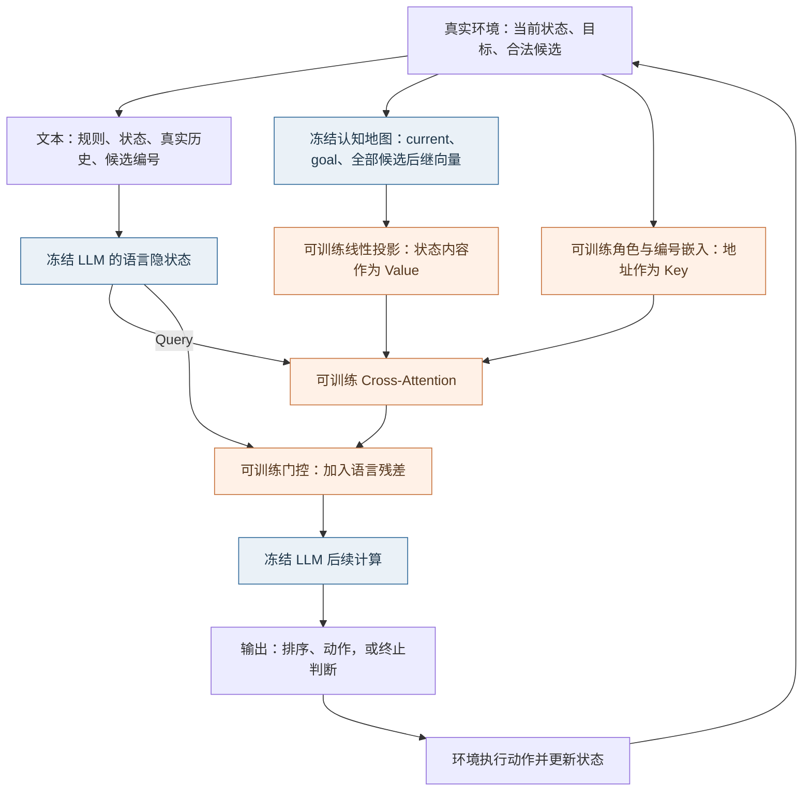
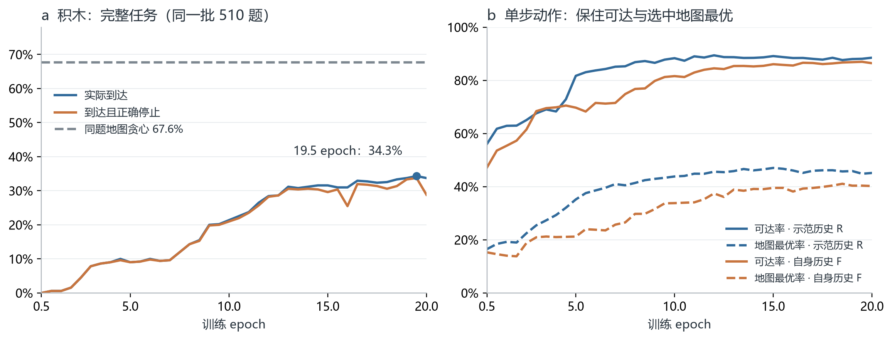
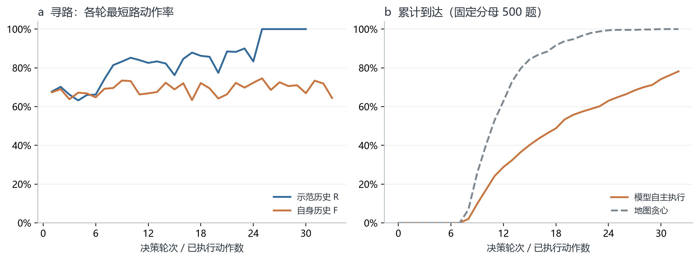

# LLM 读取与使用认知地图：两周阶段汇报

对应上次蓝图的 **2「LLM＋认知地图」与 4「LLM 如何读取和使用认知地图」**。本报告先说明模型如何接入地图、如何训练，再展示任务结果，最后分析当前瓶颈。结果截至 2026 年 10 月 11 日：寻路沿用上一轮完整验证集结果，积木使用本轮重新训练后的完整评测。

**本阶段已实现 LLM 通过交叉注意力（cross-attention）接口读取地图，并连续选择动作。** 在冻结语言模型和地图、只训练接口的条件下，寻路在同图新目标的 500 个非零步任务上到达率为 **78.2%**；积木本轮最佳权重在 510 个任务上到达率为 **34.3%**。这些结果说明方案已能运行并完成部分任务；与直接按地图选动作相比，仍有明显差距，终止判断也不够可靠。

## 一、研究问题：从“地图能指方向”到“LLM 能否用起来”

上次[蓝图](https://zcnhpsd26tyi.feishu.cn/wiki/ZiGywBK7Iiej98k7JnRcKsounec)将认知地图分为三个要素：状态表征、动作转移，以及当前状态相对目标的行动方向。本阶段以已有地图为基础，集中回答两个问题：

1. **能否读地图：** LLM 能否比较各个动作执行后的状态与目标的关系，并按地图距离排序？
2. **能否用地图：** 读出的关系能否转化为有效动作，支持连续执行直至完成任务？

这两周完成了读取接口、基于完整轨迹的监督微调（SFT），以及寻路和积木的连续执行评测。环境在每轮提供真实状态、执行历史和合法动作，积木动作的真实后继也由环境计算。本阶段因此可以集中检验地图读取、动作选择和终止判断；尚未检验模型能否自行感知环境、维护状态或在内部搜索多条未来路径。

## 二、模型架构：冻结语言模型和地图，训练中间读取接口

每轮决策接收两路信息：一路是规则、状态和候选动作的文字描述，另一路是地图编码出的状态向量。读取接口将地图信息接入 Qwen2.5-1.5B-Instruct，使模型在生成排序和动作时可以利用这些向量。模型输出动作后，由环境执行并返回下一轮状态。



**图 1｜每一轮的信息流。** 蓝色模块保持冻结，橙色接口参与训练。读取接口插入语言模型的各解码层；每轮文本只读取该轮对应的地图输入，动作执行后再更新。

- **Key 标记信息的身份：** 区分当前状态（current）、目标（goal）和候选后继（candidate），并关联本轮候选编号。
- **Value 提供状态的内容：** 将冻结地图的 128 维状态向量投影为接口可读取的信息。
- **Query 决定如何读取：** 来自语言模型当前的内部表示；交叉注意力据此读取地图，门控控制读取结果加入语言模型的程度。

这里将信息身份与状态内容分开作为 Key 和 Value，即本轮的“分离 K/V”接口。两任务分别训练接口，候选后继的来源如下。Q 表示状态编码器，V(action) 表示寻路地图中的动作位移，T 表示环境的真实状态转移；表中的 V(action) 与上文注意力中的 Value 是不同概念。

| 项目 | 寻路 | 积木 |
|---|---|---|
| 任务 | 固定 256 节点无向图；动作对应 768 条有向边，不重复访问节点 | 10×10 棋盘，按 8 种固定形状移除；目标可非空 |
| 地图 | 冻结 Q/V；状态向量 128 维 | 共享冻结棋盘编码器 Q；状态向量 128 维 |
| 候选后继 | Q(current)＋V(action)，由地图预测 | Q(T(current, action))，先由环境得到真实后继，再编码 |
| 目标方向 | 后继与 goal 的欧氏距离 | 后继与 goal 的有向距离 |

地图距离表示一个状态与目标的关系，距离较小意味着地图判断它更接近目标，但不等同于实际最短步数。文字输入包含全部合法候选，**不提供距离数值、正确排序或预选的 10 个候选**；模型需要通过接口读取地图信息。

## 三、SFT：训练数据从哪里来，具体监督什么

### 1. 数据组成与示范来源

示范先由地图贪心策略生成：每步选择地图距离目标最近的后继，得到完整轨迹，再用轨迹中的标准回答训练接口。普通训练数据只保留最终成功的轨迹；评测任务不按地图贪心能否成功筛选。因而模型能否完成未参与接口训练的任务，需要通过独立评测检验。

| 数据类别 | 独立物理任务 | 编号增强后样本 | 被监督的 assistant 回答 |
|---|---:|---:|---|
| 寻路：普通成功轨迹 | 4,000 | 24,000 | 每轮排序与动作，以及最终成功停止和总结 |
| 寻路：起始已达标 | 192 | 192 | 零动作成功停止和总结 |
| **寻路合计** | **4,192** | **24,192** | 完整会话训练 3 epoch |
| 积木：普通成功轨迹 | 8,000 | 48,000 | 每轮 Top-10＋current 排序、动作及最终成功停止 |
| 积木：起始已达标 | 1,000 | 1,000 | 唯一一轮的成功停止与零动作总结 |
| 积木：固定失败历史 | 1,000 | 1,000 | **仅末轮无解答案**；前面的 assistant 回复不计损失 |
| **积木合计** | **10,000** | **50,000** | 完整会话训练 20 epoch |

普通任务各使用 6 套候选编号，真实轨迹不变，编号、后继向量和答案同步重排，避免模型只记住固定编号。两个终止类别不做这一增强。表中的样本数包含不同编号版本，独立任务数不随之增加；1 epoch 表示完整遍历一次训练集。

### 2. 输入与答案实例

以下按实际模板展示一轮积木 SFT 的格式；棋盘、编号和排序作说明性代入，省略号表示省略的输入内容，**不是模型评测输出**。

**输入：任务说明、真实环境更新，以及独立进入接口的地图向量。**

```text
Find a valid sequence of removals from the initial board to the goal board,
as short as you can.
Reach the goal board exactly, including any occupied cells that must remain.
Goal board:
...（完整 10×10 目标棋盘）

[Environment update]
Current board:
...（完整 10×10 当前棋盘）
Actual executed actions: (none)
Legal next moves:
1: remove(0,1,2)
2: remove(4,3,5)
3: remove(2,6,1)
...（列出全部合法候选）
Candidate numbers may change between turns; use only the numbers above.
[/Environment update]
```

**监督答案：地图排序 → 选择地图最优候选 → 输出可执行控制符。**

```text
The current state has not reached the goal.
Map-distance ranking to the goal, closest to farthest:
2 < 3 < current < 1 < 7 < 4 < 9 < 5 < 6 < 8 < 10.
Choose candidate 2 because its successor has the smallest map distance among the candidates.
<action>2</action>
```

排序中的 `<` 表示更近，`=` 表示并列。积木最多输出 10 个候选加 current；寻路最多 3 个候选，全部输出。Top-10 是答案要求，输入仍包含全部候选。动作执行后，环境返回新状态，模型再生成下一轮回答。

**两种终止监督分别为：**

```text
已达标：
The current board matches the goal.
Executed actions: {实际动作序列；零动作时为 (none)}.
Summary: Reached the goal after {实际步数} executed removals.
<done/>

未达标且无合法动作：
No solution: no legal moves remain and the goal has not been reached.
<action>none</action>
<done/>
```

### 3. 损失与学习边界

训练要求模型逐 token 生成示范中的 assistant 回答，使用交叉熵计算误差；环境输入不计入损失。成功轨迹监督各轮排序、动作和最终停止，固定失败轨迹仅监督末轮无解回答。当前积木按每条轨迹的受监督 token 数计算平均损失，再对批内轨迹等权平均，排序与动作不额外加权。

**本轮同时监督了地图排序和动作选择。** 因而成绩回答的是“经接口 SFT 后能否读取地图并行动”，尚未验证“只训练状态报告，就迁移出未训练的决策能力”。

## 四、主结果：先看任务完成，再看读取与单步选择

先看完整任务是否完成，再用排序与单步指标定位差距。**“到达”** 由环境判断状态是否匹配目标；**“到达且正确停止”** 还要求模型正确宣布完成，两者分开统计。

评测采用两种模式：**R（reference，示范历史）** 每轮给定示范历史，让模型回答但不执行其动作，用于检查给定状态下的读取和选择；**F（rollout，自身历史）** 执行模型自己的动作，保留其回答并持续更新状态，用于检查连续执行。下表中的任务到达率均来自 F。

### 1. 寻路：多数新目标可以到达，路径效率仍有限

寻路始终使用同一张图，训练／验证／测试目标节点分别为 192／32／32 个。以下使用最终 3 epoch 权重，在完整验证集上评测。“新目标”指未用于读取接口训练的目标节点，不代表图或所有相关状态都未见过；非零步任务则排除了起点已是目标的情况。

| 评测范围／方法 | 任务数 | 到达目标 | 到达且最短 | 到达且正确停止 |
|---|---:|---:|---:|---:|
| **模型：非零步新目标任务** | **500** | **391/500（78.2%）** | **38/500（7.6%）** | — |
| 同题地图贪心 | 500 | 500/500（100.0%） | 115/500（23.0%） | 不适用 |
| 模型：含起始已达标 | 532 | 423/532（79.5%） | 70/532（13.2%） | 417/532（78.4%） |
| 其中起始已达标 | 32 | 32/32（100.0%） | 32/32（100.0%） | — |

| 单步指标 | R：示范历史 | F：自身历史 |
|---|---:|---:|
| 保持目标可达 | 6,140/6,140（100.0%） | 10,176/10,182（99.9%） |
| 选择环境最短路动作 | 4,567/6,140（74.4%） | 7,004/10,182（68.8%） |

**寻路已能完成多数同图新目标任务，但路径效率较低。** 非零步任务的到达率为 78.2%，以最短路径到达的比例仅为 7.6%。单步保持可达率接近 100% 也不代表选择足够好：在这些参考状态上，随机选合法动作同样能保持可达，真正拉开差距的是动作是否走在最短路上，以及能否连续到达。

### 2. 积木：本轮最佳到达 34.3%，地图利用仍有明显缺口

普通评测固定为 510 题：训练初始棋盘的新任务和新初始棋盘各 255 题；最短长度 6／7／8／9 步分别为 100／200／200／10 题。起始已达标 100 题与固定失败历史 100 题单列，不混入 510 题到达率。

| 方法／权重 | 同题实际到达 | 到达且正确停止 | 结果定位 |
|---|---:|---:|---|
| 本轮模型，10 epoch | 109/510（21.4%） | 107/510（21.0%） | 中期参照 |
| **本轮模型，19.5 epoch** | **175/510（34.3%）** | **172/510（33.7%）** | 本轮最高到达率 |
| 本轮模型，20 epoch | 172/510（33.7%） | 147/510（28.8%） | 最终权重，停止表现回落 |
| 同题现用地图＋贪心 | 345/510（67.6%） | 不适用 | 同一地图的独立控制参照 |

**19.5 epoch 是评完各轮后，在同一批任务上选出的最佳权重；尚未用另一批独立任务确认其成绩。** 下表每列均来自同一权重，不拼接不同轮次的最优值。本轮共 40 个权重，普通任务的两种模式及两类终止题均已评齐。

**主指标大表：最佳权重与最终权重。**

| 指标 | 19.5 epoch R | 19.5 epoch F | 20 epoch R | 20 epoch F |
|---|---:|---:|---:|---:|
| 普通任务数 | 510 | 510 | 510 | 510 |
| **单步保持目标可达率** | **88.1%** | **87.0%** | **88.5%** | **86.5%** |
| 地图最优动作率 | 44.9% | 40.4% | 45.2% | 40.2% |
| NDCG@10：位置倒数 | 0.787 | 0.751 | 0.786 | 0.747 |
| NDCG@10：Q-map 距离归一化 | 0.922 | 0.897 | 0.922 | 0.891 |
| NDCG@1：位置倒数 | 0.603 | 0.560 | 0.605 | 0.557 |
| NDCG@1：Q-map 距离归一化 | 0.890 | 0.852 | 0.890 | 0.847 |

“单步保持目标可达”检查执行所选动作后是否仍存在完成路径；“地图最优动作”检查是否选中了地图距离最小的候选。前者只在动作前仍可解的状态上统计，后者与排序指标还包含已经走入死局的状态，分母不同。

NDCG 衡量输出排序与地图排序的一致程度，越大越好；@10 看前 10 个候选，@1 只看首位。位置倒数侧重候选应排第几，距离归一化进一步考虑候选之间的地图距离差。这是**本轮新指标**，计算口径见附注。

**模型已读出部分地图关系，但尚未充分转化为任务完成。** 19.5 epoch 的距离归一化 NDCG@10 为 R **0.922**、F **0.897**，高于同状态随机排序的 **0.725**、**0.721**；但自主执行到达率 **34.3%**，仍明显低于同题地图贪心的 **67.6%**。排序分数、单步选择和完整任务表现需要结合判断。

| 独立终止评测 | 19.5 epoch | 20 epoch |
|---|---:|---:|
| 起始已达标：正确停止 | 100/100（100.0%） | 98/100（98.0%） |
| 固定失败历史：正确报无解 | 94/100（94.0%） | 97/100（97.0%） |

固定终止题表现较好，但不能代替模型在自身轨迹上的终止判断，详见最后的问题讨论。

## 五、地图是否真的参与了决策

上一轮做过配对干预：保持当前状态、目标、文本、候选编号和示范历史不变，仅将候选后继向量按目标距离反向分配。

| 上一轮积木 reference 干预 | 正常地图 | 反序地图 |
|---|---:|---:|
| 保持目标可达 | 87.5% | 56.6% |
| 选择环境最短路动作 | 80.4% | 52.5% |
| 合法动作率 | 99.8% | 99.9% |

**模型的动作质量会随地图内容改变，变化主要发生在合法候选之间。** 该结果支持地图参与了决策；干预制造了地图与文字冲突，不能等同于匹配训练的无地图收益对照。它来自上一轮 1,100 个 validation 任务，尚未在本轮重训权重上重复，不与本轮 510 题合并统计。

## 六、训练过程与轨迹分析

### 1. 寻路：到达率提升，最短路收益较早趋缓


**图 2｜寻路训练变化。** 左图固定 500 个非零步 validation 任务；右图使用相同参考状态，并显示均匀随机与地图贪心的单步参照。3 epoch 的到达率持续提高，但到达且最短路率从第 2 epoch 起保持 7.6%。

### 2. 积木：继续训练改善连续执行，但停止能力并不同步稳定



**图 3｜积木 0.5–20 epoch。** 每半个 epoch 评测同一批 510 题。到达率从 10 epoch 的 21.4% 提高到 19.5 epoch 的 34.3%；20 epoch 到达率变化较小，但到达且正确停止降至 28.8%。右图的可达率与地图最优率使用各自定义的状态分母。


**图 4｜积木排序能力。** 全部采用位置倒数与 Q-map 距离归一化新口径。模型在自身历史下的排序表现随训练改善，仍低于示范历史条件；F 的状态随模型动作变化，两条线之间的差值不是固定同状态的因果对照。

所有训练曲线展示单次训练的已保存权重，无平滑、无跨随机种子误差带；连线用于展示观察趋势。

### 3. 轨迹中：连续决策会暴露单步均值掩盖的问题



**图 5｜寻路最终权重。** 左图逐轮最短路动作率只统计当轮仍可解的状态；晚轮样本减少，R 与 F 的后续状态不同。右图累计到达始终使用同一批 500 个非零步任务。模型沿自身轨迹没有稳定获得示范历史条件下的后期动作质量。

本轮积木已有首轮与全轮汇总，可进一步区分首轮和后续轮的动作表现：

| 19.5 epoch | 首轮 R | 后续轮 R | 首轮 F | 后续轮 F |
|---|---:|---:|---:|---:|
| 保持目标可达 | 432/510（84.7%） | 2,342/2,638（88.8%） | 419/510（82.2%） | 1,820/2,064（88.2%） |
| 选择地图最优动作 | 26.5% | 47.5% | 22.4% | 42.9% |

首轮读取仍更困难；后续轮的较高分数同时受候选减少、任务完成退出和失败筛选影响，不能解释为“模型越走越会推理”。积木此处采用首轮／后续轮汇总，逐轮明细分析待补齐。

## 七、仍需解决的问题与下一步

### 1. 终止判断偏向宣布成功，尚不能可靠识别自身失败

19.5 epoch 在固定失败历史上正确报无解为 **94/100**，但对自身执行后“无合法动作且未达标”的终态，仅 **56/242（23.1%）** 正确报无解；模型宣布成功的 434 次中，实际达标仅 **172 次（39.6%）**。这说明终止判断尚不能可靠迁移到自身失败状态，原因仍需区分历史影响、状态读取和监督比例。

优先固定同一终态和地图输入，只改变历史，检查判断是否随之变化，再决定如何补充训练。详细证据和真实回答见[终止判断专题](https://zcnhpsd26tyi.feishu.cn/docx/JN14dOILGoTH0xxt8PncyFDPnrd)。

### 2. 地图方向尚未被充分利用

同题现用地图贪心到达 **67.6%**，最佳 LLM＋接口为 **34.3%**；首轮 F 地图最优率仅 **22.4%**。应优先区分候选读取、排序到动作输出及自身历史影响，避免仅靠增加训练轮数解释或修复所有问题。

### 3. 到达、正确停止和路径效率需要分别优化

寻路非零步到达率 **78.2%**，到达且最短仅 **7.6%**；积木 19.5→20 epoch 的到达从 **175** 题变为 **172** 题，到达且正确停止却从 **172** 题降为 **147** 题。下一阶段应分别跟踪动作效率与终止判别，不能用单一总体分数代替。

### 4. 方法优势与泛化仍需匹配对照

当前训练已经直接监督动作，还未证明“仅学会读状态就能迁移出决策能力”，也未完成匹配训练的无地图、文字状态接口与更强模型对照。寻路结论限于同图新目标；积木的新初始棋盘不保证所有中间状态未见，不能由当前结果推至跨规则或通用地图。

下一阶段应先定位信息在哪一步丢失：接口是否读对候选关系、排序是否转化为动作，以及到达或失败后是否作出正确判断。在此基础上改进训练，才能判断问题究竟来自地图、读取接口还是连续决策。

## 附：资料范围与口径

**积木排序口径。** 两种 NDCG 分别以地图真实排序位置的倒数 `1/r`、状态内归一化距离 `(d_max−d)/(d_max−d_min)` 作为候选得分，按输出位置折扣后与理想排序比较。最小、最大距离取自该状态全部候选；全等距时得分均为 1，current 不参与候选 NDCG，缺失或无法解析的答案计零。没有沿用旧报告的距离倒数指标。

**关键分母。** 19.5 epoch 单步保持可达分别为 R 的 2,774/3,148、F 的 2,239/2,574；地图最优率与排序分别统计 4,015、4,106 个状态。地图贪心是同题参照策略，不是理论性能上限。

- [上次汇报蓝图](https://zcnhpsd26tyi.feishu.cn/wiki/ZiGywBK7Iiej98k7JnRcKsounec)：本阶段在整体研究问题中的位置。
- [当前实验设计](../DESIGN.md)：分离 K/V 架构、数据、监督与新指标。
- [本轮积木完整结果](report.md)：40 个权重的主结果；本汇报不替代该权威结果页。
- [终止判断原始诊断](termination_diagnostic.md)：10 与 14.5 epoch 的条件差异、真实错误和解释边界；本汇报另使用完整汇总中的 19.5／20 epoch 数据。
- [上一轮完整轨迹报告](report_long_trajectory.md)：寻路结果与历史地图干预；旧积木到达率不与本轮直接比较。

定量图直接由已保存结果汇总生成；没有新增训练或模型推理。不同任务、权重、划分和分母已分别标注，未将旧积木指标重命名为新指标。
