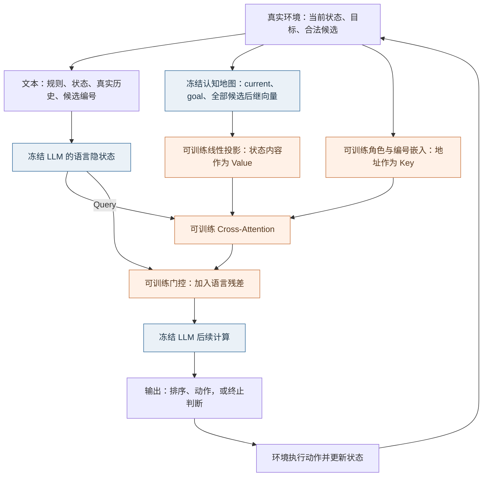
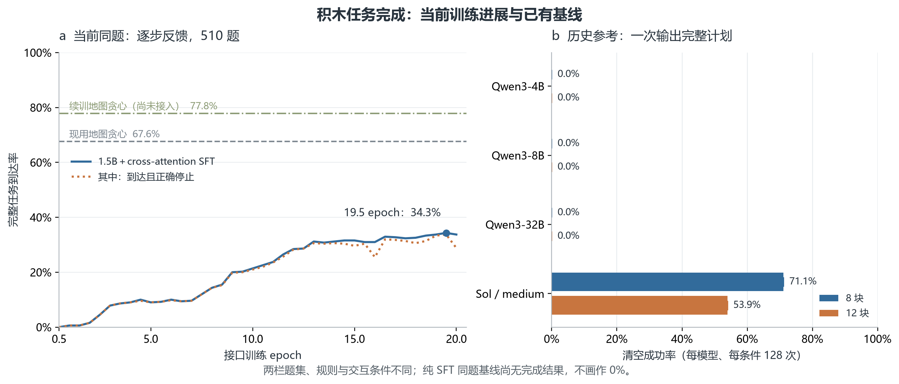

# LLM 读取与使用认知地图：两周阶段汇报

本阶段对应上次蓝图的 **2「LLM＋认知地图」与 4「LLM 如何读取和使用认知地图」**：连接提供状态关系与行动方向的认知地图，以及负责语言表达和动作输出的 LLM。结果截至 2026 年 10 月 11 日。

**本阶段已实现 LLM 通过交叉注意力（cross-attention）接口读取地图，并连续选择动作。** 在冻结语言模型和地图、只训练接口的条件下，寻路在同图新目标的 500 个非零步任务上到达率为 **78.2%**；积木本轮最佳权重在 510 个任务上到达率为 **34.3%**。这些结果说明方案已能运行并完成部分任务；与直接按地图选动作相比，仍有明显差距，终止判断也不够可靠。

## 一、研究问题：从“地图能指方向”到“LLM 能否用起来”

上次[蓝图](https://zcnhpsd26tyi.feishu.cn/wiki/ZiGywBK7Iiej98k7JnRcKsounec)将认知地图分为三个要素：状态表征、动作转移，以及当前状态相对目标的行动方向。上次工作已在具体积木任务上观察到，经过距离与可达性监督的地图可以指导贪心求解；本次进一步检验 LLM 能否利用这些关系。

沿用上次与老师讨论的“脑区分工”思路，可以把本阶段理解为连接两个功能模块：**地图组织状态关系、提供行动依据，LLM 读取这些关系、表达判断并输出动作。** “地图负责想、LLM 看着地图说话”是这一分工的直观概括；目前地图实际提供的是向量与距离关系，尚未实现完整的内部搜索器，也未验证与生物脑区的对应机制。

本阶段集中回答两个问题：

1. **能否读地图：** LLM 能否比较各个动作执行后的状态与目标的关系，并按地图距离排序？
2. **能否用地图：** 读出的关系能否转化为有效动作，支持连续执行直至完成任务？

这两周完成了读取接口、基于完整轨迹的监督微调（SFT），以及寻路和积木的连续执行评测。环境在每轮提供真实状态、执行历史和合法动作，积木动作的真实后继也由环境计算。本阶段因此可以集中检验地图读取、动作选择和终止判断；尚未检验模型能否自行感知环境、维护状态或在内部搜索多条未来路径。

## 二、模型架构：冻结语言模型和地图，训练中间读取接口

每轮决策接收两路信息：一路是规则、状态和候选动作的文字描述，另一路是地图编码出的状态向量。读取接口将地图信息接入 Qwen2.5-1.5B-Instruct，使模型在生成排序和动作时可以利用这些向量。模型输出动作后，由环境执行并返回下一轮状态。

### 1. 模型结构：地图通过可训练接口接入冻结 LLM


**图 1a｜模型架构与单层接口。** 左侧展示冻结语言模型的层堆叠，右侧展开地图输入和一个读取接口。各解码层前均有独立的 cross-attention 与门控；角色／编号嵌入和状态线性投影在层间共享。蓝色为冻结模块，橙色为可训练部分。当前模型没有新增 FFN，图中的 FFN 属于冻结 LLM 原有解码层。

### 2. 一轮决策如何运行



**图 1b｜每一轮的信息流。** 蓝色模块保持冻结，橙色接口参与训练。读取接口插入语言模型的各解码层；每轮文本只读取该轮对应的地图输入，动作执行后再更新。

- **Key 标记信息的身份：** 区分当前状态（current）、目标（goal）和候选后继（candidate），并关联本轮候选编号。
- **Value 提供状态的内容：** 将冻结地图的 128 维状态向量投影为接口可读取的信息。
- **Query 决定如何读取：** 来自语言模型当前的内部表示；交叉注意力据此读取地图，门控控制读取结果加入语言模型的程度。

这里将信息身份与状态内容分开作为 Key 和 Value，即本轮的“分离 K/V”接口。两任务分别训练接口，候选后继的来源如下。Q 表示状态编码器，V(action) 表示寻路地图中的动作位移，T 表示环境的真实状态转移；表中的 V(action) 与上文注意力中的 Value 是不同概念。

| 项目 | 寻路 | 积木 |
|---|---|---|
| 任务 | 固定 256 节点无向图；动作对应 768 条有向边，不重复访问节点 | 10×10 棋盘，按 8 种固定形状移除；目标可非空 |
| 地图 | 冻结 Q/V；状态向量 128 维 | 共享冻结棋盘编码器 Q；状态向量 128 维 |
| 候选后继 | Q(current)＋V(action)，由地图预测 | Q(T(current, action))，先由环境得到真实后继，再编码 |
| 目标方向 | 后继与 goal 的欧氏距离 | 后继与 goal 的有向距离 |

地图距离表示一个状态与目标的关系，距离较小意味着地图判断它更接近目标，但不等同于实际最短步数。文字输入包含全部合法候选，**不提供距离数值、正确排序或预选的 10 个候选**；模型需要通过接口读取地图信息。

### 3. 为什么先选择 cross-attention

本阶段要解决的是：怎样让 LLM 在每一轮读取一组不断更新、数量可变的地图向量。Cross-attention 为这些向量提供独立的输入通道，明确区分“语言侧发出查询”和“地图侧提供内容”，也便于在冻结 LLM 时单独训练、检查读取接口。

[LoRA](https://arxiv.org/abs/2106.09685)通过低秩增量适配模型权重，本身不定义外部地图如何进入模型；若采用 LoRA，仍需设计向量输入与映射方式。因此这里先选择 cross-attention，是为了直接检验“已有语言模型能否学会读取外部地图”。当前没有匹配实验支持“LoRA 描述能力更弱”，也不能据此判断两者的性能高低；后续可以比较接口增强与语言模型适配各自带来的收益。

## 三、SFT：训练数据从哪里来，具体监督什么

### 1. 数据组成、动作覆盖与示范来源

示范先由地图贪心策略生成：每步选择地图距离目标最近的后继，得到完整轨迹，再用轨迹中的标准回答训练接口。普通训练数据只保留最终成功的轨迹；评测任务不按地图贪心能否成功筛选。因而模型能否完成未参与接口训练的任务，需要通过独立评测检验。

| 数据类别      |     独立物理任务 |    编号增强后样本 | 被监督的 assistant 回答                |
| --------- | ---------: | ---------: | -------------------------------- |
| 寻路：普通成功轨迹 |      4,000 |     24,000 | 每轮排序与动作，以及最终成功停止和总结              |
| 寻路：起始已达标  |        192 |        192 | 零动作成功停止和总结                       |
| **寻路合计**  |  **4,192** | **24,192** | 完整会话训练 3 epoch                   |
| 积木：普通成功轨迹 |      8,000 |     48,000 | 每轮 Top-10＋current 排序、动作及最终成功停止   |
| 积木：起始已达标  |      1,000 |      1,000 | 唯一一轮的成功停止与零动作总结                  |
| 积木：固定失败历史 |      1,000 |      1,000 | **仅末轮无解答案**；前面的 assistant 回复不计损失 |
| **积木合计**  | **10,000** | **50,000** | 完整会话训练 20 epoch                  |

**训练中是否见过这些动作？** 下表统计具体动作的覆盖，不把重新编号当成新动作。寻路动作是有向边；积木动作是“形状＋锚点位置”，共 664 种。

| 训练任务 | 作为候选出现 | 被示范执行 |
|---|---:|---:|
| 寻路 | 768/768（100.0%） | 767/768（99.9%） |
| 积木 | 664/664（100.0%） | 664/664（100.0%） |

计数来自既有物理轨迹全量扫描，本轮复用同一批物理训练任务。动作覆盖充分，但不代表所有状态、目标与动作组合都见过，也不代表出现频次均衡。

普通任务各使用 6 套候选编号，真实轨迹不变，编号、后继向量和答案同步重排，避免模型只记住固定编号。两个终止类别不做这一增强。表中的样本数包含不同编号版本，独立任务数不随之增加；1 epoch 表示完整遍历一次训练集。

### 2. 输入与答案实例

以下按实际模板展示一轮积木 SFT 的格式；棋盘、编号和排序作说明性代入，省略号表示省略的输入内容，**不是模型评测输出**。

**输入：任务说明、真实环境更新，以及独立进入接口的地图向量。**

```text
Find a valid sequence of removals from the initial board to the goal board,
as short as you can.
Reach the goal board exactly, including any occupied cells that must remain.
Goal board:
...（完整 10×10 目标棋盘）

[Environment update]
Current board:
...（完整 10×10 当前棋盘）
Actual executed actions: (none)
Legal next moves:
1: remove(0,1,2)
2: remove(4,3,5)
3: remove(2,6,1)
...（列出全部合法候选）
Candidate numbers may change between turns; use only the numbers above.
[/Environment update]
```

**监督答案：地图排序 → 选择地图最优候选 → 输出可执行控制符。**

```text
The current state has not reached the goal.
Map-distance ranking to the goal, closest to farthest:
2 < 3 < current < 1 < 7 < 4 < 9 < 5 < 6 < 8 < 10.
Choose candidate 2 because its successor has the smallest map distance among the candidates.
<action>2</action>
```

排序中的 `<` 表示更近，`=` 表示并列。积木最多输出 10 个候选加 current；寻路最多 3 个候选，全部输出。Top-10 是答案要求，输入仍包含全部候选。动作执行后，环境返回新状态，模型再生成下一轮回答。

**两种终止监督分别为：**

```text
已达标：
The current board matches the goal.
Executed actions: {实际动作序列；零动作时为 (none)}.
Summary: Reached the goal after {实际步数} executed removals.
<done/>

未达标且无合法动作：
No solution: no legal moves remain and the goal has not been reached.
<action>none</action>
<done/>
```

### 3. 损失与学习边界

训练要求模型逐 token 生成示范中的 assistant 回答，使用交叉熵计算误差；环境输入不计入损失。成功轨迹监督各轮排序、动作和最终停止，固定失败轨迹仅监督末轮无解回答。当前积木按每条轨迹的受监督 token 数计算平均损失，再对批内轨迹等权平均，排序与动作不额外加权。

**本轮同时监督了地图排序和动作选择。** 因而成绩回答的是“经接口 SFT 后能否读取地图并行动”，尚未验证“只训练状态报告，就迁移出未训练的决策能力”。

## 四、主结果：任务完成、基线对比与训练进步

“到达”由环境核验状态是否匹配目标；“到达且正确停止”还要求模型正确宣布完成。评测分为 **teacher forcing（TF，示范历史）** 和 **rollout（RO，自主执行）**：前者每轮沿示范状态与历史测试当前回答，后者执行模型自己的动作并保留其回答。这里 teacher forcing 指历史由示范提供，当前整段回答仍自由生成，并非逐 token 喂入标准答案。原报告的 R／F 对应这里的 TF／RO。

### 1. 寻路：多数新目标可以到达，路径效率仍有限

寻路始终使用同一张图，训练／验证／测试目标节点分别为 192／32／32 个。以下使用最终 3 epoch 权重，在完整验证集上评测。“新目标”指未用于读取接口训练的目标节点，不代表图或所有相关状态都未见过；非零步任务则排除了起点已是目标的情况。

| 评测范围／方法         |     任务数 |               到达目标 |            到达且最短 | 到达且正确停止 |
| --------------- | ------: | -----------------: | ---------------: | ------: |
| **模型：非零步新目标任务** | **500** | **391/500（78.2%）** | **38/500（7.6%）** |       — |
| 同题地图贪心          |     500 |    500/500（100.0%） |   115/500（23.0%） |     不适用 |

| 单步指标 | TF：示范历史 | RO：自主执行 |
|---|---:|---:|
| 保持目标可达 | 6,140/6,140（100.0%） | 10,176/10,182（99.9%） |
| 选择环境最短路动作 | 4,567/6,140（74.4%） | 7,004/10,182（68.8%） |

**寻路已能完成多数同图新目标任务，但路径效率较低。** 非零步任务的到达率为 78.2%，以最短路径到达的比例仅为 7.6%。单步保持可达率接近 100% 也不代表选择足够好：在这些参考状态上，随机选合法动作同样能保持可达，真正拉开差距的是动作是否走在最短路上，以及能否连续到达。

### 2. 积木：先看完整到达与已有基线

当前固定评测 510 题，训练初始棋盘的新任务和新初始棋盘各 255 题；最短长度 6／7／8／9 步分别为 100／200／200／10 题。起始已达标与固定失败历史各 100 题，分别报告，不混入普通任务到达率。



**图 2｜当前训练进展与历史基线。** 左图为同一批 510 题：1.5B＋接口的最佳到达率为 **175/510（34.3%）**，现用地图贪心为 **345/510（67.6%）**；续训地图为 **397/510（77.8%）**，尚未接入 LLM，其补充监督与题集的重合尚待审计。两条地图线表示可参照的地图能力，并非理论上限。

右图保留早期强模型结果：Qwen3-4B／8B／32B 的 8 块、12 块任务均为 **0/128**；Sol／medium 分别为 **91/128（71.1%）**、**69/128（53.9%）**，合计 **160/256（62.5%）**。这些是一次输出完整计划、没有中途环境反馈的历史评测，形状集合、题集与预算也不同，不能据此声称当前 1.5B 已超过 32B。**纯 SFT 的同题基线尚无已完成结果，保留待补。**

### 3. 积木：五个代表性训练阶段

下表合并完整任务与读取指标，展示 0.5、5、10、19.5、20 epoch；所有行均为同一批 510 题，TF／RO 按此顺序列出。**19.5 epoch 是事后在这批题上选出的最佳权重**，尚未用另一批任务确认最佳成绩。首位排序指标 NDCG@1 放在附注。

| Epoch | 到达目标 | 到达且停止 | 保持可达 TF／RO | 地图最优 TF／RO | 位置 NDCG@10 TF／RO | 距离 NDCG@10 TF／RO |
|---|---:|---:|---:|---:|---:|---:|
| 0.5 | 0/510（0.0%） | 0/510（0.0%） | 56.1%／47.2% | 16.5%／15.3% | 0.522／0.520 | 0.748／0.725 |
| 5 | 46/510（9.0%） | 46/510（9.0%） | 81.7%／69.7% | 35.2%／21.2% | 0.716／0.599 | 0.892／0.802 |
| 10 | 109/510（21.4%） | 107/510（21.0%） | 88.3%／81.6% | 43.8%／33.8% | 0.782／0.708 | 0.924／0.873 |
| **19.5（最佳）** | **175/510（34.3%）** | **172/510（33.7%）** | **88.1%／87.0%** | **44.9%／40.4%** | **0.787／0.751** | **0.922／0.897** |
| 20 | 172/510（33.7%） | 147/510（28.8%） | 88.5%／86.5% | 45.2%／40.2% | 0.786／0.747 | 0.922／0.891 |

从 0.5 到 19.5 epoch，完整到达从 0 提高到 175 题，自主执行时的排序与动作指标也有改善。继续到 20 epoch，到达题数变化不大，但正确停止从 172 降为 147，说明任务选择与终止判断没有同步稳定。

### 4. 这些指标分别说明什么

- **保持目标可达率：** 选完这一步后，是否还存在完成路径，反映是否作出不可挽回的错误选择。
- **地图最优动作率：** 是否选中了地图判断最接近目标的候选，反映动作对地图指引的遵循程度；地图自身也可能判断错误。
- **NDCG@10／@1：** 前 10 个候选／首位候选与地图理想排序的一致性，反映读取关系的准确程度。它们评价地图排序，不能代替真实可达性或整题成功率。

**两种 NDCG 数值不同，不表示距离指标比位置指标“更准确”。** 位置倒数以 `1/r` 计分：即使地图距离几乎相同，第一名与第二名的得分也分别是 1 和 1/2，交换相邻候选会受到较大惩罚。距离归一化根据实际距离差计分；若前几名距离接近，交换它们的代价就较小，因此分数可能更高。当前新指标是“距离归一化”，不是旧报告的“距离倒数”。

最佳权重的距离 NDCG@10 为 TF **0.922**、RO **0.897**，高于同状态随机排序的 **0.725**、**0.721**。这说明模型已读出部分地图关系；但 RO 地图最优动作率只有 **40.4%**，完整到达率为 **34.3%**，地图信息仍未被充分利用。可达率只在动作前仍可解的状态统计，地图最优率和排序还包含已走入死局的状态，分母见附注。

独立终止题上，19.5／20 epoch 的起始已达标正确停止分别为 **100/100、98/100**，固定失败历史正确报无解分别为 **94/100、97/100**。这些成绩与自身失败轨迹上的判断差距较大，详见问题讨论。

## 五、地图是否真的参与了决策

上一轮做过配对干预：保持当前状态、目标、文本、候选编号和示范历史不变，仅将候选后继向量按目标距离反向分配。

| 上一轮积木 teacher forcing 干预 | 正常地图 | 反序地图 |
|---|---:|---:|
| 保持目标可达 | 87.5% | 56.6% |
| 选择环境最短路动作 | 80.4% | 52.5% |
| 合法动作率 | 99.8% | 99.9% |

**模型的动作质量会随地图内容改变，变化主要发生在合法候选之间。** 该结果支持地图参与了决策；干预制造了地图与文字冲突，不能等同于匹配训练的无地图收益对照。它来自上一轮 1,100 个验证任务，尚未在本轮重训权重上重复，不与本轮 510 题合并统计。

## 六、训练过程与轨迹分析

### 1. 寻路：到达率提升，最短路收益较早趋缓


**图 3｜寻路训练变化。** 左图固定 500 个非零步验证任务；右图使用相同参考状态，并显示均匀随机与地图贪心的单步参照。3 epoch 的到达率持续提高，但到达且最短路率从第 2 epoch 起保持 7.6%。

### 2. 积木：排序学习与完整到达的关系

图 2 已展示完整到达的训练过程，下图进一步区分两种排序指标。


**图 4｜积木排序能力。** 全部采用位置倒数与 Q-map 距离归一化新口径。模型在自身历史下的排序表现随训练改善，仍低于示范历史条件；RO 的状态随模型动作变化，两条线之间的差值不是固定同状态的因果对照。

所有训练曲线展示单次训练的已保存权重，无平滑、无跨随机种子误差带；连线用于展示观察趋势。

### 3. 轨迹中：连续决策会暴露单步均值掩盖的问题


**图 5｜寻路最终权重。** 左图逐轮最短路动作率只统计当轮仍可解的状态；晚轮样本减少，TF 与 RO 的后续状态不同。右图累计到达始终使用同一批 500 个非零步任务。模型沿自身轨迹没有稳定获得示范历史条件下的后期动作质量。

本轮积木已有首轮与全轮汇总，可进一步区分首轮和后续轮的动作表现：

| 19.5 epoch | 首轮 TF | 后续轮 TF | 首轮 RO | 后续轮 RO |
|---|---:|---:|---:|---:|
| 保持目标可达 | 432/510（84.7%） | 2,342/2,638（88.8%） | 419/510（82.2%） | 1,820/2,064（88.2%） |
| 选择地图最优动作 | 26.5% | 47.5% | 22.4% | 42.9% |

首轮读取仍更困难；后续轮的较高分数同时受候选减少、任务完成退出和失败筛选影响，不能解释为“模型越走越会推理”。积木此处采用首轮／后续轮汇总，逐轮明细分析待补齐。

## 七、仍需解决的问题与下一步

### 1. 工作假设：地图与语言表示之间仍有读取障碍

一个待检验的解释是：图像中的“猫”等概念较容易与语言中的已有概念建立联系，而当前 Q-map 坐标主要表达任务内的距离与可达关系，其各维度没有预先赋予语言含义。冻结 LLM 时，接口需要把这种任务关系转换成语言模型能够利用的信息；最佳模型到达 **34.3%**、同图贪心到达 **67.6%** 的差距说明有改进空间，但尚不能把差距全部归因于特征不对齐。

两个方向分别回答不同的问题：**增强 cross-attention 前后的可训练特征变换（如 FFN）**，检验固定语言模型时接口能否提取并传递更充分的关系；**允许 LLM 部分或全部更新**，检验语言表示共同适应地图是否有帮助。后者会将研究问题从“固定 LLM 能否读懂外部地图”推进到“地图接口与语言模型能否共同适配”。之前已有 FFN 试点负结果，训练条件并不完全匹配；下一轮应单独控制变量，不能预设增加 FFN 就会改善。

### 2. 终止判断：固定题会做，自身失败时仍频繁宣布成功

19.5 epoch 在固定失败历史上正确报无解为 **94/100**，对自身执行后“无合法动作且未达标”的终态却只有 **56/242（23.1%）**；全部 434 次成功声明中，实际达标仅 **172 次（39.6%）**。优先固定相同终态与地图，只改变历史，区分历史诱导、状态读取与监督比例的影响；详细数据和真实回答见[终止判断专题](https://zcnhpsd26tyi.feishu.cn/docx/JN14dOILGoTH0xxt8PncyFDPnrd)。

### 3. 补齐基线与分析，再扩展任务

先补同题、同反馈和动作预算下的未微调 1.5B、纯 SFT 与更强 LLM 基线，并加入匹配训练的无地图条件，才能判断收益来自任务训练、地图信息还是接口。同步检查“排序正确但动作选错”等环节，定位信息从读取到行动的损失。

在积木上稳定提高后，再在寻路验证同一机制，并考虑汉诺塔等新任务。寻路当前到达 **78.2%**，最短完成仅 **7.6%**，仍有独立的路径效率问题；积木的改进是否能迁移过去，需要实际验证。

## 附：资料范围与口径

**积木排序口径。** 两种 NDCG 分别以地图真实排序位置的倒数 `1/r`、状态内归一化距离 `(d_max−d)/(d_max−d_min)` 作为候选得分，按输出位置折扣后与理想排序比较。最小、最大距离取自该状态全部候选；全等距时得分均为 1，current 不参与候选 NDCG，缺失或无法解析的答案计零。没有沿用旧报告的距离倒数指标。

**首位排序补充（NDCG@1）。**

| 权重／模式 | 位置倒数 | 距离归一化 |
|---|---:|---:|
| 19.5 epoch TF | 0.603 | 0.890 |
| 19.5 epoch RO | 0.560 | 0.852 |
| 20 epoch TF | 0.605 | 0.890 |
| 20 epoch RO | 0.557 | 0.847 |

**关键分母。** 19.5 epoch 单步保持可达分别为 TF 的 2,774/3,148、RO 的 2,239/2,574；地图最优率与排序分别统计 4,015、4,106 个状态。地图贪心是同题参照策略，不是理论性能上限。

- [上次汇报蓝图](https://zcnhpsd26tyi.feishu.cn/wiki/ZiGywBK7Iiej98k7JnRcKsounec)：本阶段在整体研究问题中的位置。
- [当前实验设计](../DESIGN.md)与[完整轨迹设计](../DESIGN_long_trajectory.md)：接口、监督、动作覆盖和新指标。
- [本轮积木完整结果](report.md)：40 个权重的主结果；本汇报不替代该权威结果页。
- [终止判断原始诊断](termination_diagnostic.md)：10 与 14.5 epoch 的条件差异、真实错误和解释边界；本汇报另使用完整汇总中的 19.5／20 epoch 数据。
- [上一轮完整轨迹报告](report_long_trajectory.md)：寻路结果与历史地图干预；旧积木到达率不与本轮直接比较。
- [Qwen 历史基线](../../qwen_path_blocks/results/report.md)与[Sol 历史基线](../../sol_dag_blocks/results/report.md)：一次输出完整计划的结果。
- [纯 SFT 方案](../../../docs/LLM_SFT_PLAN.md)：当前作为待补基线，不填入推测成绩。

定量图来自已保存的实验结果，本次整理没有新增训练或推理。

## 汇报备忘（原始提醒保留）

以下保留本次修改中的原始提醒，供准备汇报和向老师请教时使用，不作为已验证结论。架构图、动作覆盖、结果合表与指标解释已落实到正文；“纯 SFT xxx”、LoRA 能力判断及未执行实验仍需补证据。“NP 难”涉及问题族及规模的形式化，本轮有限任务的成功不构成一般求解保证；“脑区分工”在正文作为研究类比使用。

**上次讨论与叙述起点**

> ==上次我们发现认知地图可以解np难问题，（对比学习方式训的map），上次老师的意见是要讲脑区的故事==

**模块分工及基线叙述草稿**

> ==我们这次的工作是把负责说话和负责思考、规划的俩个脑区连接起来。认知地图负责想，llm负责看着认知地图说话
> 我们联合训练发现初步的设定下积木到达率可以有34，作为对比qwen32B为0，纯sft仅xxx。
> sota模型（gpt）六七十左右，这是我们初步的试点结果，还有优化空间。

**接口选型提醒**

> ==加一个架构图（cross att），解释为什么不用crossatt而不是lora，lora的描述能力不如这个，先选择了这个

**覆盖率与向老师请教的问题**

> ==放上去动作覆盖率
> 问一下老师别人可能有啥质疑（你这个不就是xx）

**结果呈现提醒**

> ==能合并的表都合并，把基线对比放上去，
> 完整到达一个图，训练过程（att+sft，不同强llm基线与地图上限
> 表只放0.5–20 epoch 结果但是不放全部，四五行，表示训练有进步

**指标解释提醒**

> ==解释说明，每个指标说明什么，为什么位置倒数不如距离倒数（...），R/F改成R为teacher forcing，F为rollout

**后续工作与自用 TODO**

> ==todo：
> 1. 工程问题，不用讲
> 2. 我们的猜想是多模态的encoder能编码出一些特征，比如图里有只猫，这个特征和llm的特征能对齐，我们的qmap这个图是没有通用意义，llm没有原生表示能用于对齐，同时我们又是冻结了llm的，所以匹配比较困难。我们后续考虑crossatt+ffn让特征抽取能力更强，或是不冻结llm（需要思考区别，不冻结的叙事意义）
> 3. 工程问题
> 4. 需要再加基线与分析实验，需要确认的是，（+att基线调高），多试几个任务（汉诺塔等等），主叙事就完整了
> 5. 积木做好了，作为过渡的寻路肯定也没问题。
