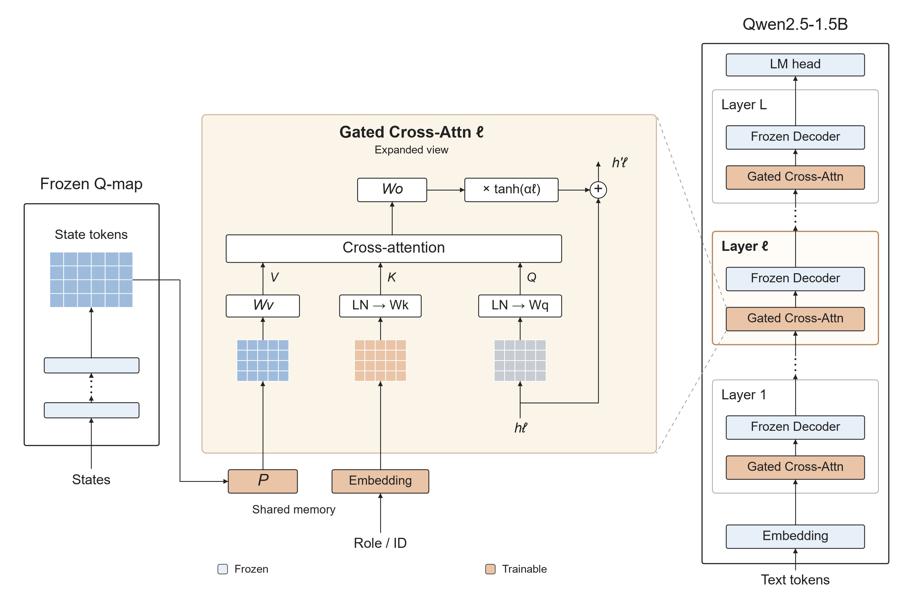
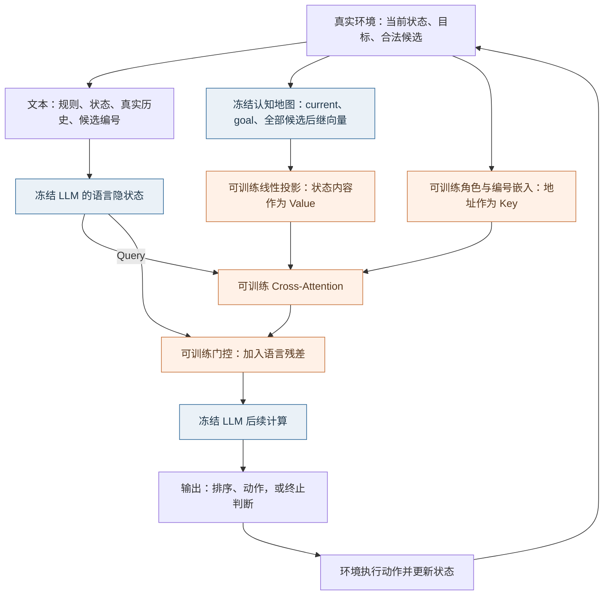
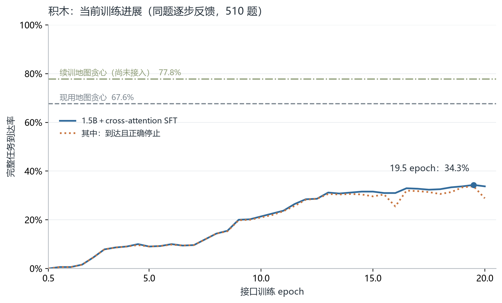
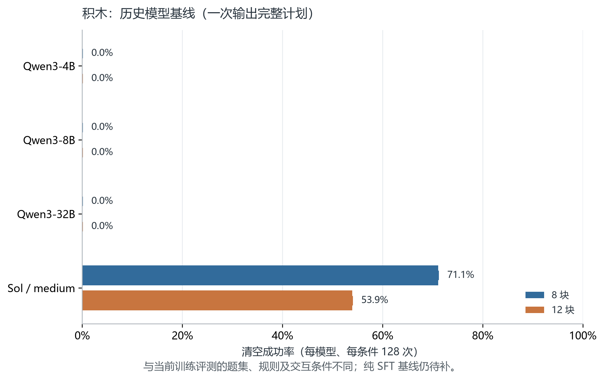
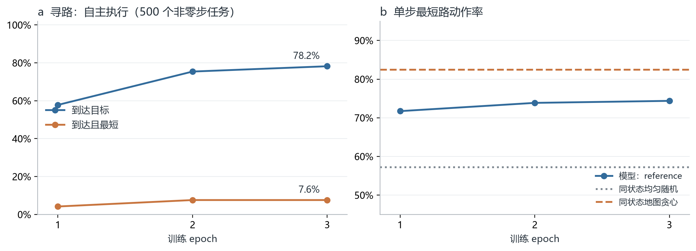
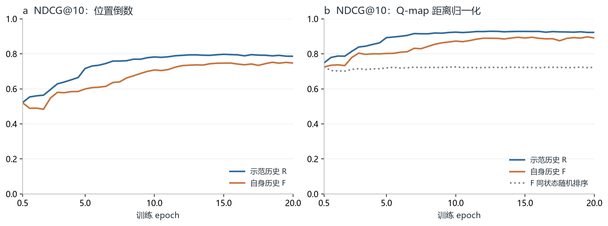

# LLM 读取与使用认知地图：两周阶段汇报

> 历史汇报草稿，保留原文与批注；含未填写数值及当时的解释，已核实结果见[实验报告](report.md)，研究边界见[研究简述](../../../docs/RESEARCH_BRIEF.md)。

上次我们发现认知地图可以解np难问题，（对比学习方式训的map），而老师的意见是要讲脑区的故事

我们这次的工作是**把负责说话和负责思考、规划的俩个脑区连接起来。认知地图负责想（给出状态关系与行动方向），llm负责看着认知地图说话（语言表达和动作输出）。**

- 联合训练cross attention接口，发现初步的设定下积木到达率可以达到 **34%**。
- 作为对比，Qwen3-32B为 0，纯sft仅xxx。
- sota模型（gpt5.6 sol）在同任务（八块积木）轨迹到达率仅 70%

以上是我们初步的试点结果，还有优化空间。

## 一、研究问题

上次[蓝图](https://zcnhpsd26tyi.feishu.cn/wiki/ZiGywBK7Iiej98k7JnRcKsounec)将认知地图分为三个要素：状态表征、动作转移，以及当前状态相对目标的行动方向。上次工作已在具体积木任务上观察到，经过距离与可达性监督的地图可以指导贪心求解；本次进一步检验 LLM 能否利用这些关系。

沿用上次与老师讨论的“脑区分工”思路，可以把本阶段理解为连接两个功能模块：**地图组织状态关系、提供行动依据，LLM 读取这些关系、表达判断并输出动作。**

本阶段集中回答两个问题：

1. **能否读地图：** LLM 能否比较各个动作执行后的状态与目标的关系，并按地图距离排序？
2. **能否用地图：** 读出的关系能否转化为有效动作，支持连续执行直至完成任务？

## 二、模型架构：冻结语言模型和地图，训练中间读取接口

每轮决策接收两路信息：
- 规则、状态和候选动作的文字描述，即llm的原生语言信息
- 地图编码出的状态向量。即经过cross attention读取的Qmap向量，每轮更新。

### 1. 模型结构：地图通过可训练接口接入冻结 LLM



**Figure 1a | Gated cross-attention map reader.** Each layer combines a trainable map-reading interface with a frozen decoder. The interface in layer ℓ is shown expanded.

### 2. 一轮决策如何运行



**图 1b｜每一轮的信息流。** 蓝色模块保持冻结，橙色接口参与训练。读取接口插入语言模型的各解码层；每轮文本只读取该轮对应的地图输入，动作执行后再更新。

- **Key 标记信息的身份：** 区分当前状态（current）、目标（goal）和候选后继（candidate），并关联本轮候选编号。
- **Value 提供状态的内容：** 将冻结地图的 128 维状态向量投影为接口可读取的信息。
- **Query 决定如何读取：** 来自语言模型当前的内部表示；交叉注意力据此读取地图，门控控制读取结果加入语言模型的程度。

## 三、SFT：训练数据与监督

### 1. 数据组成、动作覆盖与示范来源

示范答案先由地图贪心策略生成（且只保留地图可达项）：每步选择地图距离目标最近的后继，得到完整轨迹，再用轨迹中的标准回答训练接口。

| 数据类别      |     独立物理任务 |    编号增强后样本 | 被监督的 assistant 回答                |
| --------- | ---------: | ---------: | -------------------------------- |
| 寻路：普通成功轨迹 |      4,000 |     24,000 | 每轮排序与动作，以及最终成功停止和总结              |
| 寻路：起始已达标  |        192 |        192 | 零动作成功停止和总结                       |
| **寻路合计**  |  **4,192** | **24,192** | 完整会话训练 3 epoch                   |
| 积木：普通成功轨迹 |      8,000 |     48,000 | 每轮 Top-10＋current 排序、动作及最终成功停止   |
| 积木：起始已达标  |      1,000 |      1,000 | 唯一一轮的成功停止与零动作总结                  |
| 积木：固定失败历史 |      1,000 |      1,000 | **仅末轮无解答案**；前面的 assistant 回复不计损失 |
| **积木合计**  | **10,000** | **50,000** | 完整会话训练 20 epoch                  |

**训练中是否见过这些动作？**

寻路动作是有向边；积木动作是“形状＋锚点位置”，共 664 种。

| 训练任务 |          作为候选出现 |           被示范执行 |
| ---- | --------------: | --------------: |
| 寻路   | 768/768（100.0%） |  767/768（99.9%） |
| 积木   | 664/664（100.0%） | 664/664（100.0%） |

### 2. 输入与答案实例

以下按实际模板展示一轮积木 SFT 的格式；棋盘、编号和排序作说明性代入，省略号表示省略的输入内容，**不是模型评测输出**。

**输入：任务说明、真实环境更新，以及独立进入接口的地图向量。**

```text
Find a valid sequence of removals from the initial board to the goal board,
as short as you can.
Reach the goal board exactly, including any occupied cells that must remain.
Goal board:
...（完整 10×10 目标棋盘）

[Environment update]
Current board:
...（完整 10×10 当前棋盘）
Actual executed actions: (none)
Legal next moves:
1: remove(0,1,2)
2: remove(4,3,5)
3: remove(2,6,1)
...（列出全部合法候选）
Candidate numbers may change between turns; use only the numbers above.
[/Environment update]
```

**监督答案：地图排序 → 选择地图最优候选 → 输出可执行控制符。**

```text
The current state has not reached the goal.
Map-distance ranking to the goal, closest to farthest:
2 < 3 < current < 1 < 7 < 4 < 9 < 5 < 6 < 8 < 10.
Choose candidate 2 because its successor has the smallest map distance among the candidates.
<action>2</action>
```

排序中的 `<` 表示更近，`=` 表示并列。积木最多输出 10 个候选加 current；寻路最多 3 个候选，全部输出。Top-10 是答案要求，输入仍包含全部候选。动作执行后，环境返回新状态，模型再生成下一轮回答。

**两种终止监督分别为：**

```text
已达标：
The current board matches the goal.
Executed actions: {实际动作序列；零动作时为 (none)}.
Summary: Reached the goal after {实际步数} executed removals.
<done/>

未达标且无合法动作：
No solution: no legal moves remain and the goal has not been reached.
<action>none</action>
<done/>
```

## 四、主结果：任务完成、基线对比与训练进步

“到达”由环境核验状态是否匹配目标；“到达且正确停止”还要求模型正确宣布完成。

评测分为 **teacher forcing（TF，示范历史）** 和 **rollout（RO，自主执行）**：前者每轮沿示范状态与历史测试当前回答，后者执行模型自己的动作并保留其回答。

### 1. 寻路

寻路始终使用同一张图，训练／验证／测试目标节点分别为 192／32／32 个。以下使用最终 3 epoch 权重，在完整验证集上评测。

| 评测范围／方法         |     任务数 |               到达目标 |            到达且最短 |
| --------------- | ------: | -----------------: | ---------------: |
| **模型：非零步新目标任务** | **500** | **391/500（78.2%）** | **38/500（7.6%）** |
| 同题地图贪心          |     500 |    500/500（100.0%） |   115/500（23.0%） |

| 单步指标      |             TF：示范历史 |              RO：自主执行 |
| --------- | ------------------: | -------------------: |
| 选择环境最短路动作 |  4,567/6,140（74.4%） |  7,004/10,182（68.8%） |

**寻路已能完成多数同图新目标任务，但路径效率较低。** 非零步任务的到达率为 78.2%，以最短路径到达的比例仅为 7.6%。

### 2. 积木

当前固定评测 510 题，训练初始棋盘的新任务和新初始棋盘各 255 题；
最短长度 6／7／8／9 步分别为 100／200／200／10 题。



**图 2a｜当前训练进展。** 同一批 510 题：1.5B＋接口的最佳到达率为 **175/510（34.3%）**，现用地图贪心为 **345/510（67.6%）**；续训地图为 **397/510（77.8%）**（尚未接入 LLM）。



**图 2b｜历史模型基线。** 每个模型、每种积木数量评测 128 题，一次输出完整计划；与图 2a 的题集及逐步反馈条件不同。

### 3. 积木：五个代表性训练阶段

下表合并完整任务与读取指标，展示 0.5、5、10、19.5、20 epoch；所有行均为同一批 510 题，TF／RO 按此顺序列出。**19.5 epoch 是事后在这批题上选出的最佳权重**，尚未用另一批任务确认最佳成绩。位置与距离两种 NDCG 均列出 @1 和 @10。

| Epoch | 到达目标 | 保持可达 TF／RO | 地图最优 TF／RO | 位置 NDCG@1 TF／RO | 位置 NDCG@10 TF／RO | 距离 NDCG@1 TF／RO | 距离 NDCG@10 TF／RO |
|---|---:|---:|---:|---:|---:|---:|---:|
| 0.5 | 0/510（0.0%） | 56.1%／47.2% | 16.5%／15.3% | 0.307／0.293 | 0.522／0.520 | 0.636／0.578 | 0.748／0.725 |
| 5 | 46/510（9.0%） | 81.7%／69.7% | 35.2%／21.2% | 0.520／0.374 | 0.716／0.599 | 0.855／0.708 | 0.892／0.802 |
| 10 | 109/510（21.4%） | 88.3%／81.6% | 43.8%／33.8% | 0.598／0.498 | 0.782／0.708 | 0.894／0.812 | 0.924／0.873 |
| **19.5（最佳）** | **175/510（34.3%）** | **88.1%／87.0%** | **44.9%／40.4%** | **0.603／0.560** | **0.787／0.751** | **0.890／0.852** | **0.922／0.897** |
| 20 | 172/510（33.7%） | 88.5%／86.5% | 45.2%／40.2% | 0.605／0.557 | 0.786／0.747 | 0.890／0.847 | 0.922／0.891 |

- **保持目标可达率：** 选完这一步后，是否还存在完成路径，反映是否作出不可挽回的错误选择。
- **地图最优动作率：** 是否选中了地图判断最接近目标的候选，反映动作对地图指引的遵循程度；地图自身也可能判断错误。
- **NDCG@10／@1：** 前 10 个候选／首位候选与地图理想排序的一致性，反映读取关系的准确程度。它们评价地图排序。

## 五、地图作用辨析

为检验模型是否用地图内容导航，在 510 题测试集中按题源和最短步数抽取 128 题：两类题源各 64 题，最短步数 6／7／8／9 步分别为 26／50／50／2 题。两个检查点使用同一批题，每题只测首轮动作。

对每题做配对生成：保持当前状态与目标向量、用户文本、候选编号、物理动作和生成预算相同，只把候选后继的地图向量按目标距离反序分配。随后用真实积木环境判断动作是否可达、是否为环境最短路动作，以及动作是否合法。

| 检查点（每个条件 n=128） | 保持目标可达（正常→反序） | 选择环境最短动作（正常→反序） | 合法动作（正常→反序） | 物理动作改变 | 选择反序地图所示最优候选 |
|---|---:|---:|---:|---:|---:|
| 19.5 epoch | 82.0%→50.8% | 77.3%→46.9% | 100%→100% | 82.0% | 14.1% |
| 20 epoch | 85.9%→46.1% | 80.5%→45.3% | 100%→100% | 78.9% | 14.1% |

**同一批 128 个首步状态上的随机合法动作基线**（每题从全部合法候选中均匀随机选择、每题等权）：保持目标可达 **48.0%**，选择环境最短动作 **39.1%**，合法动作 **100%**。反序后的可达率（46.1%–50.8%）接近随机水平；最短动作率（45.3%–46.9%）则高于随机基线约 6–8 个百分点。

按逐题配对计算，可达性上正常地图胜过反序地图的题占 41.4%／43.8%；反序地图胜出的占 10.2%／3.9%。两个检查点方向一致：反序后可达率与环境最短动作率下降，合法率保持 100%，多数题的实际物理动作发生改变。

**这项诊断初步支持模型会使用地图来导航。** 仅反转候选后继的地图向量，就使两个检查点中约 80% 的物理动作发生改变；正常地图下，保持可达率高出反序条件 31.3／39.8 个百分点，选择环境最短动作率高出 30.5／35.2 个百分点，而合法动作率始终为 100%。反序条件下，模型选择反序地图所示最优候选的比例为 14.1%。

## 六、训练过程与轨迹分析

### 1. 寻路：到达率提升，最短路收益较早趋缓



**图 3｜寻路训练变化。** 左图固定 500 个非零步验证任务；右图使用相同参考状态，并显示均匀随机与地图贪心的单步参照。3 epoch 的到达率持续提高，但到达且最短路率从第 2 epoch 起保持 7.6%。

### 2. 积木：排序学习与完整到达的关系

图 2a 已展示完整到达的训练过程，下图进一步区分两种排序指标。



**图 4｜积木排序能力。** 全部采用位置倒数与 Q-map 距离归一化新口径。模型在自身历史下的排序表现随训练改善，仍低于示范历史条件；RO 的状态随模型动作变化。

所有训练曲线展示单次训练的已保存权重，无平滑、无跨随机种子误差带；连线用于展示观察趋势。

## 七、todo

### 1. 地图方向尚未被充分利用

最佳模型到达 **34.3%**、地图贪心到达 **67.6%** ，rollout 首轮地图最优率仅 **22.4%**。

我们的猜想：

- 多模态的encoder能编码出一些特征，比如图里有只猫，这个特征和llm的特征能对齐。也就是可以与相同语义的token对齐。

- 而我们的qmap这个图主要表达任务内的距离与可达关系，是没有通用意义的，llm没有原生表示能用于对齐，同时我们又是冻结了 llm 的，所以匹配比较困难。

后续考虑 crossatt + ffn 让特征抽取能力更强，或是不冻结llm（此时需要思考区别，不冻结的叙事意义，会不会使得功能分区不那么纯粹）

### 2. 补齐基线与分析，再扩展任务

先补同题、同反馈和动作预算下的未微调 1.5B、纯 SFT 与更强 LLM 基线，并加入匹配训练的无地图条件，才能判断收益来自任务训练、地图信息还是接口。同步检查“排序正确但动作选错”等环节，定位信息从读取到行动的损失。

在积木上稳定提高后，再在寻路验证同一机制，并考虑汉诺塔等新任务。寻路当前到达 **78.2%**，最短完成仅 **7.6%**，仍有独立的路径效率问题
