# 先编码地图，再让 LLM 读取

## 核心思路

在冻结的 Qmap 与 LLM 之间加入可训练的双向 Transformer encoder：先让当前、目标、候选的地图向量交互，提取关系特征，再交给 LLM 各层的 cross-attention 读取。

目标与候选的比较通过网络学习。encoder 接收地图向量和槽位身份，沿用排序、动作、理由和停止的文本监督。这里采用类似 BERT 的双向编码结构，从头训练。

```mermaid
flowchart TD
    S["当前、目标、全部合法后继"] --> M["冻结 Qmap"]
    M --> X["每个槽位的地图向量"]
    A["角色 + 候选编号 embedding"] --> E
    X --> E["可训练 encoder：共同 / 配对编码"]
    E --> H["多个输出：h当前、h目标、h候选1…"]
    H --> V["V 投影"]
    H --> K["内容模式：K 投影"]
    A --> AK["地址模式：K 投影"]
    T["本层 LLM 隐藏状态"] --> Q["Q 投影"]
    K --> R["Cross-attention 读取"]
    AK --> R
    V --> R
    Q --> R
    R --> G["输出投影 + 门控残差"]
    T --> G
    G --> D["本层 LLM decoder"]
```



图中两条 K 路径二选一。每个快照经过一次 encoder，编码结果供所有语言层共享；每层有自己的 Q/K/V、输出投影与门控。**LLM 各层读取的 V 都来自 encoder 输出。**

## 两种编码方式

设当前有 N 个合法动作，输入为 N+2 个槽位：当前、目标和 N 个候选后继。候选向量对应环境执行该动作后的真实状态。每个槽位先将地图投影与角色、候选编号 embedding 拼接，再线性映射到 encoder 宽度。

### 共同编码

```text
[当前, 目标, 候选1, 候选2, …, 候选N]
                   ↓ 双向 encoder
[h当前, h目标, h候选1, h候选2, …, h候选N]
```

所有有效槽位互相可见。每个输出仍对应原槽位，内容可以融合目标、当前和其他候选的信息。例如 h候选3 可以同时表达候选3与目标、其他候选的关系。

### 配对编码

```text
[当前, 目标]        → 共享 encoder → 保留 h当前、h目标
[当前, 目标, 候选1] → 共享 encoder → 保留 h候选1
[当前, 目标, 候选2] → 共享 encoder → 保留 h候选2
             …
[当前, 目标, 候选N] → 共享 encoder → 保留 h候选N
                                      ↓ 按槽位放回
                    [h当前, h目标, h候选1, …, h候选N]
```

每个候选与目标比较时也带上当前状态。所有小组共享一套 encoder 参数，并行组 batch 计算；三元组内部双向交互，候选之间隔离。

**当前实现选择单独编码 `[当前, 目标]`，产生两个公共输出。**各三元组中的当前、目标输出只用于组内交互，最终只保留候选位置。因此，配对模式的公共当前／目标特征不含候选信息；共同模式的公共特征可以包含候选信息。这是两种实际实现的一部分区别。

两种方式最终均保留 N+2 个向量；8个动作输入10个槽位，也输出10个槽位。终止状态没有候选时，仍保留当前、目标两个向量。

### 编码块与计算量

每层依次执行 Pre-LN 双向 self-attention、残差、Pre-LN GELU MLP、残差，最后统一 LayerNorm。padding 不参与读取，输出归零；不同快照独立编码。使用角色／编号身份信息，不添加绝对位置编码、因果 mask 或 dropout。

配对方式每层处理的有效 token 从 N+2 增为 3N+2，而注意力分数项从 (N+2)² 变为 9N+4。实现中把二元组补成带一个屏蔽位置的三元组，批量处理 N+1 组。它增加重复投影与 MLP 计算，同时缩短每组注意力；实际耗时需结合完整训练测量。

## Cross-attention 的两种读取方式

令 h[i] 为 encoder 输出，a[i] 为角色与候选编号 embedding 的拼接，x 为本层 LLM 隐藏状态。每层独立计算：

| 读取方式 | K | V | 读取依据 |
|---|---|---|---|
| 内容 K/V | Wk · LN(h[i]) | Wv · h[i] | 查询与编码后地图特征匹配 |
| 地址 K、内容 V | Wk · LN(a[i]) | Wv · h[i] | 查询与角色／候选编号匹配 |

两种方式的查询均为 `q = Wq · LN(x)`，每个头计算 `softmax(q Kᵀ / √d头) V`。合并各头后投影回 LLM 宽度，通过可训练门控加到 x，再进入本层 decoder。

- **内容 K/V：同一份特征，分别投影。**不同槽位有各自的特征，K 与 V 使用不同参数。
- **地址 K：保留按身份寻址。**地址分支绕过 encoder，V 仍是编码后的特征。“读候选3”由注意力学习对应编号，代码没有硬指定权重。
- **前面的 self-attention 正常生成 Q/K/V。**K/V 来源的两种选择只发生在后续 cross-attention。两种编码模式的输入均包含地图、角色、编号。
- **两处 attention 分工明确。**encoder 让目标和候选交互、提取关系；cross-attention 让 LLM 根据当前查询读取这些关系特征。后者的点积发生在 LLM 查询与槽位 key 之间。

特征与主干的宽度适配由注意力投影完成：双方进入同一个注意力空间，读取结果再投影回 LLM 宽度。encoder 与读取模块通过任务损失共同学习，使地图特征适合主干使用。

## 训练范围与快照读取

| 模块 | 全参组 | 冻结 LLM 组 |
|---|---|---|
| Qmap | 冻结 | 冻结 |
| 地图输入投影、角色／编号 embedding、encoder | 训练 | 训练 |
| 每层 cross-attention、输出投影与门控 | 训练 | 训练 |
| 原 LLM 词嵌入、decoder、输出头 | 训练 | 冻结 |

冻结组保留穿过主干的反向传播，encoder 可以正常学习。沿用原门控零初始化：第一步先更新门控，门控打开后梯度进入地图读取与 encoder。角色／编号 embedding 同时供 encoder 和地址 K 使用，属于可训练参数。

每个文字 token 只读取所属时间步的地图快照；训练虽然把整条轨迹组 batch，encoder 和 cross-attention 均隔离未来快照。语言自注意力保留正常的因果历史。候选重编号同步作用于动作菜单、向量对应关系和监督。

排序在 assistant 目标中提供监督，当前 user 输入与地图特征中没有预计算排名。训练预测动作时可见 teacher forcing 的前序排序；推理时读取模型自己生成的前序排序。环境后继生成、数据认证与模型学习各自沿用原职责。

## 比较与数据

优先运行4层的共同／配对 × 内容／地址 K × 全参／冻结，共8组；2层作为后续备用。首批为共同内容全参、配对内容全参、配对地址全参。维度、训练预算、GPU 分配与后续顺序统一维护在[正式配置](configs/five_task_50k.json)，实现及运行入口见[README](README.md)。

所有组从同一基座开始，共享按最新已采用 Qmap 重建并认证的50k轨迹。新路线对应新动作、向量、排序与停止监督。优先保留原起终点；需要补题时，匹配相同任务、小类和精确最短成本。验证／测试题保持原题集。

[数据制备结果](results/data_preparation.json)：保留原起终点查询47,204条，替换2,796条；任务、小类、精确成本直方图匹配。替换来自魔方2,339条、8-Puzzle 430条、积木27条。魔方路径覆盖变化较大，新旧候选状态交集占旧集合约48.9%；各架构使用完全相同的新数据。

沿用原5类版ID验证、自动停止和最终类内／整类OOD评测；棋子交换、移车和算术整类留出，按完整ID节点选模。三项比较分别观察交互组织、寻址来源与主干训练范围的影响。两种K输入宽度不同，参数量也略有差别；旧Flan结果作为历史参照。

终点OOD使用每组完成训练时保存的终点权重，运行已冻结的2,000题，不用OOD重新选模。终点评测优先于每50,000步整数节点和其他检查点：两机已有分片完成后统一交接评测卡，完成当前待评终点后恢复ID。具体题数、模式与输出见[终点评测说明](README.md#终点-ood-评测)。

## 实现核对结论

正式训练源码 `80357b7` 的主路径符合设计：先编码地图、保留多个输出、编码结果供各层共享、两种K来源独立配置、全参／冻结范围正确。配对模式中公共当前／目标向量的处理方式已在上文明确。

[针对性检查](tests/test_contextual_reader.py)覆盖正式8组配置的构建与训练范围、候选与目标依赖、配对隔离、padding、槽位重排、未来快照隔离、门控打开后的梯度以及保存／加载。
